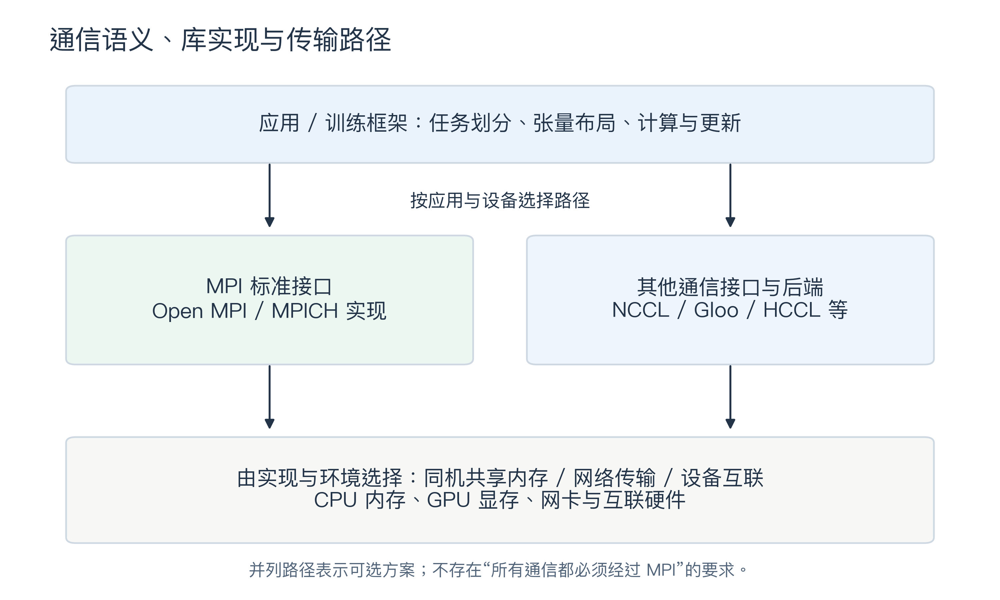
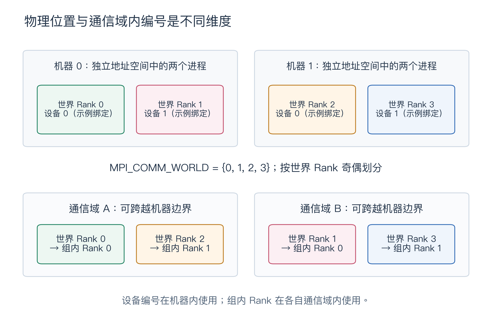
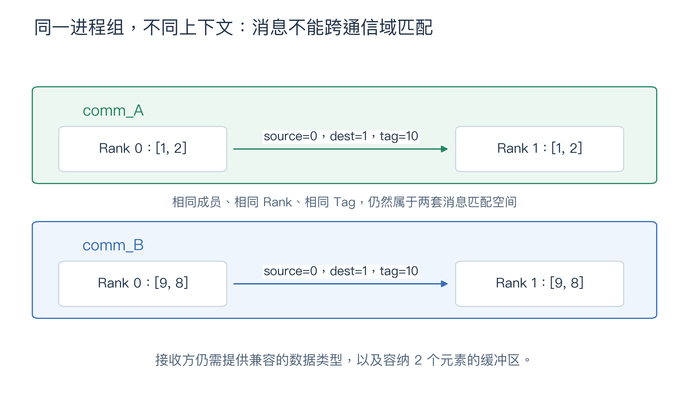
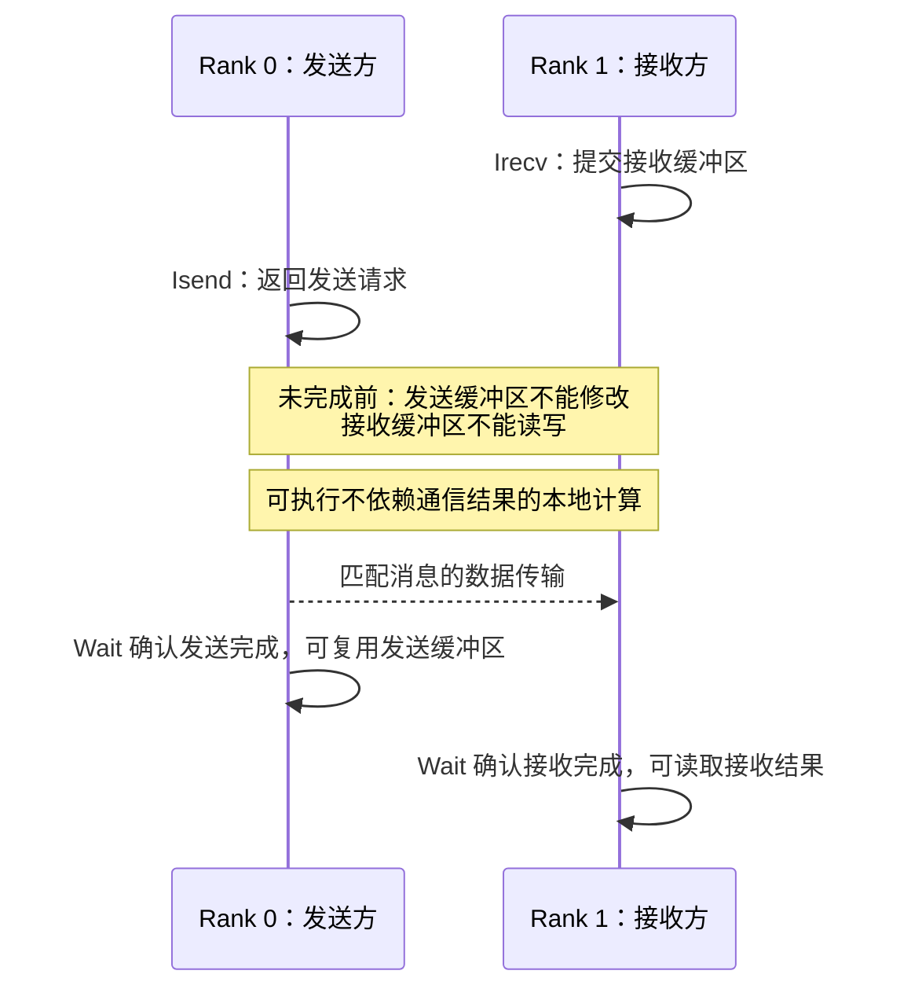
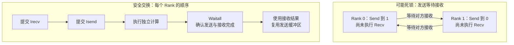
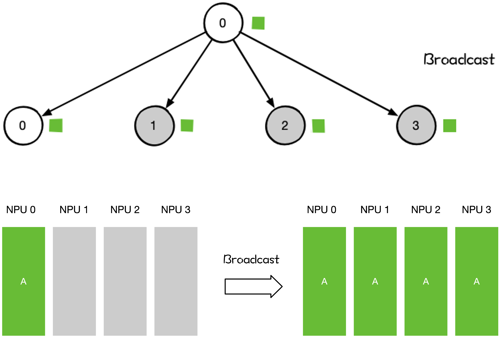
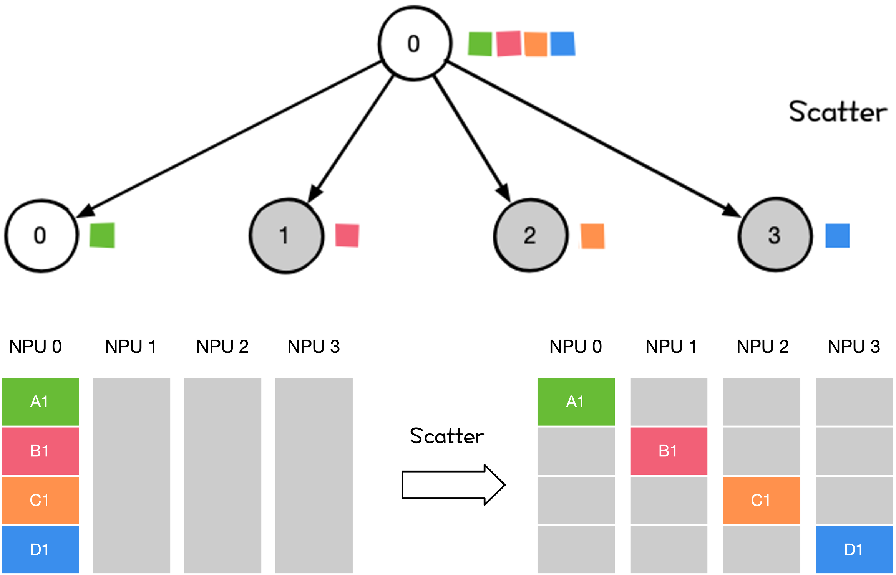
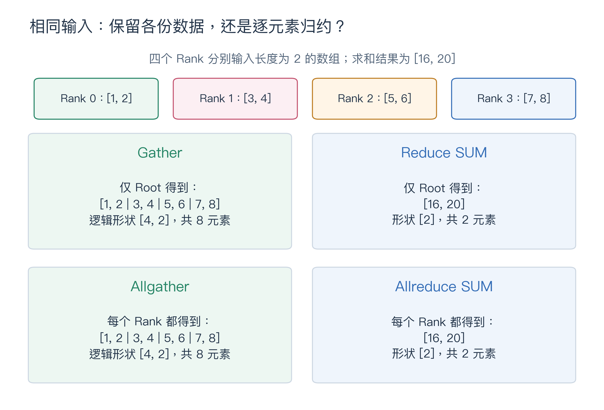
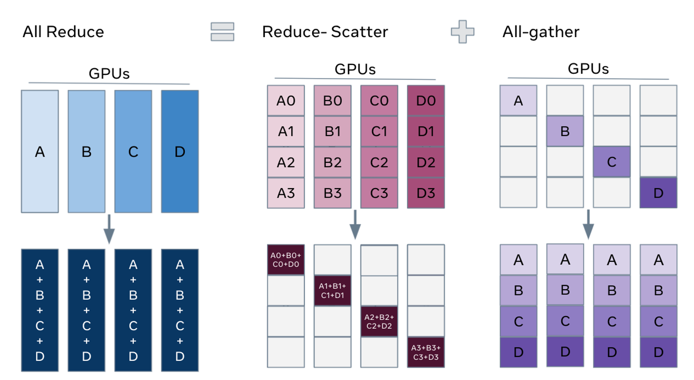
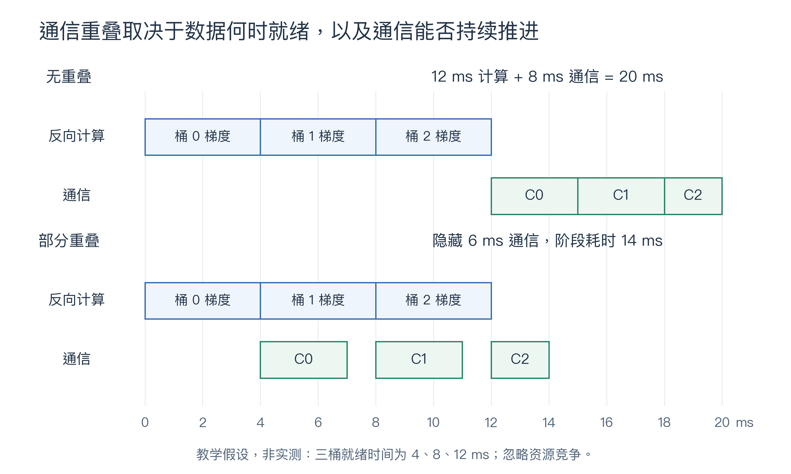

<!--Copyright © ZOMI 适用于[License](https://github.com/Infrasys-AI/AIInfra)版权许可-->

# MPI：分布式通信的编程模型与基础语义

当模型训练从一个进程扩展到多个进程时，计算之外还出现了新的约束：谁持有哪一份数据？一条消息应交给谁？函数返回后，数据是否已经可用？各进程何时才能用一致的梯度更新模型？这些问题直接影响分布式程序的正确性与效率。

MPI（Message Passing Interface，消息传递接口）为进程协作定义了一套明确的规则。它既是高性能计算中的通信标准，也提供了理解 AI 通信系统的重要基础：Rank、通信域、消息匹配、集合操作和完成语义。理解这些概念，才能分清“程序想完成什么通信”和“通信库怎样搬运数据”。

前章的[集合通信原语](../03CollectComm/03CCPrimtive.md)介绍了数据如何分发、收集和归约。本章进一步讨论这些操作如何落实到进程、内存和程序执行顺序，并以梯度同步连接到深度学习。读完本章，应能判断一段通信代码的参与者、输入输出布局、缓冲区使用时机，以及主要的通信成本。

> 范围与阅读路径：本章使用传统 MPI World 模型、组内通信域（intracommunicator）和 CPU 内存中的连续数组，不要求 GPU。第 1～2 节建立模型，第 3～5 节通过完整 Python 示例（`mpi4py + NumPy`）解释接口，第 6～7 节连接训练系统与性能，第 8 节用于排错与自测。组间通信、单边通信、MPI I/O 和线程支持不在本章展开。

## 1. 从独立计算到进程协作

### 1.1 消息传递：显式交换独立内存中的数据

可以把四个进程想象成共同统计问卷的四位同学：每人处理不同的问卷，在自己的草稿纸上计算，再交换结果。一个人修改草稿纸，不会自动改变其他人的记录。

这个类比对应的是**分布式内存编程模型**。各进程有独立的地址空间；即使运行在同一台机器上，普通变量也不会自动共享。MPI 提供显式的通信操作，让程序指定数据从哪里读取、传给哪个进程、写到哪里，以及何时能够继续使用相关内存。

- **点对点通信**（Point-to-Point Communication，P2P）在指定进程之间传递消息，适合阶段间的激活传输、任务分派和结果回传。
- **集合通信**（Collective Communication）由通信域中的一组成员共同完成广播、收集、归约或交换。
- **进程协调**包括查询成员身份、划分通信域和阶段同步，帮助应用组织协作。

MPI 不会自动完成并行化。如何划分样本、切分模型、组织反向传播，仍由应用或训练框架决定。消息传递模型也不规定底层一定经过网络：同机通信可以使用共享内存机制，但这并不使应用中的普通变量变成共享变量。

### 1.2 区分标准、实现与传输路径

**MPI 是接口与行为的标准，Open MPI 和 MPICH 是实现该标准的软件。** 标准规定操作应该产生什么结果、满足什么条件；实现负责选择协议、调度数据传输并适配硬件。



*图 1：应用通过所选接口和后端完成通信。MPI 实现与其他通信库是可选择或组合的路径，并不构成固定的上下级调用关系；GPU 支持和可用传输方式取决于具体实现、构建选项与运行环境。*

图 1 中的三个层次应分别理解：

1. **通信语义**：例如 Allreduce 要让所有参与者得到同样的归约结果。
2. **通信算法**：例如树形或环形算法决定数据分几轮、沿哪些逻辑路径移动。
3. **传输路径**：数据最终通过同机内存、TCP、RDMA 或设备互联等机制传输。

MPI 不是 TCP 的替代协议，也不宜固定归入某一层 OSI 模型。学习接口语义之后，再结合具体实现讨论网络与硬件，才能避免把逻辑通信图误读为物理布线图。

## 2. 参与者、通信域与消息匹配

### 2.1 Rank 是身份，设备与机器是位置

**Rank（秩）是进程在某个通信域中的编号。** 本章统一将 communicator 译为“通信域”，也常见“通信器”这一译法。组内通信域包含一个有序进程组及独立的通信上下文；若组内有 `P` 个进程，Rank 的范围就是 `0`～`P-1`。

在本章的启动方式中，`MPI_COMM_WORLD` 包含初始化时的全部 MPI 进程。启动 4 个进程，并不意味着使用 4 台机器或 4 张 GPU。Rank 标识的是通信参与者，机器、CPU 核和 GPU 则描述执行位置与资源。



*图 2：世界 Rank 0、1 位于机器 0，世界 Rank 2、3 位于机器 1；一进程绑定一设备只是示例。按世界 Rank 奇偶划分后，通信域 A 包含世界 Rank 0、2，通信域 B 包含世界 Rank 1、3。两个小组都跨机器，且分别拥有组内 Rank 0、1。*

世界 Rank 2 在 A 组中是 Rank 1。这里的“组内 Rank”不能与训练启动器中的本机进程编号 `LOCAL_RANK` 混为一谈：前者相对于通信域，后者通常用于表达某台机器内的进程位置。

表 1：协作所需的身份与范围

| 概念 | 精确定义 | 使用时要问的问题 |
| --- | --- | --- |
| 进程（Process） | 拥有独立地址空间的执行实例 | 谁执行本地计算？ |
| 进程组（Group） | 有序的进程集合 | 哪些进程参与，顺序是什么？ |
| 通信域（Communicator） | 进程组及独立通信上下文 | 这次通信在哪个范围中匹配？ |
| Rank / Size | 组内编号 / 组内进程数 | 当前是第几个成员，一共多少成员？ |
| Root | 某次集合操作指定的根 Rank | 谁提供广播输入或接收汇总结果？ |
| Tag | 区分点对点消息的整数标签 | 同一范围中，这是哪一类消息？ |

Root 是一次操作的角色，可以是该通信域内任意有效 Rank；`MPI_Allreduce()` 等操作没有 Root。Tag 不必全局唯一，其合法非负取值上限可通过 `MPI_TAG_UB` 查询。[消息信封与匹配范围][ref-envelope]

### 2.2 通信域既能分组，也能隔离消息

通过 `MPI_Comm_split()`，原通信域的成员共同按 `color` 分组，再按 `key` 确定组内顺序。图 2 对应的规则是：`color` 取世界 Rank 对 2 的余数，`key` 取世界 Rank；每组按世界 Rank 升序重新编号。通信域可以跨机器，默认也不表示特定物理网络拓扑。[通信域划分][ref-split]

通信域的另一个作用是隔离消息。假设一个程序同时运行训练模块和统计模块，即使两者都使用 Tag 10，也不应该误收对方的数据。`MPI_Comm_dup()` 可以创建一个**成员与顺序相同、上下文不同**的新通信域。[通信域复制][ref-dup]



*图 3：`comm_A` 和 `comm_B` 包含同一对进程，但上下文不同。A 中 Rank 0 发送 `[1, 2]`，B 中同一进程发送 `[9, 8]`；两条消息均使用 Tag 10。通信前，Rank 1 的两个接收缓冲区均为 `[0, 0]`；各自通信完成后，在对应缓冲区得到相应的 2 元素数组；在 B 中提交的接收不会消费 A 中的消息。图中 A、B 表示通信域，不是硬件通道。*

### 2.3 数据描述与消息匹配是两件事

一条 MPI 消息同时包含数据和用于匹配的“信封”。信封回答“来自谁、交给谁、属于哪类消息、在哪个上下文内”；数据描述回答“从哪里读写、包含多少个什么类型的元素”。

表 2：发送一个三元素浮点数组需要说明什么

| 参数 | 本章示例 | 含义 |
| --- | --- | --- |
| `buf` | NumPy 数组 `x` 的缓冲区 | 从哪段内存读取或向哪段内存写入 |
| `count` | `3` | 3 个数据类型实例，不是 3 个字节 |
| `datatype` | `MPI.FLOAT` | 示例使用 `np.float32` 元素 |
| `dest` / `source` | Rank 1 / Rank 0 | 目标进程 / 期望的来源进程 |
| `tag` | `10` | 点对点消息类别 |
| `comm` | `MPI.COMM_WORLD` | 消息匹配的范围 |

接收操作必须在相应通信域中匹配来源和 Tag；接收方身份由调用进程决定。`MPI_ANY_SOURCE` 和 `MPI_ANY_TAG` 可以放宽匹配条件，但初学时显式指定更容易排错。**消息能匹配，不等于缓冲区一定正确**：双方还需使用兼容的数据类型，接收端必须有足够容量；仅仅字节数相同，不能证明 MPI 类型匹配正确。

一个形状为 `[2, 3]` 的连续 NumPy `float32` 数组含 6 个元素，可用 `[x, 6, MPI.FLOAT]` 描述。MPI 不会因此自动携带“二维、两行三列”这一张量形状；双方应事先约定布局，或另行传输形状信息。MPI 也支持描述非连续内存的派生数据类型，但本章示例均使用连续数组。

## 3. 先运行一个 MPI 程序

### 3.1 准备环境

本章用 Python 表达 MPI 通信，使用 NumPy 连续数组保存数据。`mpi4py` 是 MPI 的 Python 绑定，仍需可用的 MPI 运行时；它不负责自动把普通 Python 程序并行化。下面采用“系统 Open MPI + Python 虚拟环境”的安装方式；已有集群环境时，优先加载管理员提供的 MPI 模块。[mpi4py 安装说明][ref-mpi4py-install]

先安装 Open MPI。Ubuntu / Debian：

```bash
sudo apt update
sudo apt install python3 python3-venv python3-dev build-essential openmpi-bin libopenmpi-dev
```

macOS（已安装 Homebrew）：

```bash
brew install python open-mpi
```

然后在工作目录中创建并激活独立 Python 环境，安装依赖：

```bash
python3 -m venv .venv
source .venv/bin/activate
python -m pip install --upgrade pip
python -m pip install numpy mpi4py
```

后续命令中的 `python` 均指这个虚拟环境的解释器。在新的终端中运行时，需要先重新激活环境。检查启动器和 Python 实际加载的 MPI 库：

```bash
mpiexec --version
python -c "from mpi4py import MPI; print(MPI.Get_library_version())"
```

两条命令应指向所选的同一套 MPI 实现，例如都显示 Open MPI。不要将 Open MPI 的启动器与加载 MPICH 的 Python 环境混用。如果找不到 MPI 动态库，按官方安装说明检查库路径及集群模块；如果需要从源码构建 `mpi4py`，还需要相应编译工具与 MPI 开发文件。

`mpiexec` 负责启动多个进程，每个进程运行同一 Python 脚本并持有自己的变量。配套 C 程序另需 `mpicc` 编译；它是添加 MPI 头文件和库选项的编译器包装器，正文 Python 示例无需这一步。多机运行时，各机器还需具有一致的脚本、依赖和可访问的解释器路径。

### 3.2 示例 1：查看自己的 Rank

将下面的完整代码保存为 `mpi_hello.py`。本节后续示例也都可以单独保存并运行；配套 C 源码仍保留在示例目录中。

```python
from mpi4py import MPI  # 默认在首次导入 MPI 模块时初始化 MPI

comm = MPI.COMM_WORLD  # 本次启动的所有 MPI 进程
rank = comm.Get_rank()  # 当前进程在 comm 中的编号
size = comm.Get_size()  # comm 中的进程总数
host = MPI.Get_processor_name()  # 运行位置的名称

print(f"Hello: rank {rank}/{size} on {host}", flush=True)
# 默认在解释器正常退出时由 mpi4py 结束 MPI 使用
```

`comm.Get_rank()` 与 `comm.Get_size()` 返回普通 Python 整数；每个进程独立查询自己的身份。`print(..., flush=True)` 及时刷新当前进程的输出，但不会给不同进程的输出排序。

在已激活虚拟环境的终端中，于脚本所在目录启动 4 个进程：

```bash
mpiexec -n 4 python mpi_hello.py
```

预期得到以下四行，**行顺序不保证一致**；主机名会随环境变化。

```text
Hello: rank 0/4 on my-laptop
Hello: rank 1/4 on my-laptop
Hello: rank 2/4 on my-laptop
Hello: rank 3/4 on my-laptop
```

`-n 4` 表示运行 4 个进程，不表示使用 4 台机器或 4 张 GPU。`MPI.Get_processor_name()` 返回运行位置的名称，不是 CPU 核编号。多机启动还需配置主机、网络、可执行文件及调度系统，详见 [Open MPI 启动指南][ref-launch]。

多个进程执行同一份程序、处理不同数据，是常见的 SPMD（Single Program, Multiple Data）模式。程序可以根据 Rank 分工，而不是为每个进程编写不同的程序。

### 3.3 Python 接口与 C 接口如何对应

`from mpi4py import MPI` 在默认配置下初始化 MPI，并在解释器正常退出时自动结束 MPI 使用；本章无需再显式调用 `MPI.Init()` 和 `MPI.Finalize()`。这只是生命周期管理方式的变化，不会改变通信完成条件：退出前仍须完成所有已发起的请求。[运行时配置][ref-mpi4py-runtime]

`comm` 保存通信域对象，原来 C 函数中的通信域参数变为方法的调用对象。例如 `MPI_Send(..., MPI_COMM_WORLD)` 对应 `comm.Send(...)`，其中 `comm = MPI.COMM_WORLD`。为方便查阅标准与配套 C 源码，概念说明保留 `MPI_...` 名称，实际运行代码统一使用 Python 接口。

表 3：本章常用 C／Python API 对照

| C 接口或常量 | Python 接口或常量 | 含义 |
| --- | --- | --- |
| `MPI_COMM_WORLD` | `MPI.COMM_WORLD` | 初始世界通信域 |
| `MPI_Comm_rank()` / `MPI_Comm_size()` | `comm.Get_rank()` / `comm.Get_size()` | 查询 Rank 与进程数 |
| `MPI_Comm_split()` / `MPI_Comm_dup()` | `comm.Split()` / `comm.Dup()` | 分组或隔离通信上下文 |
| `MPI_Send()` / `MPI_Recv()` | `comm.Send()` / `comm.Recv()` | 阻塞缓冲区通信 |
| `MPI_Isend()` / `MPI_Irecv()` | `comm.Isend()` / `comm.Irecv()` | 发起非阻塞缓冲区通信 |
| `MPI_Wait()` / `MPI_Waitall()` | `request.Wait()` / `MPI.Request.Waitall()` | 等待请求完成 |
| `MPI_Bcast()` / `MPI_Scatter()` / `MPI_Gather()` | `comm.Bcast()` / `comm.Scatter()` / `comm.Gather()` | 广播、分发、收集 |
| `MPI_Allreduce()` / `MPI_SUM` | `comm.Allreduce()` / `MPI.SUM` | 全归约 / 求和操作 |
| `MPI_Barrier()` / `MPI_Wtime()` | `comm.Barrier()` / `MPI.Wtime()` | 阶段屏障 / 本进程计时 |

**通信方法的大小写会影响数据处理方式。** `comm.send()`、`comm.recv()` 等小写接口传输 Python 对象，通常需要 `pickle` 序列化；`comm.Send()`、`comm.Recv()`、`comm.Allreduce()` 等首字母大写接口直接使用数组缓冲区。本章统一采用后者，显式展示接收内存、元素类型和数量。[mpi4py 教程][ref-mpi4py-tutorial]

缓冲区描述 `[x, 3, MPI.FLOAT]` 表示数组 `x`、3 个元素和 MPI 浮点类型，外层列表是参数描述，实际传输的是 `x` 的数值内存。`mpi4py` 也能对支持的 NumPy 基本类型自动推断类型和数量；这里保留显式描述，便于核对双方约定。示例用 `np.float32` 配合 `MPI.FLOAT`，整数用对应 C `int` 的 `np.intc` 配合 `MPI.INT`，避免把平台相关的默认整数类型误配给 `MPI.INT`。

## 4. 点对点通信：匹配、完成与缓冲区生命周期

点对点通信首先需要解决两件事：发送与接收是否匹配，以及双方何时可以继续使用各自的缓冲区。下面先用一条消息观察结果，再讨论不同调用形式的完成条件。

### 4.1 示例 2：Rank 0 发送，Rank 1 接收

保存为 `mpi_p2p.py`。本例必须使用 2 个进程。

```python
import sys

import numpy as np
from mpi4py import MPI

comm = MPI.COMM_WORLD
rank = comm.Get_rank()
size = comm.Get_size()

if size != 2:
    if rank == 0:
        print("Run with exactly 2 processes.", file=sys.stderr, flush=True)
    sys.exit(1)  # 所有 Rank 都在开始通信前退出

x = np.zeros(3, dtype=np.float32)  # 每个 Rank 独立持有形状 [3] 的数组
if rank == 0:
    x[:] = [1.0, 2.0, 3.0]
    comm.Send([x, 3, MPI.FLOAT], dest=1, tag=10)
    # 返回后可以修改发送缓冲区 x
else:
    comm.Recv([x, 3, MPI.FLOAT], source=0, tag=10)
    # 返回后接收缓冲区 x 已可读取
    print(f"rank 1 received: {x.tolist()}", flush=True)
```

前面的进程数检查让所有 Rank 在错误启动时共同退出，防止只有部分进程继续通信。`np.zeros` 分配接收前可见的零值数组；只有 Rank 0 将其改成 `[1, 2, 3]`。`Send` 和 `Recv` 使用相同通信域、Tag 10 和 `MPI.FLOAT`，元素数均为 3。`tolist()` 仅用于打印，通信过程中没有将数组转成 Python 列表。

```bash
mpiexec -n 2 python mpi_p2p.py
```

预期输出：

```text
rank 1 received: [1.0, 2.0, 3.0]
```

表 4：示例 2 的数据状态（两个数组的形状均为 `[3]`）

| 进程 | 角色 | 通信前的`x` | 通信完成后的`x` |
| --- | --- | --- | --- |
| Rank 0 | 发送方 | `[1, 2, 3]` | `[1, 2, 3]`，发送不消耗原数据 |
| Rank 1 | 接收方 | `[0, 0, 0]` | `[1, 2, 3]`，接收覆盖原缓冲区 |

本例省略了接收状态参数。需要检查实际来源、Tag 或收到的元素数时，可创建 `status = MPI.Status()`，传给 `comm.Recv(..., status=status)`，再查询 `status.Get_source()`、`status.Get_tag()` 和 `status.Get_count(MPI.FLOAT)`。接收参数中的 `count` 是容量上限；例如容量为 3 的缓冲区可以接收更短的消息，但不能接收超过容量的消息。

### 4.2 阻塞调用与发送模式是两个维度

“阻塞/非阻塞”描述调用如何返回；“标准/同步”等发送模式描述操作的完成条件。不要把阻塞发送一概称为同步发送。

- `MPI_Send()` 是标准模式的阻塞发送。返回表示发送缓冲区可安全复用，但不保证对方接收调用已经返回，更不表示对方已经处理完数据。
- `MPI_Recv()` 是阻塞接收。返回时，收到的数据已经放入本进程的接收缓冲区。
- `MPI_Ssend()` 是同步模式的阻塞发送。完成还要求匹配接收已开始并与消息匹配；这仍不等于接收方已完成后续计算。
- `MPI_Isend()`、`MPI_Irecv()` 发起操作并返回请求句柄，调用返回本身不代表通信完成。随后使用 `MPI_Wait()` 或成功报告完成的 `MPI_Test()` 确认完成。

阻塞/非阻塞与发送模式可以组合，例如 `MPI_Issend()` 就是非阻塞同步发送。这说明“非阻塞”并不是另一种底层网络协议。[发送模式][ref-modes]、[非阻塞通信][ref-nonblocking]



*图 4：非阻塞单向通信的一种合法时序。提交操作与确认完成分开；两个 Wait 的返回先后不由此图规定，传输与本地计算也可能交错。双向交换包含两组方向相反的发送/接收。API 允许重叠，并不保证底层一定实现有效重叠。*

### 4.3 为什么小消息能跑通，大消息却可能挂起

MPI 标准允许实现决定标准模式发送是否使用内部缓冲。常见实现可能为某些小消息先缓存数据，也可能先等待接收方准备好再传输；具体策略和阈值不是标准保证。因此，不能依赖“`MPI_Send()` 总能先返回”来安排后续接收。

如果两个进程都先阻塞发送，再执行接收，而发送又需要等待对方接收，就会形成循环等待。增大消息可能暴露这个问题，但根因是调用依赖，而不是消息本身“太大”。



*图 5：依赖环表示标准发送无法先靠缓冲完成时可能发生的死锁；顺序链先发起接收与发送，再等待完成，避免了这个循环依赖。双向交换也可用 `MPI_Sendrecv()` 表达。*

### 4.4 示例 3：非阻塞双向交换

保存为 `mpi_exchange.py`。Rank 0 发出 `[0, 1]`，Rank 1 发出 `[10, 11]`；双方接收数组的初值均为 `[-1, -1]`，形状均为 `[2]`。

```python
import sys

import numpy as np
from mpi4py import MPI

comm = MPI.COMM_WORLD
rank = comm.Get_rank()
size = comm.Get_size()

if size != 2:
    if rank == 0:
        print("Run with exactly 2 processes.", file=sys.stderr, flush=True)
    sys.exit(1)  # 所有 Rank 都在开始通信前退出

peer = 1 - rank  # Rank 0 的伙伴是 1，Rank 1 的伙伴是 0
outgoing = np.array([rank * 10, rank * 10 + 1], dtype=np.intc)
incoming = np.full(2, -1, dtype=np.intc)
requests = [
    comm.Irecv([incoming, 2, MPI.INT], source=peer, tag=20),
    comm.Isend([outgoing, 2, MPI.INT], dest=peer, tag=20),
]

local_result = rank + 100  # 不依赖通信缓冲区的本地计算
MPI.Request.Waitall(requests)  # 两个请求都完成后再读写相关缓冲区
print(f"rank {rank} received {incoming.tolist()}, local={local_result}", flush=True)
```

`np.intc` 与 `MPI.INT` 描述一致的整数类型；两个数组均含 2 个元素。列表中的调用按顺序执行，先提交接收，再提交发送；`requests` 保存两个请求，数组变量则保留通信所需的内存。`Waitall` 等待两者完成，然后才能打印接收结果。

```bash
mpiexec -n 2 python mpi_exchange.py
```

预期输出，行顺序可能不同：

```text
rank 0 received [10, 11], local=100
rank 1 received [0, 1], local=101
```

发送完成前不要修改 `outgoing`；接收完成前不要读取或修改 `incoming`。示例里的本地计算很短，只展示安全的调用顺序，不用于证明性能提升。解释器退出时的自动清理，以及显式调用 `MPI.Finalize()`，都不能代替对未完成通信的等待。

不仅要调用非阻塞 API，还要让程序存在足够的独立工作，并让通信能够推进，才可能得到性能收益。不同实现可能依靠硬件卸载、进展线程或后续 MPI 调用推进通信；本章不假定运行普通计算时一定有后台线程替程序完成传输。

## 5. 集合通信：从数据布局选择操作

集合通信首先是一份全体成员共同遵守的数据变换约定。为理解这种约定，本节按“复制或分块”“拼接或归约”“分片或重排”组织操作，而不是逐一背诵函数名。

### 5.1 广播与分发：每人拿相同内容，还是不同分块

`MPI_Bcast()` 让所有成员得到 Root 的同一份数据；`MPI_Scatter()` 按 Rank 将 Root 的输入划分为不同块，Root 自己也得到其中一块。



*图 6：复用前章广播示意。设 Root 为 Rank 0，原来只有它持有有效数组 A；广播结束后所有 Rank 都有 A。若 A 的形状为 `[2]`、数值为 `[7, 8]`，每个成员得到的也是 `[7, 8]`。图内 NPU 0～3 在本章按“一设备对应一参与进程”的示例解读，MPI 本身不要求该映射，也不要求使用 NPU。箭头仅表示逻辑数据流。*



*图 7：Root 的 A1、B1、C1、D1 四块分别交给 Rank 0、1、2、3。若每块长度为 2，Root 输入为 `[0, 1, 2, 3, 4, 5, 6, 7]`，四个输出依次为 `[0, 1]`、`[2, 3]`、`[4, 5]`、`[6, 7]`。沿用图 6 的参与者映射；发送不消耗 Root 的原输入。*

表 5：复制与分块的缓冲区约定（`P` 个进程，每块 `K` 个元素）

| 操作 | 有效输入 | 有效输出 | 典型用途 |
| --- | --- | --- | --- |
| `MPI_Bcast()` | Root 的`[K]` | 每个 Rank 的`[K]`，内容相同 | 公共配置、初始参数 |
| `MPI_Scatter()` | Root 的`[P, K]` | Rank`r` 的 `[K]`，取第 `r` 块 | 从集中输入分发不同任务 |

`[P, K]` 在这里表示逻辑分块，可存储为长度 `P × K` 的连续数组。函数的元素计数描述每个参与者的一块，而不是总数组长度。两种操作都要求所有成员参与，而不是仅由 Root 调用。[广播][ref-bcast]、[分发][ref-scatter]

### 5.2 收集与归约：保留每份数据，还是对相同位置做运算

Gather 像按编号收回四位同学的统计表：每份数据都保留。Reduce 则把四份表的对应项目求和，只留下合并结果。Allgather 和 Allreduce 进一步让每位成员都拿到相应结果。



*图 8：四个 Rank 输入分别为 `[1, 2]`、`[3, 4]`、`[5, 6]`、`[7, 8]`。收集保留 8 个元素；逐元素求和得到 `[16, 20]`，仍为 2 个元素。Gather/Reduce 仅在 Root 提供结果，Allgather/Allreduce 在每个 Rank 提供结果。示意均使用独立输入输出缓冲区，输入不会被消耗。*

表 6：收集与归约的形状和接收方（每个 Rank 输入 `[K]`）

| 操作 | 结果接收方 | 输出形状 | 输出内容 |
| --- | --- | --- | --- |
| `MPI_Gather()` | Root | `[P, K]` | 按 Rank 顺序拼接 |
| `MPI_Allgather()` | 每个 Rank | `[P, K]` | 相同的完整拼接结果 |
| `MPI_Reduce()` | Root | `[K]` | 对对应位置执行指定运算 |
| `MPI_Allreduce()` | 每个 Rank | `[K]` | 相同的逐元素归约结果 |

求和只是归约的一种操作，也可以使用 `MPI_MAX`、`MPI_MIN` 等支持的运算。**Allreduce 不会自动求平均**；训练中的梯度平均需要结合损失定义和参与者数量处理。

Gather 与 Scatter 的数据分布方向相反，不能把 Gather 当成 Bcast 的简单逆操作。Allgather 的拼接按来源 Rank 排列，也不自动理解某个高维张量应该沿哪一维拼接。[收集][ref-gather]、[全收集][ref-allgather]、[全归约][ref-allreduce]

### 5.3 归约后分片与全交换

`MPI_Reduce_scatter_block()` 先对各进程的等长输入逐元素归约，再让每个 Rank 保留结果的一个等长分片。如果每个进程输入形状为 `[P, K]`，归约后的完整结果仍有 `P × K` 个元素，Rank `r` 最终只得到其中第 `r` 块 `[K]`。

这与 Allreduce 的区别在于**谁保留多少结果**。参数或梯度分片场景常需要只保留本进程负责的部分，而不在所有成员上复制完整结果。`MPI_Reduce_scatter()` 则通过各 Rank 的接收数量数组支持不等长分片。[归约后等分][ref-reduce-scatter]

`MPI_Alltoall()` 不做求和。每个进程把自己的输入按目标 Rank 分块，第 `j` 块交给 Rank `j`；接收方按来源 Rank 顺序排列各块。设两个进程输入分别为 `[a00, a01]` 和 `[a10, a11]`，每块一个元素，则输出分别为 `[a00, a10]` 和 `[a01, a11]`。这类重排可用于按目标专家路由 token。[全交换][ref-alltoall]

对于不等长消息，可使用 `MPI_Gatherv()`、`MPI_Scatterv()`、`MPI_Allgatherv()` 或 `MPI_Alltoallv()`，通过计数与位移指定各块。前缀归约 `MPI_Scan()` 则让 Rank `r` 得到 Rank 0～`r` 的累计结果；例如四个标量 `1、2、3、4` 求前缀和后分别得到 `1、3、6、10`。[前缀归约][ref-scan]

### 5.4 用分块理解 Allreduce 的一种实现思路

Allreduce 在结果上可以理解为 Reduce 后广播，也可以在合适的分块下由 Reduce-scatter 与 Allgather 两阶段组合。后者有助于理解后续章节的环形归约：先让不同 Rank 分担最终结果的各个分片，再交换这些分片。



*图 9：复用前章的 Allreduce 分解图。每个 Rank 都提供完整输入；Reduce-scatter 后，每个 Rank 只持有一部分已经归约完成的结果；Allgather 后，各 Rank 都持有全部归约结果。图内 GPU 标签采用一设备对应一参与者的示例映射；这是一种分解思路，不是 MPI 强制的物理传输路径。*

用两个 Rank 的整数数组核对这一过程：输入分别为 `[1, 2, 3, 4]` 和 `[10, 20, 30, 40]`。先归约并等分，Rank 0 得到 `[11, 22]`，Rank 1 得到 `[33, 44]`；再全收集，两者都得到 `[11, 22, 33, 44]`。输入长度为 4，分片长度为 2，重建结果长度恢复为 4。

这一说明假设各 Rank 对元素顺序、分块边界和归约操作有一致约定。若元素数量不能整除进程数，就需要处理不等长分片或填充。实际实现可选择不同算法；浮点归约顺序变化还可能产生舍入差异，不能把语义等价理解为任意实现都逐位相同。

### 5.5 示例 4：广播 → 分发 → 本地计算 → 收集

四个进程各处理两个整数。Rank 0 先广播一个公共乘数 `10`，再把 `[0, 1, 2, 3, 4, 5, 6, 7]` 分发给大家。各进程乘以 `10` 后，Rank 0 收集结果。保存为 `mpi_collectives.py`。

```python
import sys

import numpy as np
from mpi4py import MPI

comm = MPI.COMM_WORLD
rank = comm.Get_rank()
size = comm.Get_size()

if size != 4:
    if rank == 0:
        print("Run with exactly 4 processes.", file=sys.stderr, flush=True)
    sys.exit(1)  # 所有 Rank 都在开始通信前退出

factor = np.array([10 if rank == 0 else 0], dtype=np.intc)
comm.Bcast([factor, 1, MPI.INT], root=0)  # 每个 Rank 都得到 [10]

input_data = np.arange(8, dtype=np.intc) if rank == 0 else None
local = np.zeros(2, dtype=np.intc)
sendbuf = [input_data, 2, MPI.INT] if rank == 0 else None
comm.Scatter(sendbuf, [local, 2, MPI.INT], root=0)
# Root 向每个 Rank 发送 2 个整数，自己也得到一块

local *= factor[0]  # 仅修改当前 Rank 的两个元素

output = np.zeros(8, dtype=np.intc) if rank == 0 else None
recvbuf = [output, 2, MPI.INT] if rank == 0 else None
comm.Gather([local, 2, MPI.INT], recvbuf, root=0)
# Root 从每个 Rank 收 2 个整数，按 Rank 排列；总容量为 4×2

if rank == 0:
    print("gathered:", *output.tolist(), flush=True)
```

`factor` 使用形状 `[1]` 的 NumPy 数组承载一个整数，便于广播直接写入缓冲区；乘法使用其中的 `factor[0]`。Scatter 的发送描述与 Gather 的接收描述中的 `2` 都是**每个 Rank 的元素数**，不是 Root 总数组长度。`local *= factor[0]` 原地修改本地数组，Gather 再按 Rank 顺序写入 Root 的结果数组。

```bash
mpiexec -n 4 python mpi_collectives.py
```

预期输出：

```text
gathered: 0 10 20 30 40 50 60 70
```

表 7：示例 4 的逐阶段状态

| 阶段 | Rank 0 | Rank 1 | Rank 2 | Rank 3 |
| --- | --- | --- | --- | --- |
| 广播前的 `factor`（形状 `[1]`） | `[10]` | `[0]` | `[0]` | `[0]` |
| 广播后的 `factor`（形状 `[1]`） | `[10]` | `[10]` | `[10]` | `[10]` |
| 分发后的`local`（形状 `[2]`） | `[0, 1]` | `[2, 3]` | `[4, 5]` | `[6, 7]` |
| 本地乘法后的`local`（形状 `[2]`） | `[0, 10]` | `[20, 30]` | `[40, 50]` | `[60, 70]` |
| 收集后的`output`（形状 `[8]`） | `[0, 10, 20, 30, 40, 50, 60, 70]` | 非结果接收方 | 非结果接收方 | 非结果接收方 |

Scatter 只读取 Root 的 `input_data`，Gather 只写入 Root 的 `output`。本例只在 Root 分配这两个形状 `[8]` 的数组；非 Root 传入 `None`，表示该侧参数在此操作中不使用，但所有 Rank 仍须调用集合方法。Gather 完成后，各进程的 `local` 仍保持计算结果，Root 的 `input_data` 仍为 `[0, 1, 2, 3, 4, 5, 6, 7]`。

### 5.6 集合调用的顺序与局部完成

同一通信域内，所有成员必须按一致顺序发起相匹配的集合操作，并满足参数兼容要求。上例中每个进程都执行 Bcast、Scatter、Gather，Root 一致为 0。不能只在 `if rank == 0:` 内调用 Bcast，也不能让部分进程先 Gather、另一部分先 Scatter。[集合通信正确性规则][ref-collective-order]

“一起参与”不意味着“同时进入函数”。阻塞集合操作返回，通常说明**本进程相关缓冲区**已可使用，不能据此认定其他进程均已返回。集合操作也没有供应用使用的点对点 Tag 参数，不能用不同 Tag 修正集合调用顺序错误。

`MPI_Barrier()` 的用途是阶段协调：本进程返回时，通信域内所有成员已经进入此次屏障。但它不传输用户数组，不要求所有成员同时返回，也不能替代未完成请求的 `MPI_Wait()`，更不会自动等待独立提交的 GPU 异步工作。[屏障定义][ref-barrier]

因此，正确程序不需要在每个集合操作前后都加 Barrier。额外的屏障会引入等待，却不能修复消息匹配或集合顺序错误。仅部分进程需要参加集合通信时，应先创建对应的通信域。

## 6. 从全归约到数据并行训练

### 6.1 梯度同步的数学前提

同步数据并行让多个进程持有同一模型，处理不同样本。对同一参数，它们通常得到不同的局部梯度；如果直接独立更新，模型副本就会分叉。

设共有 $P$ 个进程，每个进程对**等量样本**计算局部平均损失，得到梯度 $g_r\in\mathbb{R}^{D}$。$D$ 是参数元素总数。一次简化的 SGD 更新为：

$$
\bar{g}=\frac{1}{P}\sum_{r=0}^{P-1}g_r,
\qquad
\theta_{t+1}=\theta_t-\eta\bar{g}.

$$

这里，$\theta_t$ 是当前参数，$\eta$ 是学习率。所有进程提交形状 `[D]` 的局部梯度；Allreduce 求和让各自得到同样的 `[D]` 梯度和，再除以 `P`，最后各自更新。各进程还需具有一致的初始参数、更新规则和相关优化器状态。

若各进程样本数 $n_r$ 不同，而 $g_r$ 仍是本地样本平均梯度，则应按样本数加权：

$$
\bar{g}=\frac{\sum_{r=0}^{P-1}n_r g_r}{\sum_{r=0}^{P-1}n_r}.

$$

例如两个进程分别有 1 个和 3 个样本，局部平均梯度为 `[1, 3]` 和 `[3, 5]`，全局样本平均梯度应为 `[2.5, 4.5]`，而不是直接按进程平均得到的 `[2, 4]`。这个结论以损失能按样本求和、各样本等权为前提；若按 token 或其他权重归一化，还需采用相应的有效计数。


*图 10：同步数据并行的一次训练迭代。各 Rank 从一致的参数和优化器状态开始，反向产生形状 `[D]` 的梯度，通信阶段交换梯度；原始样本通常由各进程自行加载。本图用完整反向结束后通信表达数据依赖，实际框架可在梯度桶就绪时提前发起通信。*

### 6.2 示例 5：同步梯度并更新参数

保存为 `mpi_gradient.py`。本例用已知数值模拟反向传播的输出，重点观察梯度通信和参数更新；它不包含完整神经网络。

```python
import sys

import numpy as np
from mpi4py import MPI

comm = MPI.COMM_WORLD
rank = comm.Get_rank()
size = comm.Get_size()

if size != 2:
    if rank == 0:
        print("Run with exactly 2 processes.", file=sys.stderr, flush=True)
    sys.exit(1)  # 所有 Rank 都在开始通信前退出

weights = np.array([1.0, 1.0], dtype=np.float32)
grad = np.array([1.0 + 2.0 * rank, 3.0 + 2.0 * rank], dtype=np.float32)
grad_sum = np.zeros(2, dtype=np.float32)
comm.Allreduce([grad, 2, MPI.FLOAT], [grad_sum, 2, MPI.FLOAT], op=MPI.SUM)
# 所有 Rank 都提供 grad，也都收到 [4, 8]；没有 root 参数

grad_mean = grad_sum / np.float32(size)  # 等量样本时求进程平均
learning_rate = np.float32(0.1)
weights -= learning_rate * grad_mean  # 每个 Rank 更新自己的参数副本
print(
    f"rank {rank}: sum=[{grad_sum[0]:.1f}, {grad_sum[1]:.1f}], "
    f"weights=[{weights[0]:.1f}, {weights[1]:.1f}]",
    flush=True,
)
```

`weights`、`grad`、`grad_sum` 都是形状 `[2]` 的 `float32` 数组。Rank 0 的梯度为 `[1, 3]`，Rank 1 为 `[3, 5]`；`Allreduce` 将对应元素求和写入各自的 `grad_sum`。随后除以进程数得到 `[2, 4]`，以学习率 `0.1` 将两份初始参数 `[1, 1]` 都更新为 `[0.8, 0.6]`。显式使用 `np.float32` 保持本例计算的数据类型；输出格式 `.1f` 仅控制显示的小数位数。

```bash
mpiexec -n 2 python mpi_gradient.py
```

预期输出，行顺序可能不同：

```text
rank 0: sum=[4.0, 8.0], weights=[0.8, 0.6]
rank 1: sum=[4.0, 8.0], weights=[0.8, 0.6]
```

通信前，两个 `grad_sum` 都为 `[0, 0]`；通信后都为 `[4, 8]`，局部 `grad` 保持不变。Allreduce 的结果可以理解为“Reduce 后把结果广播给所有人”，但 MPI 实现不必真的串行调用这两个接口。[全归约定义][ref-allreduce]

实际框架可以把多个参数的梯度打包成桶，在反向计算过程中分批同步，以争取计算与通信重叠。PyTorch DDP 就采用梯度桶机制；上例展示的是其核心数据依赖，而非完整实现。[PyTorch DDP 设计说明][ref-ddp]

### 6.3 通信语义如何映射到其他并行方式

表 8：深度学习场景中的数据交换

| 场景 | 常用操作 | 输入与结果的关系 |
| --- | --- | --- |
| 流水线并行 | 点对点发送/接收 | 前一阶段向后一阶段发送`[B, S, H]` 激活；反向传回对应的激活梯度 |
| 张量并行 | Allreduce / Allgather | 对`[B, H]` 的部分和求和，或收集不重叠特征分片；取决于切分维度 |
| 参数或梯度分片 | Allgather / Reduce-scatter | 将各 Rank 的`[D/P]` 参数分片还原为 `[D]`，或将归约梯度各保留 `[D/P]` |
| 混合专家模型（MoE） | 全交换或变长交换 | 各 Rank 按目标专家分组 token，交换后的数量由路由结果决定 |
| 评估统计 | Reduce / Allreduce | 归约正确预测数与样本数，再计算全局准确率 |

`B`、`S`、`H` 分别是批次大小、序列长度、隐藏维度；分片行假设 `D` 能被 `P` 整除。通信原语不替代布局设计。例如按特征维收集时，按 Rank 拼接的平坦缓冲区可能还需重排，才能形成期望的二维张量。

### 6.4 理解语义，不等于所有训练都使用 MPI

MPI 与 NCCL 有相似的通信概念，但 NCCL 不是 MPI 的完整实现。其 Rank 与进程不必一一对应，一个进程可以管理多个 GPU Rank；NCCL 的 ReduceScatter 对应等长分片的 `MPI_Reduce_scatter_block()`，也没有 MPI 点对点消息的 Tag 机制。[NCCL 与 MPI][ref-nccl]

MPI 实现能否直接接收 GPU 缓冲区，取决于其 GPU 支持及构建配置；不能把 CPU 数组示例中的地址直接替换为任意 GPU 指针而假定可用。PyTorch 对 CUDA GPU 训练推荐 NCCL，对 CPU 训练推荐 Gloo；MPI 后端是可选项，通常需要在具备 MPI 的环境中从源码构建。[PyTorch 后端说明][ref-pytorch]

某些系统使用 MPI 启动或协调进程，再使用 NCCL 传输 GPU 张量。因而，启动命令、消息接口和数据传输后端应分别判断；单凭 `mpiexec` 不能认定梯度通过 MPI 传输。后续 [XCCL 通信库章节](./02XCCL.md)会进一步比较实现，这里的相似性是通信语义上的相似，不是要求所有库兼容 MPI API。

## 7. 通信成本：从消息大小到训练关键路径

### 7.1 固定开销与有效带宽

对一次消息传输，可用下面的简化模型建立量级直觉：

$$
T_{\mathrm{msg}}\approx\alpha+\frac{M}{B_{\mathrm{eff}}}.

$$

$\alpha$ 表示单次消息的固定开销，$M$ 是消息字节数，$B_{\mathrm{eff}}$ 是有效传输带宽。该模型假设带宽近似稳定，暂不单独建模拥塞、资源竞争、内存拷贝和归约计算；它不是任意集合操作的完整耗时公式。

假设 $\alpha=5\,\mu\mathrm{s}$、$B_{\mathrm{eff}}=25\times10^9\,\mathrm{byte/s}$。一条 4 KiB 消息的纯传输项约为 0.164 μs，总耗时约为 5.164 μs；一条 64 MiB 消息的纯传输项约为 2.684 ms，总耗时约为 2.689 ms。这里 KiB、MiB 分别表示 $2^{10}$、$2^{20}$ 字节，而带宽使用十进制单位；这些数值是教学假设，不是硬件实测。

小消息的固定开销占比更高，因此合并消息可能节省多次启动的成本；大消息则更容易暴露带宽限制。对集合通信，还要考虑算法的轮数、各轮数据量以及归约成本，不能把张量大小直接代入上式就当作 Allreduce 的实际耗时。

### 7.2 梯度分桶为何有用，又为何不能无限增大

梯度通常随着反向传播逐层就绪。框架可把多个梯度组织成桶：一个桶全部就绪，就发起一次通信，同时继续计算后面的梯度。PyTorch DDP 使用这类机制，并要求不同 Rank 按一致的桶顺序执行全归约。[DDP 设计说明][ref-ddp]



*图 11：教学时间轴。三个桶分别在反向计算开始后的 4、8、12 ms 就绪，通信耗时分别为 3、3、2 ms。全部算完再通信时，阶段耗时 20 ms；通信能够推进且不拖慢计算时，分桶后在 14 ms 完成。横轴单位为 ms，C0～C2 表示对应桶的通信，不是不同 Rank。*

图 11 假设忽略调度和资源竞争，并且三个桶按相同顺序通信。在这个简化阶段中：

$$
T_{\mathrm{stage}}=T_{\mathrm{compute}}+T_{\mathrm{comm}}-T_{\mathrm{overlap}}
=12+8-6=14\,\mathrm{ms}.

$$

桶过小会增加调用次数和固定开销；桶过大则可能等很久才全部就绪，推迟通信启动。是否有收益还取决于各 Rank 的梯度就绪时间、通信进展机制、计算与通信的资源竞争。非阻塞接口只提供组织重叠的手段，不能代替这些条件。

### 7.3 测量时看什么

NumPy 缓冲区通信可以调用底层 MPI 的高效路径，避免把数值数组按普通 Python 对象序列化；但这不意味着整段 Python 程序与 C 程序性能相同。解释器调用、数组创建、格式转换和本地计算都可能影响总耗时，小消息尤其容易体现调用开销。比较通信性能时应在计时区外准备缓冲区，并明确测量范围。[数组通信接口][ref-mpi4py-tutorial]

本章的小数组示例用于验证语义，不是性能基准。正式评估应固定进程数、绑定方式、消息大小、数据类型和机器布局，预热后重复测量，并记录各 Rank 的耗时；仅观察 Rank 0 可能遗漏慢进程。

Python 中的 `MPI.Wtime()`（对应 C 的 `MPI_Wtime()`）可用于测量本进程时间差，但不要直接相减不同机器的时间戳。分布式阶段通常受慢成员制约，可以汇总各 Rank 的耗时最大值，并报告多次运行的统计结果。微基准如需起点对齐可在计时外使用屏障；端到端训练则应观察实际关键路径，避免随意插入 Barrier 改变原有重叠。[MPI 计时接口][ref-wtime]

后续通信算法章节将进一步讨论 Ring、Tree 和拓扑映射。本章先建立一条判断链：**接口语义决定结果，数据依赖约束时序，算法和传输路径决定成本。**

## 8. 排错、自测与进一步阅读

### 8.1 从匹配关系与执行顺序定位问题

表 9：常见现象与优先检查项

| 现象 | 优先检查 |
| --- | --- |
| 程序挂起 | Rank、Tag、通信域是否匹配；是否形成阻塞发送依赖环；集合顺序是否一致 |
| 消息截断或数组越界 | 接收容量和数据类型；元素数与字节数是否混淆；Gather 总容量是否为`P × K` |
| 非阻塞结果偶尔错误 | 是否过早修改发送缓冲区或读取接收缓冲区 |
| 输出顺序变化 | 多进程输出可能交错；按 Rank 核对内容，不依赖打印次序 |
| 梯度幅度不符合预期 | 是否遗漏平均；局部损失归一化方式与样本/token 数量是否一致 |
| 多进程比单进程更慢 | 计算量是否足够；小消息是否过多；是否有额外同步、慢 Rank 或资源争用 |
| Open MPI 提示 slots 不足 | 本机教学实验可在`mpiexec` 后加 `--oversubscribe`；集群应正确申请资源 |
| 找不到 MPI 库 | Python 加载的 MPI 库与启动器是否一致；虚拟环境、库路径及多机环境是否一致 |

### 8.2 用三个问题检验理解

1. 四个 Rank 各有 `[1, 2]`，Gather 与 Allreduce SUM 的结果分别是什么、出现在哪里？
2. 为什么 `MPI_Isend()` 返回之后不能立即改写原数组，而 `MPI_Send()` 返回后可以？
3. 两个 Rank 的样本数为 1 和 3，局部平均梯度分别为 `[1, 3]` 与 `[3, 5]`，为什么不能将梯度和直接除以 2？

参考答案：第一题，Gather 在 Root 得到按 Rank 排列的四份 `[1, 2]`，共 8 元素；Allreduce SUM 在每个 Rank 得到 `[4, 8]`。第二题，非阻塞发起调用只返回请求，需另行确认完成；阻塞发送返回已保证发送缓冲区可复用。第三题，直接平均会让样本较少的 Rank 获得过大权重，正确的样本平均为 `[2.5, 4.5]`。

### 8.3 实验资产与图源

本章五个完整 Python 程序保存在[配套示例目录](./examples/01MPIIntro/README.md)，正文与 `.py` 源码一一对应；同名 `.c` 文件保留为 C 接口对照。在已安装依赖的环境中，可从该目录运行 `python verify_examples.py`，核对正文、Python 源码、预期输出、数组类型与尺寸以及错误进程数退出行为；加 `--with-c` 可同时严格编译和运行五个 C 示例，核对两种语言的数值输出。测试只使用本机 CPU，不检验跨机网络或 GPU 性能。

图 6、7、9 直接复用仓库前章 PNG，未改动原图；其设备标签与本章进程视角的对应关系见各图注。图 1、2、3、8、11 为新增 300 dpi PNG，保留同名 SVG 和[绘图脚本](./images/sources/01MPIIntro_book_figures.py)，便于调整字号、配色与出版尺寸。图 4、5、10 使用 Mermaid 保留可编辑的时序与流程描述。

## 9. 参考资料与版本说明

本章接口以 MPI Forum 标准语义为准，官方实现文档用于补充调用约定。资料核对日期为 2026-10-26；MPI Forum 此时已发布 MPI 5.0。文中引用 MPI 4.1 的稳定章节定位基础语义，不表示其为最新标准。Python 示例在 macOS、Open MPI 5.0.7、Python 3.10.0、NumPy 2.2.6、mpi4py 4.1.2 环境验证，配套 C 示例也在同一 MPI 环境复验；实现软件版本号与 MPI 标准版本号不对应。

1. [MPI Forum：标准版本目录][ref-standard]、[消息信封与上下文][ref-envelope]。
2. [MPI Forum：发送模式][ref-modes]、[非阻塞通信][ref-nonblocking]、[集合通信正确性][ref-collective-order]。
3. [Open MPI：通信域划分][ref-split]、[通信域复制][ref-dup]、[程序启动指南][ref-launch]。
4. [Open MPI：广播][ref-bcast]、[分发][ref-scatter]、[收集][ref-gather]、[全收集][ref-allgather]。
5. [Open MPI：全归约][ref-allreduce]、[归约后等分][ref-reduce-scatter]、[全交换][ref-alltoall]、[前缀归约][ref-scan]。
6. [Open MPI：屏障][ref-barrier]、[计时接口][ref-wtime]。
7. [PyTorch：分布式通信后端][ref-pytorch]、[DDP 设计说明][ref-ddp]。
8. [NVIDIA：NCCL 与 MPI 的关系及差异][ref-nccl]。
9. [mpi4py：安装][ref-mpi4py-install]、[教程与数组缓冲区接口][ref-mpi4py-tutorial]、[初始化与运行时配置][ref-mpi4py-runtime]。

配套视频：[通信库基础 MPI 介绍（Bilibili）](https://www.bilibili.com/video/BV1Di421h7u2/)。视频用于辅助理解，具体语义以官方文档为准。

[ref-standard]: https://www.mpi-forum.org/docs/
[ref-modes]: https://www.mpi-forum.org/docs/mpi-4.1/mpi41-report/node67.htm
[ref-nonblocking]: https://www.mpi-forum.org/docs/mpi-4.1/mpi41-report/node71.htm
[ref-collective-order]: https://www.mpi-forum.org/docs/mpi-4.1/mpi41-report/node172.htm
[ref-split]: https://docs.open-mpi.org/en/main/man-openmpi/man3/MPI_Comm_split.3.html
[ref-launch]: https://docs.open-mpi.org/en/main/launching-apps/quickstart.html
[ref-bcast]: https://docs.open-mpi.org/en/main/man-openmpi/man3/MPI_Bcast.3.html
[ref-scatter]: https://docs.open-mpi.org/en/main/man-openmpi/man3/MPI_Scatter.3.html
[ref-gather]: https://docs.open-mpi.org/en/main/man-openmpi/man3/MPI_Gather.3.html
[ref-allreduce]: https://docs.open-mpi.org/en/main/man-openmpi/man3/MPI_Allreduce.3.html
[ref-reduce-scatter]: https://docs.open-mpi.org/en/main/man-openmpi/man3/MPI_Reduce_scatter_block.3.html
[ref-alltoall]: https://docs.open-mpi.org/en/main/man-openmpi/man3/MPI_Alltoall.3.html
[ref-scan]: https://docs.open-mpi.org/en/main/man-openmpi/man3/MPI_Scan.3.html
[ref-barrier]: https://docs.open-mpi.org/en/main/man-openmpi/man3/MPI_Barrier.3.html
[ref-pytorch]: https://docs.pytorch.org/docs/stable/distributed.html
[ref-ddp]: https://docs.pytorch.org/docs/stable/notes/ddp.html
[ref-nccl]: https://docs.nvidia.com/deeplearning/nccl/user-guide/docs/mpi.html
[ref-envelope]: https://www.mpi-forum.org/docs/mpi-4.1/mpi41-report/node58.htm
[ref-dup]: https://docs.open-mpi.org/en/main/man-openmpi/man3/MPI_Comm_dup.3.html
[ref-allgather]: https://docs.open-mpi.org/en/main/man-openmpi/man3/MPI_Allgather.3.html
[ref-wtime]: https://docs.open-mpi.org/en/main/man-openmpi/man3/MPI_Wtime.3.html

[ref-mpi4py-install]: https://mpi4py.readthedocs.io/en/stable/install.html
[ref-mpi4py-tutorial]: https://mpi4py.readthedocs.io/en/stable/tutorial.html
[ref-mpi4py-runtime]: https://mpi4py.readthedocs.io/en/stable/mpi4py.html
