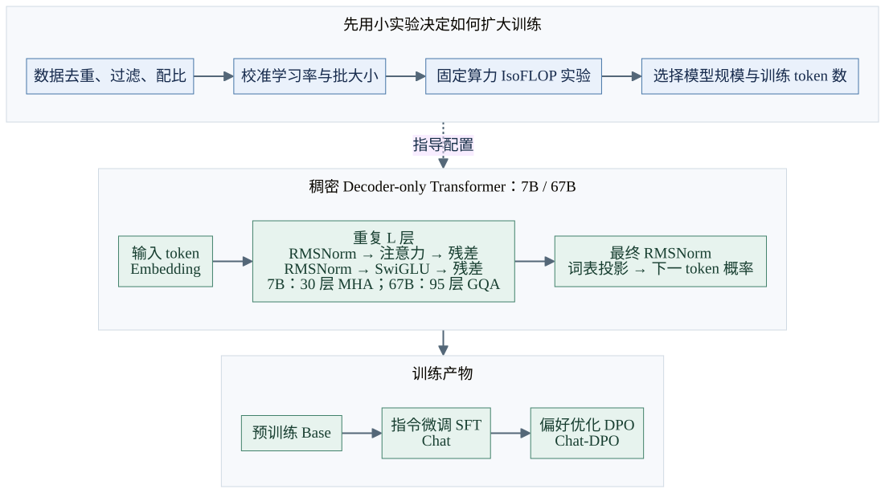
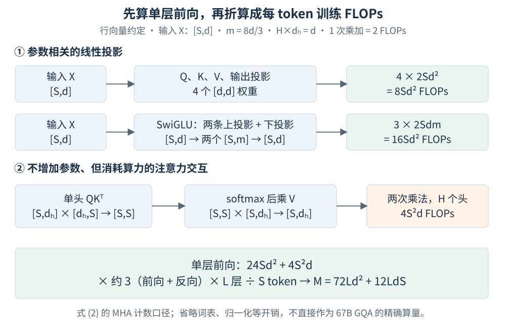
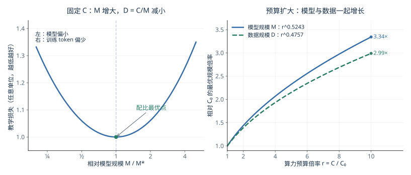
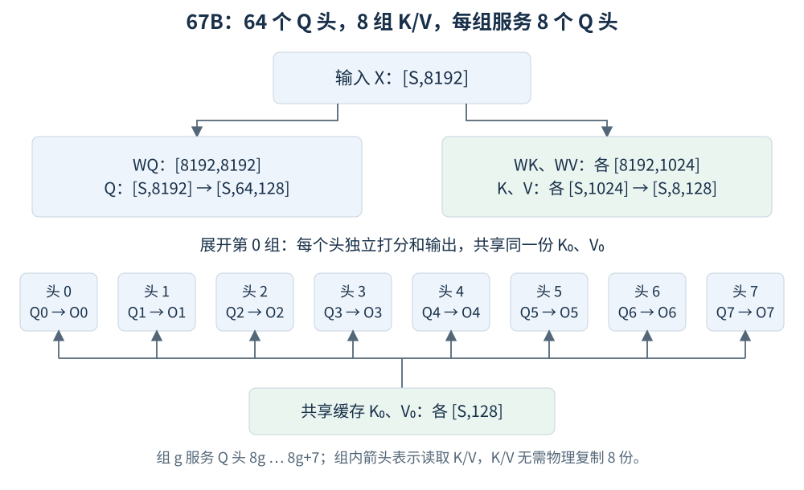
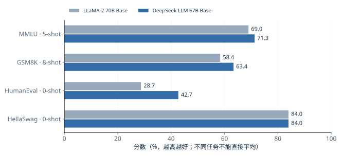

# DeepSeek-V1：从小规模实验规划大模型训练

> **正式论文：** [DeepSeek LLM: Scaling Open-Source Language Models with Longtermism](https://arxiv.org/abs/2401.02954v1)，DeepSeek-AI，arXiv:2401.02954 **v1，2024-01-05**。本文以“DeepSeek-V1”作为系列笔记名称，论文和模型正式名称为 **DeepSeek LLM**。讨论的是稠密 7B/67B 模型。

## 1. 论文解决什么问题

**算力预算增加后，应该把模型做大，还是让模型多读一些数据？** 如果小规模实验的学习率没调好、计算量统计有偏差，外推出来的“大模型配方”就可能浪费大量训练资源。

这篇论文的主线是建立可靠的扩展方法：**先校准超参数，再修正模型规模的计量方式，最后用等算力实验寻找模型与数据的配比。** 7B/67B 是这一研究的落地模型；核心贡献不在于发明新的 Transformer 注意力模块。[原文 §1、§3](https://arxiv.org/html/2401.02954v1#S3)

| 本文的主要贡献与发现 | 沿用的已有方法 |
| --- | --- |
| 拟合计算预算与合适学习率、批大小之间的关系 | 稠密 Decoder-only Transformer、RMSNorm、SwiGLU、RoPE |
| 以非词嵌入 FLOPs/token 计量模型规模，改善外推 | Chinchilla 的 IsoFLOP 实验方法 |
| 观察到数据变化会改变最优模型/数据增长比例 | 67B 使用 GQA；指令微调 SFT 与偏好优化 DPO |
| 训练双语 7B/67B 模型，检验扩展预测并分析对齐效果 | AdamW 与多阶段学习率调度 |

*图 1：自绘整体图，依据[原文 §2–§4](https://arxiv.org/html/2401.02954v1#S2)。上层是训练规划，中间是模型前向结构，下层是训练阶段；实线表示处理顺序，虚线表示配置指导。每个残差连接均绕过其对应的“归一化 + 子层”。[Mermaid 源文件](./images/DeepSeek-V1/overview.mmd)。*

## 2. 核心：先把“规模”与“预算”量对

### 2.1 问题：参数量不等于计算量

常见估计为 $C\approx6ND$：$N$ 是模型参数量，$D$ 是训练 token 数，$C$ 是训练 FLOPs。系数 6 近似来自每参数每 token 的前向计算约 2 FLOPs，再乘约 3 覆盖前向和反向。

但这个口径有两个盲点：**注意力中的 $QK^\top$、$AV$ 没有新参数，却需要计算；大词表又会增加参数量，影响“参数量作为模型容量代理”的准确性。** 其中 $A$ 为注意力权重矩阵。小模型尤其容易受到这些比例差异影响。[原文 §3.2](https://arxiv.org/html/2401.02954v1#S3.SS2)

论文改用 **$M$：非词嵌入训练 FLOPs/token**，并定义研究预算 $C=MD$。它计入注意力交互，排除词表相关计算；因此这个 $C$ 不是训练作业全部 GPU 开销，也不是推理 FLOPs。

### 2.2 直觉图解：注意力还有一笔随序列长度增长的账

*图 2：根据[原文式 (2)](https://arxiv.org/html/2401.02954v1#S3.E2)独立绘制的教学推导，不是论文原图。先看上方参数相关投影，再看下方无新增参数的注意力交互，最后转换为每 token 训练 FLOPs。这里使用理想化 MHA 与 $m=8d/3$，不直接套作实际 67B GQA 的精确算量。*

全文矩阵统一采用**行向量约定**，token 沿行排列。$X\in\mathbb R^{S\times d}$；$S$ 为序列长度，$d$ 为隐藏维度，$L$ 为层数，$H$ 为注意力头数，$d_h=d/H$，$m$ 为 FFN 中间维度。

**补充推导：** 一次 $[a,b]\times[b,c]$ 矩阵乘法约需 $2abc$ FLOPs。对图中的 MHA 层：

| 计算 | 单层前向 FLOPs |
| --- | ---: |
| Q/K/V 与输出的 4 个线性投影 | $4\times2Sd^2=8Sd^2$ |
| SwiGLU 的两条上投影与一条下投影 | $3\times2Sdm=16Sd^2$，取 $m=8d/3$ |
| 所有头的 $QK^\top$ 与 $AV$ | $H\times2\times2S^2d_h=4S^2d$ |

将前向成本乘约 3、乘 $L$ 层，再除以 $S$，就得到**论文式 (2)**：

$$
\boxed{M=\frac{3L(24Sd^2+4S^2d)}S=72Ld^2+12LdS.}
$$

这是主导矩阵运算的计数模型，省略归一化、softmax、激活、重计算等成本；“前反向约 3 倍”也不是所有算子都严格满足的定律。

**为什么有效？** 它让不同大小的实验更接近同一计算口径。原文表 3 的小模型例子取 $L=8,d=512,S=4096$，补充计算得到：

$$
M\approx352.3\text{M FLOPs/token},\qquad
6N_1=72Ld^2\approx151.0\text{M},\qquad
\frac{6N_1}{M}\approx0.43.
$$

$N_1$ 为非词嵌入参数量。若忽略注意力交互，就把此例的研究口径成本低估了约 57%。把这种偏差带入大量小实验，会影响后续缩放规律拟合。[原文表 3、附录 A.2](https://arxiv.org/html/2401.02954v1#S3.T3)

### 2.3 先调好超参数，才能公平比较模型配比

一个模型表现差，可能只是学习率或 batch size 不合适。论文先搜索近优区域，再拟合**原文式 (1)**：

$$
\eta_{\rm opt}=0.3118C^{-0.1250},\qquad
B_{\rm opt}=0.2920C^{0.3271}.
$$

$\eta$ 为学习率，$B$ 为**全局每次优化器更新的 token 数**，不是单卡 micro-batch 的样本数；$C$ 按论文非词嵌入训练 FLOPs 口径。常数依赖这些单位和实验设置。

**补充推导：** 预算扩大 $r$ 倍时，直接取比值消去常数：

$$
\frac{\eta(rC)}{\eta(C)}=r^{-0.1250},\qquad
\frac{B(rC)}{B(C)}=r^{0.3271}.
$$

例如 $r=10$，学习率约变成 $0.75$ 倍，全局 batch tokens 约为 $2.12$ 倍。它们是搜索起点，不是对所有架构、优化器和数据都成立的推荐值。论文把验证损失相对最优值不超过 0.25% 的设置视为近优，并观察到近优区域较宽。[原文 §3.1、图 2–3](https://arxiv.org/html/2401.02954v1#S3.SS1)

### 2.4 阶梯学习率如何支撑扩展实验

为了比较不同训练预算，论文采用可复用训练前缀的多阶段学习率：2000 步预热后保持最大值，到 80% token 进度降为最大值的 31.6%，到 90% 再降为 10%。其他配置一致时，不同预算的实验可以复用尚未进入衰减的前缀，再分别完成后续训练，降低搜索超参数和模型/数据配比的实验成本。[原文 §2.3、§3.1](https://arxiv.org/html/2401.02954v1#S2.SS3)

这一选择有对照依据：在 **1.6B 模型、100B tokens** 的实验中，阶梯调度与余弦调度的最终损失基本相当。它支持论文在减少重复训练的同时开展扩展研究，不意味着阶梯调度在所有配置下都优于余弦调度。[原文图 1](https://arxiv.org/html/2401.02954v1#S2.F1)

## 3. 用 IsoFLOP 找到“模型多大、训练多久”

### 3.1 直觉：同一预算下，两边都不能走极端

固定 $C=MD$ 后，大模型每 token 更贵，只能读更少 token；小模型可以读更多 token，却可能容量不足。**IsoFLOP 就是在相同预算内试多个配比，寻找验证损失最低的点。**

*图 3：自绘解释图。左侧为教学损失曲线，只有 U 形权衡的含义，不是原论文数据；右侧由[原文式 (4)](https://arxiv.org/html/2401.02954v1#S3.E4)的指数计算相对倍率，不是重新拟合的实验结果。$M^*$ 是给定预算下的最优规模，$C_0$ 是参考预算。原文真实 IsoFLOP 曲线见[图 4](https://arxiv.org/html/2401.02954v1#S3.F4)。*

论文的操作顺序是：选定多个预算 → 每个预算尝试约 10 个模型/数据配比 → 用近优超参数训练 → 在独立验证集上找低点 → 拟合这些低点随预算的变化。实验用了 $10^{17}$ 到 $3\times10^{20}$ FLOPs 的 8 档预算，以及 100M token 验证集；损失用 bits-per-byte（BPB）衡量。[原文 §3.2、图 4](https://arxiv.org/html/2401.02954v1#S3.SS2)

### 3.2 论文拟合了什么

**论文式 (3)** 是受预算约束的最小化目标。下式将原文损失记号统一改写为 $\mathcal L(M,D)$：

$$
(M_{\rm opt},D_{\rm opt})
=\underset{M,D:\,MD=C}{\arg\min}\;\mathcal L(M,D).
$$

**原文式 (4)** 在其当前数据上的拟合为：

$$
\boxed{M_{\rm opt}=0.1715C^{0.5243},\qquad
D_{\rm opt}=5.8316C^{0.4757}.}
$$

这里的 $M$ 是 FLOPs/token，不能把 $0.5243$ 不加说明地当成“参数量的精确指数”。预算扩大 10 倍，得到的最优 $M$、$D$ 分别扩大约 **3.34 倍、2.99 倍**，乘积约为 10。

**补充推导：为什么两个指数相加为 1？** 设 $M=k_MC^a$、$D=k_DC^b$，代入 $MD=C$：

$$
k_Mk_DC^{a+b}=C
\quad\Longrightarrow\quad
a+b=1,\quad k_Mk_D\approx1.
$$

这只是预算约束，不能单独推导出 $a=0.5243$；具体指数来自实验拟合，系数的微小误差来自取舍小数。

**外推是否成立？** 论文进一步拟合预算与最优验证损失的关系，比较对 7B/67B 的预测与实际结果。图 5 显示两者较为吻合；附录 A.2 使用相同实验重新比较规模计量方式，发现 $6N_1$ 倾向于高估大模型表现，$6N_2$ 倾向于低估，而 $M$ 的预测最准确。这是采用 $M$ 的直接实验依据，预测对象是验证 BPB，并非各项下游基准分数。[原文图 5](https://arxiv.org/html/2401.02954v1#S3.F5)、[附录 A.2、图 6](https://arxiv.org/html/2401.02954v1#A1.SS2)

### 3.3 数据换了，配比也可能换

| 论文自己的数据实验 | 模型增长指数 $a$ | 数据增长指数 $b$ |
| --- | ---: | ---: |
| 早期内部数据 | 0.450 | 0.550 |
| 当前内部数据 | 0.524 | 0.476 |
| OpenWebText2 | 0.578 | 0.422 |

来源：[原文 §3.3、表 4](https://arxiv.org/html/2401.02954v1#S3.T4)。按照作者对这些数据质量的排序，质量更高时，最优分配更偏向扩大模型。**这是这几组数据上的经验观察，不是“高质量数据必然对应某个固定指数”的定律**；数据分布也发生了变化。

这项发现为不同研究得到不同缩放指数提供了一种解释：最优配比不仅由计算预算决定，也受训练数据影响。作者将其视为可能的解释，而非已经隔离所有变量的因果结论。[原文 §3.3](https://arxiv.org/html/2401.02954v1#S3.SS3)

## 4. 7B/67B：扩展研究落到什么模型上

| 配置 | DeepSeek LLM 7B | DeepSeek LLM 67B |
| --- | ---: | ---: |
| 层数 $L$ / 隐藏维度 $d$ | 30 / 4096 | 95 / 8192 |
| Q 头数 / KV 头数 | 32 / 32（MHA） | 64 / 8（GQA） |
| 上下文长度 / 训练 token 数 | 4096 / 2T | 4096 / 2T |

来源：[原文 §2.2、表 2](https://arxiv.org/html/2401.02954v1#S2.T2)。两者都是稠密模型；并非每个 token 只激活一部分专家。两者都训练 2T tokens，也不意味着各自在这点上严格满足前述 compute-optimal 配比。

架构整体沿用 LLaMA 的 Pre-Norm、RMSNorm、SwiGLU 和 RoPE。主要配置差异之一是 67B 采用已有的 **GQA**：让一组 Q 头共享 K/V，各个 Q 头仍独立计算注意力权重。[原文 §2.2](https://arxiv.org/html/2401.02954v1#S2.SS2)

*图 4：依据[原文表 2](https://arxiv.org/html/2401.02954v1#S2.T2)的 67B 配置自绘。上方给出投影尺寸，下方展开第 0 组：8 个 Q 头读取同一份 K/V。仅为理解省略 RoPE、mask、归一化和输出投影；箭头表示读取关系，无需把共享缓存复制 8 份。*

**补充展开的 GQA 公式：** 令 $g(i)=\lfloor i/8\rfloor$，头编号 $i=0,\ldots,63$，组编号 $g=0,\ldots,7$。在 Q、K 应用 RoPE 后：

$$
O_i=\operatorname{softmax}\left(
\frac{Q_iK_{g(i)}^\top}{\sqrt{128}}+\text{因果 mask}
\right)V_{g(i)}.
$$

形状为 $[S,128][128,S]\to[S,S]$，再乘 $[S,128]\to[S,128]$；拼接 64 个头回到 $[S,8192]$，经 $W_O\in\mathbb R^{8192\times8192}$ 输出。

在相同层数、长度和精度下，历史 K/V 的元素数从 $2SHd_h$ 变为 $2SGd_h$，其中 $G=8$ 为 KV 组数，因此相对 64 个独立 KV 头只需 **$8/64=1/8$ 的缓存**。这不是整个模型显存降到 1/8，也不是注意力全部 FLOPs 降到 1/8。

在宏观设计上，论文主要增加网络深度，而非扩宽 FFN，以维持参数规模；但没有单独的深度消融证明整体提升来自这一选择。FFN 的中间维度在论文中写为 $m\approx8d/3$，官方 67B 配置实际取 $m=22016$。[原文 §2.2](https://arxiv.org/html/2401.02954v1#S2.SS2)、[官方 config.json，仅补充尺寸](https://huggingface.co/deepseek-ai/deepseek-llm-67b-base/blob/main/config.json)

## 5. 对齐与实验：分清能力、格式和评测条件

### 5.1 SFT 与 DPO：论文观察到了什么

论文使用约 150 万条中英文指令数据进行 SFT。小模型更容易在数学、代码训练后出现重复输出，因此 7B 先用全量数据微调，再用去掉数学和代码的数据做第二阶段；67B 不采用这套第二阶段，因为其基准分数会受损。[原文 §4、§5.1.2](https://arxiv.org/html/2401.02954v1#S4)

7B 的对照体现了取舍：重复比例 **2.0%→1.4%**、IFEval **38.0→41.2**，HumanEval 保持 **48.2**，GSM8K **63.9→63.0**。这是温度为 0 的重复率与 prompt-level loose IFEval 评估；更少重复不代表所有能力指标都上升。[原文表 12](https://arxiv.org/html/2401.02954v1#S5.T12)

DPO 用偏好答案对直接优化回答倾向，本文没有提出新的 DPO 目标。原文主要观察到开放式生成改善，标准基准变化较小；表中的 Chat 与 Chat-DPO 也应分别识别。[原文 §4、附录 A.5](https://arxiv.org/html/2401.02954v1#S4)

### 5.2 基座对比：整体训练方案有效，不能单独归功于 GQA

*图 5：从[原论文表 5](https://arxiv.org/html/2401.02954v1#S5.T5)抽取四项数据重新绘制，不是复制原图。两侧均为 Base 模型，标注 shot 数为表中设定，图中未跨任务求平均。特别保留 HellaSwag 的相同分数，避免把局部优势画成全面领先。*

这组比较使用论文内部评测框架；DeepSeek 67B 和 LLaMA-2 70B 都训练 2T tokens，但数据分布、模型结构和训练细节不同。生成式任务采用贪心解码，部分任务受上下文长度影响可能减少 few-shot 示例。[原文 §5.1、表 5 图注](https://arxiv.org/html/2401.02954v1#S5.SS1)

**版本细节：** 本笔记采用原论文表 5 的 67B Base HumanEval **42.7**；不要把后续论文重评的数值或 Chat 的成绩混入同一组比较。

### 5.3 三个必须保留的评测边界

- **Base 与 Chat 的 shot 设置不同。** 原文表 6 中，Chat 在 MMLU、GSM8K 等任务用 0-shot，而 Base 仍使用 few-shot；分数差不能简单视为同条件下的能力增量。[表 6](https://arxiv.org/html/2401.02954v1#S5.T6)
- **开放式评测不是全面能力排名。** MT-Bench 中 Chat 为 8.35，Chat-DPO 为 8.76；表中 GPT-3.5-turbo-0613 为 8.39，带星号的外部模型结果来自其他研究。它支持特定测评下的观察，不支持笼统宣称全面超过 GPT-3.5。[表 8](https://arxiv.org/html/2401.02954v1#S5.T8)
- **选择题涨分可能只改善题型适应。** 额外加入选择题数据的实验显著提高选择题成绩，却没有相应改善生成式问答；作者据此没有把这类数据纳入最终训练方案。该实验表明，特定题型的得分提升不一定对应更广泛的能力提升。[原文 §5.5、表 13](https://arxiv.org/html/2401.02954v1#S5.T13)

## 6. 值得记住的结论

1. **核心贡献是更可靠的扩展研究。** 先校准超参数，再以非词嵌入 FLOPs/token 计量规模，最后通过 IsoFLOP 实验拟合最优配比与验证损失。
2. **配比指数来自实验，且依赖数据。** $a+b=1$ 由预算约束解释，具体指数不能由此推导；不同数据上的拟合结果也不相同。
3. **7B/67B 检验了扩展预测，但不构成模块级消融。** 它们沿用成熟的稠密 Transformer 组件，整体表现不能单独归因于 GQA、深度或某项训练选择。
4. **预测损失与评测能力要分开。** 验证 BPB、下游基准和开放式生成衡量不同方面；Base、Chat、Chat-DPO 及不同 shot 设置不能混为一谈。

## 原文与图解来源

- [正式版本与摘要](https://arxiv.org/abs/2401.02954v1)、[完整 HTML](https://arxiv.org/html/2401.02954v1)、[官方仓库](https://github.com/deepseek-ai/DeepSeek-LLM)。正文以原论文为依据，官方配置仅补充 FFN 实际尺寸。
- [§3：Scaling Laws](https://arxiv.org/html/2401.02954v1#S3)，式 (1)–(4)、图 2–5、表 3–4；[附录 A.2](https://arxiv.org/html/2401.02954v1#A1.SS2)比较不同规模计量方式。
- 本文所有图均为独立自绘，无复制外部图片。图 3 左侧为教学示意，右侧为论文拟合公式的归一化计算；图 5 为论文表格数值的独立可视化。图注给出各自依据，不能把教学图当作原始实验点。
- 图 1 保留 [Mermaid 源文件](./images/DeepSeek-V1/overview.mmd)；其他图保留 [Python 绘图脚本](./images/DeepSeek-V1/build_figures.py)，输出为可编辑 SVG。
