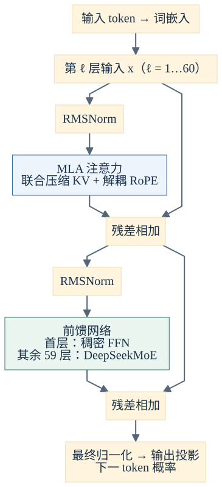
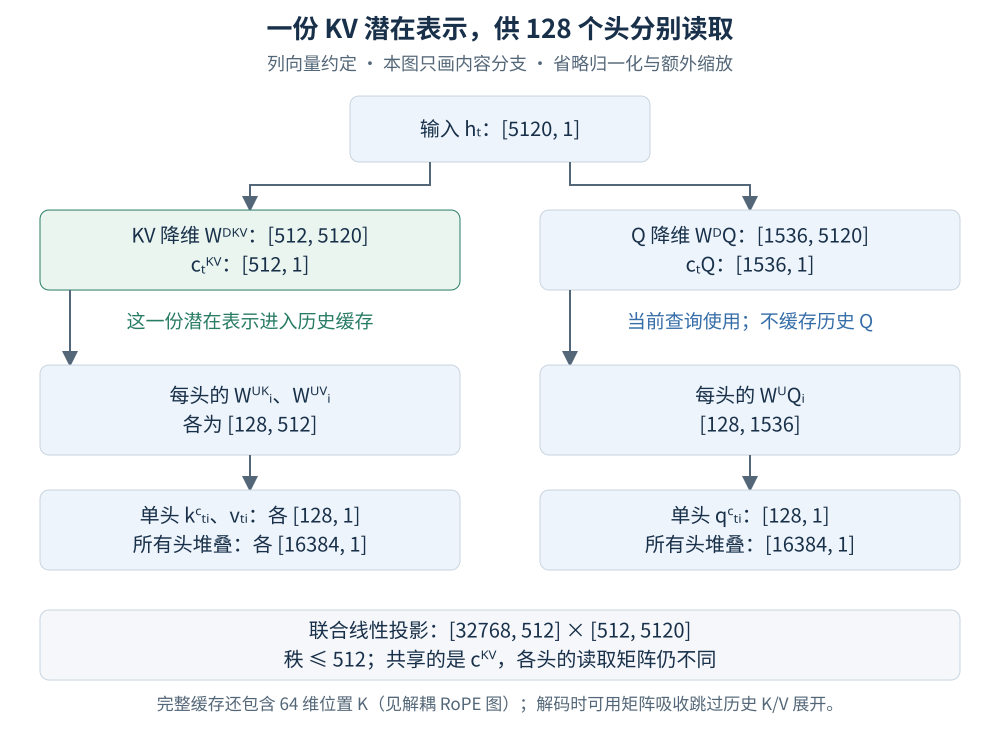
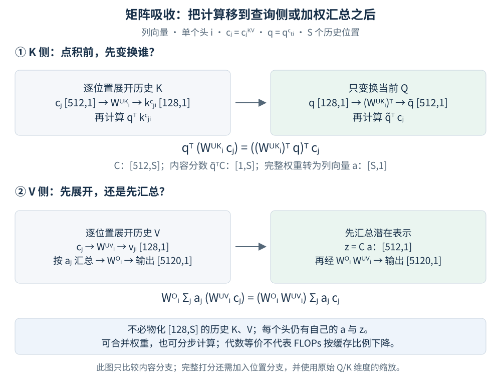
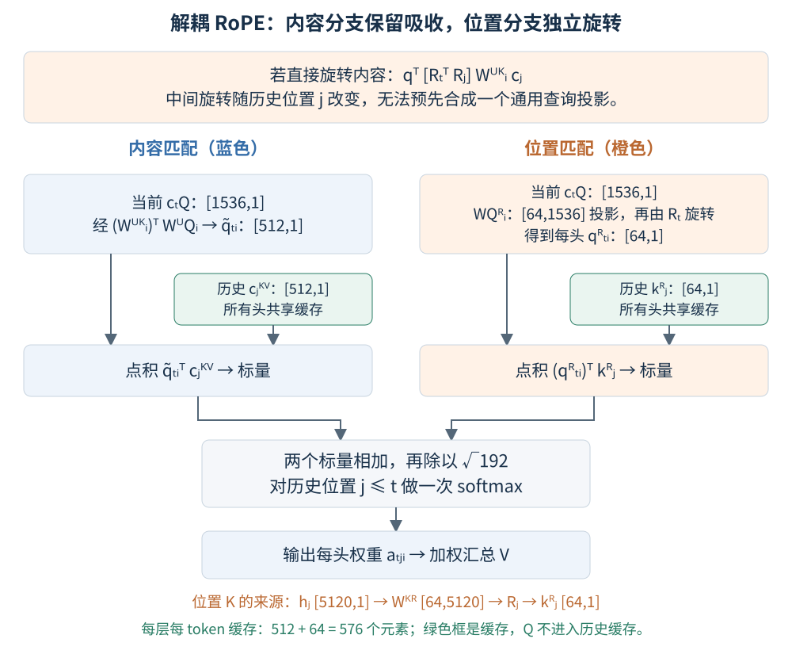
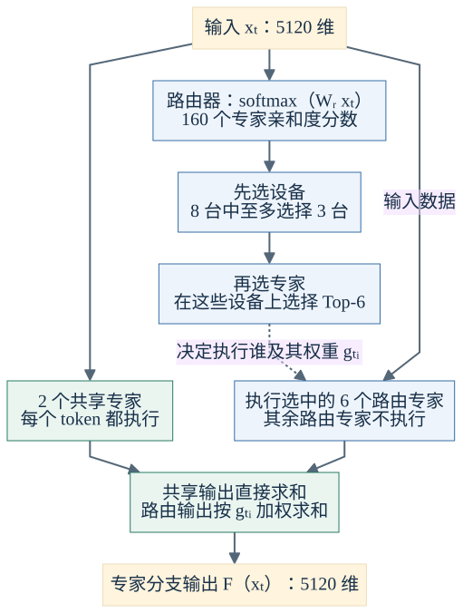
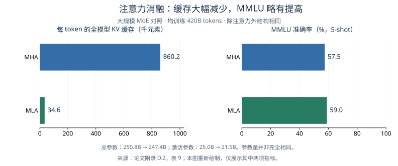

# DeepSeek-V2 论文学习笔记

> 论文：[DeepSeek-V2: A Strong, Economical, and Efficient Mixture-of-Experts Language Model](https://arxiv.org/abs/2405.04434)，DeepSeek-AI，2024。本文依据 [arXiv:2405.04434v5（2024-06-19）](https://arxiv.org/abs/2405.04434v5)；初版发表于 2024-05-07。重点讨论 MLA、MoE 路由与验证它们的实验。文中标明原论文公式和补充推导，图解均为自绘。

## 1. 论文解决什么问题

DeepSeek-V2 将两类优化结合起来：**MLA 减少注意力的历史状态缓存，DeepSeekMoE 用少量激活专家提供较大的参数容量。** 模型共 236B 参数，每个 token 激活约 21B，支持 128K 上下文。[论文 §1、§3.1.2](https://arxiv.org/html/2405.04434v5#S3.SS1.SSS2)

| 模块                  | 解决的问题                                 | 核心办法                                   |
| ----------------------- | -------------------------------------------- | -------------------------------------------- |
| MLA：多头潜在注意力   | 解码时 KV Cache 占显存、读历史状态消耗带宽 | KV 联合低秩压缩、矩阵吸收、解耦 RoPE       |
| DeepSeekMoE：混合专家 | 模型容量与每 token 计算量同时增长          | 细粒度专家、共享专家、稀疏路由             |

**贡献边界：** MLA 是 V2 提出的注意力设计；DeepSeekMoE、GRPO 分别沿用此前的 DeepSeekMoE、DeepSeekMath 工作。V2 在此基础上加入设备受限路由、设备级与通信级负载均衡，并验证完整模型的能力和效率。[论文 §2、§4.2](https://arxiv.org/html/2405.04434v5#S2)

*图 1｜自绘简化架构。沿主链看 MLA 与前馈网络的位置，旁路箭头是残差连接；60 层依次堆叠，首层 FFN 稠密，其余 59 层使用 MoE。依据[论文 §2、图 2 与 §3.1.2](https://arxiv.org/html/2405.04434v5#S2)，并非论文原图。*

## 2. MLA：让多个头共享紧凑记忆

### 2.1 普通多头注意力为什么贵

把注意力理解为查资料：Q 是当前问题，K 是历史资料的检索特征，V 是需要取出的内容。第 $t$ 个 token 的第 $i$ 个头计算：

$$
a_{tji}=\operatorname{softmax}_{j\le t}
\left(\frac{q_{t,i}^{\top}k_{j,i}}{\sqrt{d_h}}\right),
\qquad o_{t,i}=\sum_{j\le t}a_{tji}v_{j,i}.
$$

先计算相关性，再按权重汇总内容。历史 K、V 会被后续 token 反复使用，因此缓存起来。若每头的 K、V 都是 $d_h$ 维，$H$ 个头每层、每 token 就要保存 $2Hd_h$ 个数。

下文使用列向量；$h_t\in\mathbb R^d$ 是当前层的输入。省略归一化、额外缩放和残差，以突出主计算链。实际模型在压缩表示后使用 RMSNorm 等稳定训练措施。

| 符号  | 含义                                | V2 配置 |
| ------- | ------------------------------------- | --------: |
| $d$   | 隐藏维度                            |    5120 |
| $H$   | 注意力头数                          |     128 |
| $d_h$ | 每头内容 Q/K 及 V 的维度            |     128 |
| $d_c$ | KV 潜在维度                         |     512 |
| $d_q$ | Q 潜在维度，论文记为$d_c'$          |    1536 |
| $d_r$ | 每头 RoPE 分支维度，论文记为$d_h^R$ |      64 |
| $L$   | Transformer 层数                    |      60 |

这里 **$Hd_h=16384$，不等于 $d=5120$**；不能直接套用常见的“头数 × 头维度 = 隐藏维度”。[论文 §3.1.2](https://arxiv.org/html/2405.04434v5#S3.SS1.SSS2)

### 2.2 KV 联合压缩：一个潜在向量供所有头读取

先把每个 token 编码为共享潜在向量，再由各个头读取自己的 K、V。绿色框中的潜在向量进入缓存，下面的大向量是展开后的表示。

*图 2｜自绘内容分支。先看左侧 KV 的 5120 → 512 → 每头 128，再看右侧 Q 的 5120 → 1536 → 每头 128；箭头表示矩阵乘法。维度取自[§3.1.2](https://arxiv.org/html/2405.04434v5#S3.SS1.SSS2)，计算关系依据 §2.1.2、式 (9)–(13)。*

**论文式 (9)–(11)，按头展开：**

$$
c_t^{KV}=W^{DKV}h_t,\qquad
k_{t,i}^{C}=W_i^{UK}c_t^{KV},\qquad
v_{t,i}=W_i^{UV}c_t^{KV}.
$$

$D/U$ 表示降维/升维，$C$ 表示内容分支。图 2 已列出矩阵形状；所有头堆叠后的 $W^{UK},W^{UV}$ 均为 $[16384,512]$。

**补充推导：为什么叫“低秩”？** 将所有头的 K、V 投影纵向堆叠，有：

$$
\begin{bmatrix}k_t^C\\v_t\end{bmatrix}
=\underbrace{\begin{bmatrix}W^{UK}\\W^{UV}\end{bmatrix}W^{DKV}}_{\text{线性化后的联合投影，秩不超过 }d_c}h_t.
$$

**共享编码不等于各头相同，也不保证无损还原任意已有 MHA。** 这些矩阵由训练共同学习；上面的秩结论针对省略归一化后的线性表达。

Q 也经过压缩：

$$
c_t^Q=W^{DQ}h_t\in\mathbb R^{d_q},\qquad
q_{t,i}^C=W_i^{UQ}c_t^Q\in\mathbb R^{d_h}.
$$

尺寸为 $5120\to1536\to128$。Q 压缩主要服务训练激活内存优化；历史 Q 本来就不需要像 K、V 那样长期缓存。[论文 §2.1.2，式 (9)–(13)](https://arxiv.org/html/2405.04434v5#S2.SS1.SSS2)

### 2.3 矩阵吸收：直接在压缩空间计算

如果每次查询都展开所有历史 K、V，仍要反复计算高维历史状态。矩阵吸收利用乘法结合律，把这部分计算移到当前 Q 或加权汇总之后。

*图 3｜自绘代数等价变换。每一行从左到右比较计算顺序，灰色为展开历史 K/V 的形式，绿色为吸收后的形式。$C=[c_1^{KV},\ldots,c_S^{KV}]$ 按列存放历史状态。依据[§2.1.2](https://arxiv.org/html/2405.04434v5#S2.SS1.SSS2) 的矩阵吸收说明；下列展开是补充推导。*

**K 侧：把“展开历史 K”改成“变换当前 Q”。**

$$
\begin{aligned}
(q_{t,i}^C)^\top k_{j,i}^C
&=(q_{t,i}^C)^\top W_i^{UK}c_j^{KV}\\
&=\left((W_i^{UK})^\top q_{t,i}^C\right)^\top c_j^{KV}\\
&=\left(\underbrace{(W_i^{UK})^\top W_i^{UQ}}_{\widetilde W_i^Q\in\mathbb R^{d_c\times d_q}}c_t^Q\right)^\top c_j^{KV}.
\end{aligned}
$$

于是 $\widetilde q_{t,i}=\widetilde W_i^Qc_t^Q\in\mathbb R^{512}$，直接与历史 $c_j^{KV}\in\mathbb R^{512}$ 点积。每个头仍有自己的查询和注意力权重。

**V 侧：先汇总潜在向量，再投影输出。**

$$
o_{t,i}=\sum_{j\le t}a_{tji}W_i^{UV}c_j^{KV}
=W_i^{UV}\underbrace{\left(\sum_{j\le t}a_{tji}c_j^{KV}\right)}_{z_{t,i}\in\mathbb R^{d_c}}.
$$

将输出矩阵按头分块，$W^O=[W_1^O,\ldots,W_H^O]$，则：

$$
u_t=\sum_{i=1}^{H}W_i^Oo_{t,i}
=\sum_{i=1}^{H}\underbrace{\left(W_i^OW_i^{UV}\right)}_{\widetilde W_i^O\in\mathbb R^{d\times d_c}}z_{t,i}.
$$

这一步利用线性投影可移出加权求和。合并权重或分阶段相乘都可以，不要求物化大矩阵。[论文附录 C](https://arxiv.org/html/2405.04434v5#A3)

### 2.4 解耦 RoPE：位置分支独立处理

旋转位置编码（RoPE）使 Q、K 的点积包含相对位置信息。但如果直接旋转内容 Q、K，打分会出现：

$$
(R_tq_{t,i}^C)^\top(R_jW_i^{UK}c_j^{KV})
=(q_{t,i}^C)^\top\underbrace{R_t^\top R_j}_{\text{依赖相对位置}}W_i^{UK}c_j^{KV}.
$$

位置矩阵夹在中间，通常不能把 $W_i^{UK}$ 合成一个对所有历史位置通用的查询投影。问题在于**妨碍固定矩阵吸收**，并非 RoPE 与压缩完全不能共存。

*图 4｜自绘解耦 RoPE。蓝、橙两条分支分别产生标量分数，相加后只做一次 softmax；绿色框是历史缓存。按[§2.1.3、式 (14)–(19)](https://arxiv.org/html/2405.04434v5#S2.SS1.SSS3) 绘制，下半部分使用图 3 的吸收形式；顶部为解释障碍的补充推导。*

**论文式 (14)–(17)：** MLA 将内容与位置拆开：

$$
q_{t,i}^R=R_tW_i^{QR}c_t^Q\in\mathbb R^{d_r},\qquad
k_j^R=R_jW^{KR}h_j\in\mathbb R^{d_r}.
$$

位置 Q 每头独立，位置 K 所有头共享。拼接后 $q_{t,i}=[q_{t,i}^C;q_{t,i}^R]$、$k_{j,i}=[k_{j,i}^C;k_j^R]$，每头 Q/K 都是 $128+64=192$ 维，V 仍为 128 维。

把论文式 (18) 的拼接点积展开，再代入矩阵吸收，可得：

$$
\boxed{
a_{tji}=\operatorname{softmax}_{j\le t}
\left(
\frac{\underbrace{\widetilde q_{t,i}^{\top}c_j^{KV}}_{\text{内容匹配}}
+\underbrace{(q_{t,i}^R)^\top k_j^R}_{\text{携带位置信息的匹配}}}
{\sqrt{d_h+d_r}}
\right)
}
$$

注意：吸收后内容点积在 512 维计算，**缩放分母仍是原始 Q/K 的 $\sqrt{192}$**，不能改成 $\sqrt{512+64}$。位置分支也由输入内容生成，不是单纯的“距离分数”。[论文 §2.1.3，式 (14)–(19)](https://arxiv.org/html/2405.04434v5#S2.SS1.SSS3)

### 2.5 缓存大小与比较口径

完整 MLA 缓存 $c_j^{KV}$ 和 $k_j^R$。对批大小 $B$、历史长度 $S$、层数 $L$、每元素 $b$ 字节：

$$
\boxed{\text{KV Cache 字节数}=BLS(d_c+d_r)b}
$$

| 机制 | 每层、每 token 缓存元素数 | 共享方式                 |
| ------ | --------------------------: | -------------------------- |
| MHA  |                   $2Hd_h$ | 每个头独立 K/V           |
| GQA  |                   $2Gd_h$ | $G$ 组 K/V               |
| MQA  |                    $2d_h$ | 全部头共享一组 K/V       |
| MLA  |                 $d_c+d_r$ | 共享 KV 潜在表示和位置 K |

前三行假设 K/V 每头同为 $d_h$ 维。代入 V2 参数，MLA 每层每 token 为 $512+64=576$ 个数；60 层、BF16 存储时为 $576\times60\times2=67.5$ KiB。

若仅构造一个同为 128 头、K/V 各 128 维的 MHA 比较项，则 $576/(2\times128\times128)\approx1.76\%$。**这是上述假设的计算结果，不是论文对实际 DeepSeek 67B 的比较值。** 论文报告的 93.3% 缓存削减以 DeepSeek 67B 为基线；不同层数、KV 头数和存储精度必须统一后再比较。[论文表 1](https://arxiv.org/html/2405.04434v5#S2.T1)、[官方概览](https://github.com/deepseek-ai/DeepSeek-V2#1-introduction)

MLA 压缩的是每个 token 的特征，不是历史 token 数。缓存仍随 $S$ 线性增长，完整因果注意力的序列交互仍是二次规模；缓存减少也不等于 FLOPs 同比例减少。

## 3. DeepSeekMoE：用细分工提高参数利用率

### 3.1 细粒度专家与共享专家

专家是参数不同的前馈网络（FFN）。细粒度划分将一个较宽专家拆成多个较窄专家，使相同计算预算可以选择更丰富的组合；共享专家始终参与，承担通用信息，减少路由专家重复学习。

**补充推导：** 对一个 SwiGLU 专家，忽略偏置，参数量约为 $3dm$，$m$ 是中间维度。若把宽度缩成 $m/r$，同时将激活数从 $K$ 增至 $rK$，则激活专家的参数规模近似保持：

$$
K\cdot3dm=(rK)\cdot3d\frac mr.
$$

这解释了“更多、更小的专家”为什么不必同比增加算术量；但路由、通信和小矩阵执行开销并不因此消失。

V2 每个 MoE 层配置 **2 个共享专家、160 个路由专家，每 token 选择 6 个路由专家**，专家中间维度 1536；第一层 FFN 保持稠密，其余层使用 MoE。[论文 §2.2.1、§3.1.2](https://arxiv.org/html/2405.04434v5#S2.SS2.SSS1)

*图 5｜自绘 MoE 数据流。实线表示数据或分数流，虚线表示专家选择与权重；每个专家内部均为 5120 → 1536 → 5120 的 SwiGLU（上投影有两条支路）。该图只画专家分支，归一化与残差见图 1。依据[§2.2.1–2.2.2、式 (20)–(22)](https://arxiv.org/html/2405.04434v5#S2.SS2.SSS1)，配置见 §3.1.2。*

### 3.2 路由公式

设 MoE 输入为 $x_t\in\mathbb R^d$，路由器 $W_r\in\mathbb R^{N_r\times d}$，则：

$$
s_t=\operatorname{softmax}(W_rx_t),\qquad
g_{t,i}=s_{t,i}\mathbf1\{i\in\mathcal S_t\}.
$$

$\mathcal S_t$ 为选中的 $K_r$ 个路由专家；未考虑设备约束时就是全体专家的 Top-$K_r$。MoE 输出为：

$$
F(x_t)=\sum_{i=1}^{N_s}F_i^{\rm shared}(x_t)
+\sum_{i=1}^{N_r}g_{t,i}F_i^{\rm routed}(x_t).
$$

按原论文式 (21)，选中专家保留全局 softmax 分数，**公式中没有额外的 Top-K 内再归一化**。上式只写专家分支；完整层还包括归一化和残差连接。[论文式 (20)–(22)](https://arxiv.org/html/2405.04434v5#S2.SS2.SSS1)

### 3.3 为什么还需要设备约束与负载均衡

**限制设备数。** 细粒度划分增加了激活专家数，也可能增加通信次数。图 5 的“先选设备，再选专家”把每个 token 的目标设备限制在至多 3 台。论文观察到，允许至少 3 台时，性能与不受限 Top-K 大致相当；但这一约束不能保证各设备收到同样多的任务。[论文 §2.2.2](https://arxiv.org/html/2405.04434v5#S2.SS2.SSS2)

**三类均衡损失。** 设 $T$ 为统计范围内 token 数，论文式 (23)–(25) 的专家级损失为：

$$
f_i=\frac{N_r}{K_rT}\sum_{t=1}^{T}\mathbf1\{i\in\mathcal S_t\},\qquad
P_i=\frac1T\sum_{t=1}^{T}s_{t,i},\qquad
\mathcal L_{\rm ExpBal}=\alpha_1\sum_i f_iP_i.
$$

$f_i$ 表示归一化后的实际分配频率，$P_i$ 是平均路由概率。均匀分配时 $f_i\approx1$、$P_i\approx1/N_r$，损失约为 $\alpha_1$。当某专家已很拥挤时，它的 $f_i$ 较大，继续提高其路由概率的惩罚更强；这是软约束，不保证每步严格均衡。

| 均衡层级 | 统计什么                 | 解决什么                           |
| ---------- | -------------------------- | ------------------------------------ |
| 专家级   | 每个专家的分配频率与概率 | 避免少数专家垄断，其他专家缺少训练 |
| 设备级   | 同设备专家的负载聚合     | 避免部分 GPU 忙、其他 GPU 等待     |
| 通信级   | 每个设备收到的 token 数  | 避免接收端通信热点                 |

设备级统计专家计算任务，通信级统计 token 是否发送到设备：同一个 token 在同卡使用多个专家，可能只发送一次输入，但要执行多次专家计算。这是两者不能简单合并的原因。[论文 §2.2.3，式 (23)–(31)](https://arxiv.org/html/2405.04434v5#S2.SS2.SSS3)

**超载兜底。** 训练时采用设备级 token dropping，容量因子为 1.0，超载时优先丢弃低亲和度分配；约 10% 的训练序列不丢弃，评估也不丢弃。这里跳过的是超载的专家计算，不是从原始文本中删除 token。[论文 §2.2.4](https://arxiv.org/html/2405.04434v5#S2.SS2.SSS4)

## 4. 训练与对齐：支撑模型能力的条件

预训练使用 8.1T tokens、4K 序列。MLA 的小缓存并不自动带来长上下文能力：论文另用 YaRN 扩展位置编码，并以 32K 序列继续训练 1000 步；128K 能力通过长上下文评估验证。其 NIAH 结果主要检验长文中的信息检索，不代表所有长文任务都同样可靠。[§3.1.2、§3.1.4、图 4](https://arxiv.org/html/2405.04434v5#S3.SS1.SSS4)

SFT 使用 150 万条指令数据，随后先进行数学、代码推理 RL，再做人类偏好 RL。沿用 DeepSeekMath 的 **GRPO**：同一道题采样一组答案，以组内奖励作为相对基线。[§4.1–4.2](https://arxiv.org/html/2405.04434v5#S4)

$$
A_i=\frac{r_i-\operatorname{mean}(r_1,\ldots,r_G)}
{\operatorname{std}(r_1,\ldots,r_G)}.
$$

这里 $G$ 是答案数，$r_i$ 是奖励。高于组均值的答案获得正优势，低于均值的获得负优势；这是[论文式 (34)](https://arxiv.org/html/2405.04434v5#S4.E34)。GRPO 省去单独的 critic，仍通过概率比裁剪和参考策略的 KL 项约束更新。它是 V2 的对齐方法，不是本文新提出的算法。

## 5. 实验结果如何读

| 观察         | 论文或官方报告                     | 正确解读                                                                    |
| -------------- | ------------------------------------ | ----------------------------------------------------------------------------- |
| 训练成本     | 相对 DeepSeek 67B 降低 42.5%       | 论文按相同训练 token 量比较 GPU hours，不能把不同数据量的总训练账单直接相比 |
| KV Cache     | 相对 DeepSeek 67B 减少 93.3%       | 是特定模型基线，不是所有 MHA→MLA 的固定比例                                |
| 最大生成吞吐 | 相对 DeepSeek 67B 达到 5.76 倍     | 属于整体服务配置结果，不等于单请求延迟缩短 5.76 倍                          |
| 基座能力     | MMLU：71.3→78.5；MATH：18.7→43.6 | 容量、数据、结构共同变化，不能把增益全部归因于一个模块                      |
| 对齐后能力   | HumanEval：SFT 76.8→RL 81.1       | 代码表现提高，但不意味着所有基准同步提高                                    |

基座分数来自[论文表 2](https://arxiv.org/html/2405.04434v5#S3.T2)（MMLU 5-shot、MATH 4-shot）；HumanEval 来自[表 3](https://arxiv.org/html/2405.04434v5#S4.T3)（0-shot）。效率比较见[论文 §3.2.3](https://arxiv.org/html/2405.04434v5#S3.SS2.SSS3)。训练成本是在 H800 集群上每 1T tokens 的 GPU hours（300.6K → 172.8K）。吞吐测试使用单节点 8 张 H800，按 DeepSeek 67B 实际服务的输入、输出长度分布测试；V2 还使用 FP8 权重、平均 6 bit 的 KV 量化和更大批量，不能全算作 MLA 的单项收益。

*图 6｜根据[附录 D.2、表 9](https://arxiv.org/html/2405.04434v5#A4.T9) 数据重新绘制。左图缓存越小越好，右图准确率越高越好；两图横轴单位不同，均从零起。该组模型均训练 420B tokens，除注意力外架构相同，但注意力替换也改变了总参数及激活参数。*

这组对照中，MLA 的缓存为 MHA 的 $34.6/860.2\approx4.0\%$，MMLU 提高 1.5 个百分点。它更直接地支持 MLA 的设计，但不能视为完全等参数比较，也不能与最终 V2 的配置及前面的 1.76% 假设比较混用。

论文还观察到对齐税：偏好对齐改善开放式生成时，部分标准基准可能下降。[论文 §4.4](https://arxiv.org/html/2405.04434v5#S4.SS4)

## 6. 值得记住的四点

1. **MLA：** 每 token 缓存“KV 潜在向量 + 共享位置 K”；矩阵吸收避免反复展开历史 K/V，解耦 RoPE 保住这条优化路径。
2. **MoE：** 大容量靠专家总量，低计算靠稀疏激活；21B 激活参数不代表只需存储 21B 权重。
3. **路由：** 设备限制控制每个 token 访问多少台设备，均衡损失控制任务分布，token dropping 为训练超载兜底；三者作用不同。
4. **边界：** 区分 V2 新提出的 MLA、沿用的 DeepSeekMoE/GRPO，以及实际服务中的量化和内核优化，分别判断贡献与收益。

## 原文导航

- [§2.1：MLA，式 (1)–(19)](https://arxiv.org/html/2405.04434v5#S2.SS1)：联合压缩与解耦 RoPE。
- [附录 C：MLA 完整公式](https://arxiv.org/html/2405.04434v5#A3)：核对计算链与缓存对象。
- [§2.2：DeepSeekMoE，式 (20)–(31)](https://arxiv.org/html/2405.04434v5#S2.SS2)：专家、路由、三类均衡与丢弃策略。
- [§3：预训练与评测](https://arxiv.org/html/2405.04434v5#S3)、[§4：对齐](https://arxiv.org/html/2405.04434v5#S4)、[附录 D：注意力消融](https://arxiv.org/html/2405.04434v5#A4)：查看实验条件与结论边界。

图解源文件位于 [images/DeepSeek-V2](./images/DeepSeek-V2/)：流程图保留 `.mmd`，矩阵图和实验图由 [build_figures.py](./images/DeepSeek-V2/build_figures.py) 生成；均为可编辑 SVG，无外部图片转载。
