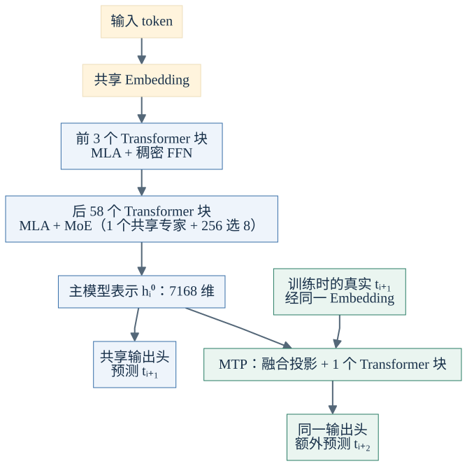
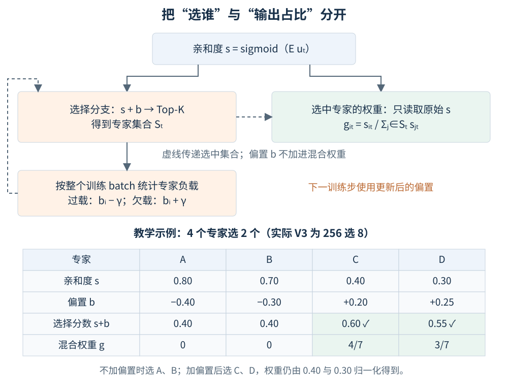
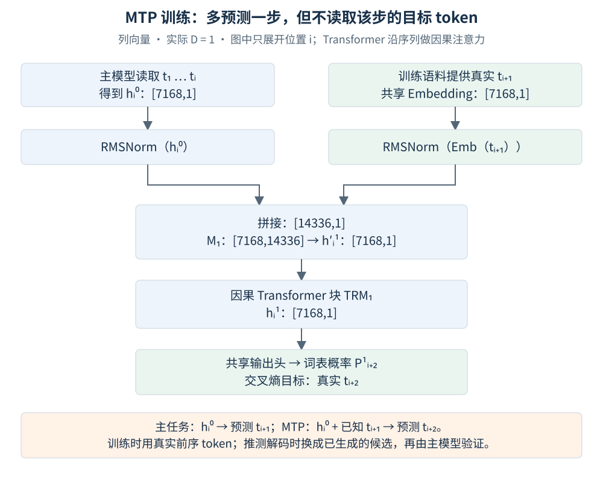
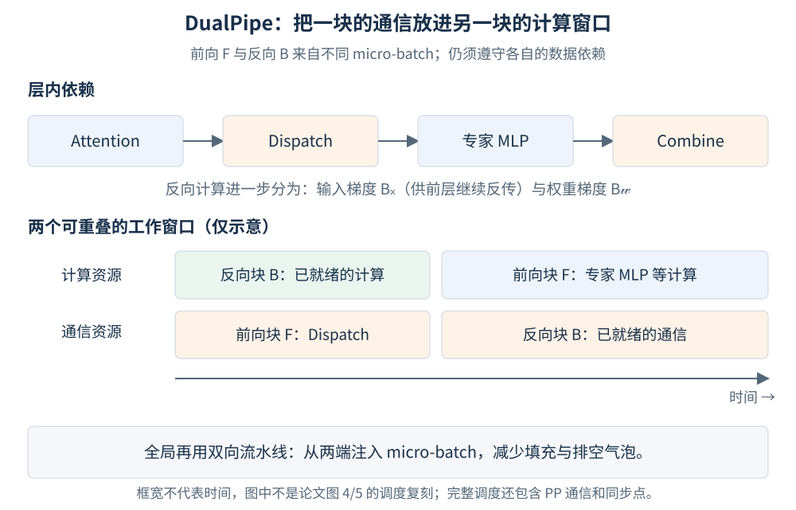
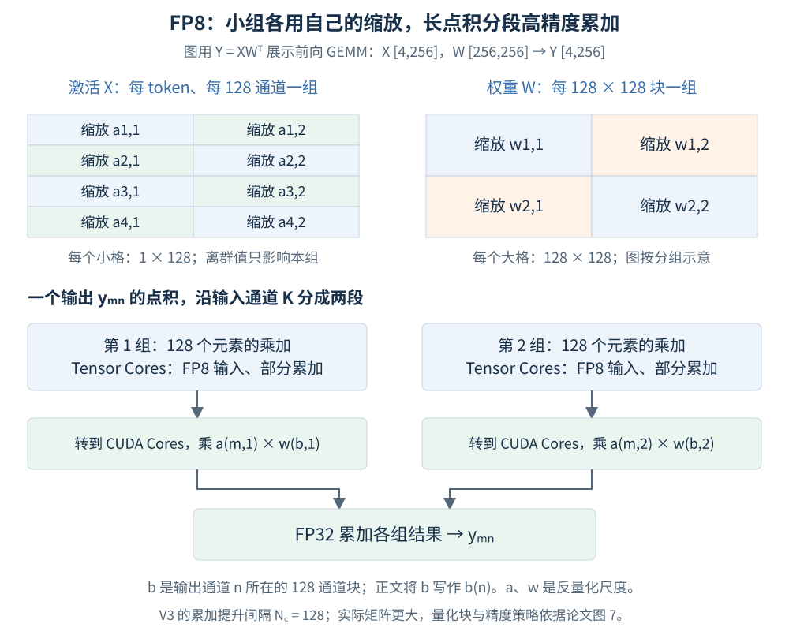
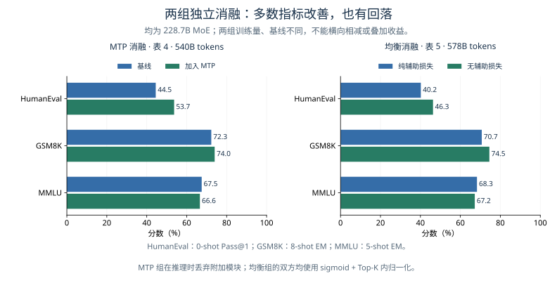

# DeepSeek-V3 论文学习笔记

> 论文：[DeepSeek-V3 Technical Report](https://arxiv.org/abs/2412.19437v2)，DeepSeek-AI。本文依据 **v2（2025-02-18）**，初版发表于 2024-12-27，讨论技术报告中的原版 V3。矩阵默认采用列向量；自绘图、教学数值和补充推导均在附近标明。

V3 要解决的是：**扩大 MoE 容量时，如何兼顾模型能力、专家负载和训练效率。** 它有 671B 总参数，每 token 激活约 37B；主干沿用 V2 的 MLA 与 DeepSeekMoE，重点改进专家均衡、训练目标和低精度训练。[§1、§4.2](https://arxiv.org/html/2412.19437v2#S4.SS2)

| 重点     | 论文具体做了什么                               | 与已有工作的关系                                                        |
| ---------- | ------------------------------------------------ | ------------------------------------------------------------------------- |
| 专家均衡 | 动态偏置调节路由，减轻强辅助损失对能力的影响   | 采用团队此前的 Auxiliary-Loss-Free 策略，并做规模化验证                 |
| MTP      | 串联预测模块，增加未来 token 的训练监督        | 多 token 预测已有先例；V3 保留逐步预测的因果链，共享 Embedding 与输出头 |
| FP8      | 细粒度量化、分段高精度累加，支持大规模稳定训练 | FP8 不是新格式，贡献在混合精度方案与验证                                |
| DualPipe | 重排前后向计算和通信，双向调度减少气泡         | 结合输入梯度／权重梯度拆分等已有思路，设计新的流水线调度                |

MLA 的联合压缩、矩阵吸收、解耦 RoPE 已在 [V2 笔记](./DeepSeek-V2.md) 展开，本文只保留理解 V3 必需的部分。[原文 §2–3](https://arxiv.org/html/2412.19437v2#S2)

## 1. 模型架构

|  |  |
| ------------------------------------------------------------------------------------------------------------- | ------------------------------------------------------------------------------------------------------------- |

*图 1｜依据[论文图 2、图 3 与 §4.2](https://arxiv.org/html/2412.19437v2#S4.SS2) 自绘的简化架构。蓝色是主模型，绿色是训练时的 MTP 分支；每个 Transformer 块包含归一化与残差。MTP 与主模型共享 Embedding、输出头，附加 Transformer 块有自己的参数。*

主干共 61 层，隐藏维度 $d=7168$。MLA 仍使用 128 个头、每头内容维度 128、KV 潜在维度 512、Q 潜在维度 1536，以及 64 维位置分支。每层每 token 缓存的是 **512 维 KV 潜在向量 + 64 维共享位置 K**，不是全部展开后的 K/V。[§2.1.1、§4.2](https://arxiv.org/html/2412.19437v2#S2.SS1.SSS1)

### 1.1 DeepSeekMoE

共享专家处理各类输入都需要的信息；路由专家按 token 选择，提供更大的参数容量。与 V2 相比，V3 更改了亲和度函数和权重归一化方式：

| 配置／机制              | V2                    | V3                     |
| ------------------------- | ----------------------- | ------------------------ |
| 共享专家／路由专家      | 2／160                | 1／256                 |
| 每 token 选择的路由专家 | 6                     | 8                      |
| 专家中间维度            | 1536                  | 2048                   |
| 稠密 FFN 层             | 第 1 层               | 前 3 层                |
| 亲和度                  | 全局 softmax          | 各专家独立 sigmoid     |
| 选中后的权重            | 保留全局 softmax 分数 | 在选中专家间再次归一化 |

配置来源：[V2 §3.1.2](https://arxiv.org/html/2405.04434v5#S3.SS1.SSS2)、[V3 §2.1.2、§4.2](https://arxiv.org/html/2412.19437v2#S2.SS1.SSS2)。

设 FFN 输入为 $u_t\in\mathbb R^d$，路由矩阵 $E\in\mathbb R^{N_r\times d}$，第 $i$ 行为 $e_i^\top$。用集合 $\mathcal S_t$ 表示选中的专家，将论文式 (12)–(15) 改写为：

$$
s_{i,t}=\sigma(e_i^\top u_t),\qquad
g_{i,t}=\frac{s_{i,t}\mathbf1\{i\in\mathcal S_t\}}
{\sum_{j\in\mathcal S_t}s_{j,t}},

$$

$$
h'_t=u_t+\sum_{i=1}^{N_s}\operatorname{FFN}^{(s)}_i(u_t)
+\sum_{i=1}^{N_r}g_{i,t}\operatorname{FFN}^{(r)}_i(u_t).

$$

其中 $N_s=1,N_r=256,K_r=|\mathcal S_t|=8$。路由打分的形状为 $[256,7168][7168,1]\to[256,1]$；每个专家的 SwiGLU 为 $7168\to2048\to7168$，上投影有两条支路。**1 个共享专家加 8 个路由专家同时参与；不是总共只执行 8 个专家。** 公式省略实现中的额外缩放。

### 1.2 无辅助损失负载均衡（Loss-Free Balancing）

#### 为什么把均衡从梯度里分出来

过载专家会拖慢整批计算，长期未被选中的专家又得不到充分训练。传统辅助损失能推动均衡，但权重过大时，会迫使路由器为了“平均分配”牺牲任务表现。

V3 为每个专家维护一个偏置：繁忙专家降低被选中的机会，空闲专家提高机会。**偏置只改变选择，不直接改变选中后的输出权重。**

*图 2｜依据[§2.1.2、式 (16)](https://arxiv.org/html/2412.19437v2#S2.SS1.SSS2) 自绘。橙色是偏置控制的选择分支，绿色是原始分数决定的权重分支；虚线传递选中集合或下一步反馈。下方“4 选 2”仅为教学数值，实际 V3 是“256 选 8”。*

**论文式 (16)，用专家索引表示：**

$$
\mathcal S_t=\operatorname{TopKIndex}_{i}(s_{i,t}+b_i,K_r).

$$

选中后仍代入上一节的 $g_{i,t}$，不把 $b_i$ 加进分子、分母。图中 C、D 被选中，其权重为 $0.4/(0.4+0.3)=4/7$、$3/7$，而非用 0.60、0.55 归一化。

论文在每个训练 step 结束后，依据**整个 batch** 的专家负载调节偏置。以下是对文字规则的补充数学表达，以 $n$ 表示训练步，避免与 token 下标 $t$ 混淆：

$$
b_i^{(n+1)}
=b_i^{(n)}+\gamma\,\operatorname{sign}
\left(\bar\ell^{(n)}-\ell_i^{(n)}\right),
\qquad
\bar\ell^{(n)}=\frac1{N_r}\sum_j\ell_j^{(n)}.

$$

$\ell_i^{(n)}$ 为专家实际接到的 token 分配数；过载减 $\gamma$，欠载加 $\gamma$。这是反馈更新，不是对 $b_i$ 做梯度下降。任务损失仍会通过被选中专家的权重训练路由器；“无辅助损失”不意味着路由器没有梯度。

V3 前 14.3T tokens 使用 $\gamma=0.001$，最后 500B tokens 设为 0。更新速度也需要控制，不能把偏置理解为每步都强制实现严格均衡的约束。[§4.2](https://arxiv.org/html/2412.19437v2#S4.SS2)

#### 仍保留序列级约束，也限制跨节点通信

V3 保留很小的**序列级辅助损失**，防止单条序列极端集中到少数专家。论文式 (17)–(20) 为：

$$
\mathcal L_{\rm Bal}=\alpha\sum_{i=1}^{N_r}f_iP_i,\qquad
f_i=\frac{N_r}{K_rT}\sum_{t=1}^{T}
\mathbf1\{i\in\operatorname{TopKIndex}_j(s_{j,t},K_r)\},

$$

$$
s'_{i,t}=\frac{s_{i,t}}{\sum_j s_{j,t}},\qquad
P_i=\frac1T\sum_{t=1}^{T}s'_{i,t}.

$$

$T$ 是单条序列长度，$\alpha=10^{-4}$。均匀分配时 $f_i\approx1,P_i\approx1/N_r$，故损失约为 $\alpha$（补充推导）。注意论文式 (18) 的统计采用**未加偏置的亲和度 Top-K**；不要把它直接改写成实际偏置路由的 $\mathcal S_t$。

通信方面，每 token 最多访问 **4 个节点**。选节点时，对每个节点上最高的 $K_r/M=8/4=2$ 个专家亲和度求和，再选择节点、限定专家候选范围。这里的节点是一台含 8 张 GPU 的服务器，不是一张 GPU。训练中配合均衡策略不做 token dropping；推理不丢 token 还依赖额外的部署均衡策略。[§2.1.2、§3.1、§4.2](https://arxiv.org/html/2412.19437v2#S2.SS1.SSS2)

**为什么 batch 级均衡可能更好？** 它允许一条代码序列集中使用代码专家，只要求整个 batch 的负载大致平衡，不强求每条序列“人人有份”。但不能把收益全归因于去掉辅助梯度：论文另做 batch 级辅助损失实验，在 1B、3B MoE 上得到与无辅助损失方法相同的验证损失，说明**均衡范围**本身也是关键因素。[§4.5.3](https://arxiv.org/html/2412.19437v2#S4.SS5.SSS3)

### 1.3 Multi-Token Prediction（MTP）

普通语言模型在位置 $i$ 主要受“预测 $t_{i+1}$”监督。MTP 让表示还要支持后续预测，增加训练信号。V3 并非在同一个表示上挂几个独立 Head：**后一深度接收前一深度表示，以及再向前一个 token 的 Embedding，串联保留因果链。**

#### 1.3.1 架构与因果关系

*图 3｜依据[论文图 3、式 (21)–(23)](https://arxiv.org/html/2412.19437v2#S2.SS2) 自绘，展示实际使用的 $D=1$。沿两条输入分支看：$h_i^0$ 汇总至 $t_i$，另一支加入真实 $t_{i+1}$，目标是尚未读到的 $t_{i+2}$。这不泄漏目标 token；也不表示推理时能提前拿到真实未来 token。*

一般情况下，第 $k$ 个模块的公式为：

$$
h_i^{\prime k}
=M_k\left[
\operatorname{RMSNorm}(h_i^{k-1});
\operatorname{RMSNorm}(\operatorname{Emb}(t_{i+k}))
\right],
\quad M_k\in\mathbb R^{d\times2d},

$$

$$
h_{1:T-k}^{k}=\operatorname{TRM}_k(h_{1:T-k}^{\prime k}),
\qquad
P_{i+k+1}^{k}=\operatorname{OutHead}(h_i^k)\in\mathbb R^{V}.

$$

$[\,;\,]$ 为纵向拼接，$V$ 为词表大小；$\operatorname{OutHead}$ 包含到词表的线性投影与 softmax。每个深度的 TRM 沿序列执行因果注意力，不是对每个 token 独立运行 MLP。MTP 的 Embedding、输出头与主模型共享，融合矩阵 $M_k$ 和 Transformer 块独立。

#### 1.3.2 训练目标

**论文式 (24)–(25)：**

$$
\mathcal L_{\rm MTP}^{k}
=-\frac1T\sum_{j=k+2}^{T+1}\log P_j^k[t_j],
\qquad
\mathcal L_{\rm MTP}=\frac{\lambda}{D}
\sum_{k=1}^{D}\mathcal L_{\rm MTP}^{k}.

$$

这里沿用论文的 $1/T$ 分母；有效目标有 $T-k$ 个，不改成按有效目标数求平均。主任务与附加任务共同优化，可概括为 $\mathcal L_{\rm NTP}+\mathcal L_{\rm MTP}$，另加上一节的小权重均衡项。

对实际 $D=1$，损失化为
$\mathcal L_{\rm MTP}=-(\lambda/T)\sum_{j=3}^{T+1}\log P_j^1[t_j]$。
附加损失经 $h_i^0$ 回传到主干，主模型表示因而同时受到下一步和更远一步的监督。这是补充的梯度路径解释。V3 前 10T tokens 取 $\lambda=0.3$，之后取 0.1。[§4.2](https://arxiv.org/html/2412.19437v2#S4.SS2)

#### 1.3.3 推理：可丢弃，也可用于推测解码

MTP 首先是训练目标。推理时删掉附加模块，主模型仍正常逐 token 生成；论文的 MTP 消融正是这样评测，所以比较双方的推理成本相同。

保留模块时，可以用它产生候选 token，再由主模型验证。报告在不同生成主题上观察到第二个 token 的接受率为 **85%–90%**，结合推测解码获得 **1.8 倍 TPS**。这是该实现的实测结果，不等于一次前向总能无条件输出两个 token，也不是接受率本身就能保证的加速倍数。[§2.2、§5.4.3](https://arxiv.org/html/2412.19437v2#S5.SS4.SSS3)

## 2. 训练 Infra

系统设计直接服务两个问题：MoE 的通信等待，以及 FP8 的数值误差。论文使用 2048 张 H800，16 路流水线并行、64 路专家并行和 ZeRO-1 数据并行；一组专家并行跨 8 个节点。[§3.1–3.2](https://arxiv.org/html/2412.19437v2#S3.SS2)

### 2.1 DualPipe：计算与通信重叠的流水线

跨节点专家并行需要先把 token 发给专家（Dispatch），再收回并合并输出（Combine）。论文指出其场景下计算与通信耗时约为 1:1；简单串行执行会让 GPU 花大量时间等待。

*图 4｜根据[§3.2.1、论文图 4–5](https://arxiv.org/html/2412.19437v2#S3.SS2.SSS1) 自绘的重叠示意。上方保留前向的数据依赖，下方显示两个不同 micro-batch 的工作如何共享时间窗口；框宽不是实测耗时，也不是完整 DualPipe 调度表。*

DualPipe 的关键是细分并重排工作：

1. 将 chunk 拆为 Attention、Dispatch、MLP、Combine，另处理流水线通信。
2. 反向的 Attention、MLP 再拆为输入梯度 $B_x$ 与权重梯度 $B_w$。前者决定前一层何时能继续反传，后者有更多调度余地。
3. 配对执行不同 micro-batch 的前向、反向 chunk，调整通信与计算使用的 SM 比例；全局从流水线两端注入 micro-batch，缩短填充和排空阶段。

双向指物理流水线的调度方向，不改变 Transformer 的层序或因果注意力。论文图 4 的调度可隐藏 All-to-All 和 PP 通信；这个结论依赖其计算通信比例与内核实现，不能泛化为任意配置下“通信为零”。

收益也有内存代价：按论文表 2 的比较口径，DualPipe 的参数内存为 1F1B 的 $2\times$，峰值激活项由 $PP$ 增至 $PP+1$，即相对增加 $1/PP$。它减少气泡，但不是零气泡、零额外内存的流水线。[表 2](https://arxiv.org/html/2412.19437v2#S3.T2)

### 2.2 FP8 混合精度训练

#### 用在哪些运算上

FP8 的难点不是单次乘法，而是离群值导致的量化误差，以及长点积累计的小误差。V3 让主要 Linear 的 Fprop、Dgrad、Wgrad GEMM 使用 FP8 输入；输出与敏感运算保留更高精度。

| 部分                                            | 论文精度策略             |
| ------------------------------------------------- | -------------------------- |
| 主要 Linear 的三类 GEMM 输入                    | FP8 E4M3                 |
| Embedding、输出头、路由、归一化、Attention 算子 | 保持 BF16／FP32 等原精度 |
| 主权重、用于 batch 累加的梯度                   | FP32                     |
| AdamW 一阶、二阶矩                              | BF16                     |

因此“FP8 训练”不是把所有张量都存成 8 bit，也不表示所有累加都在 FP8 中完成。[§3.3.1、§3.3.3](https://arxiv.org/html/2412.19437v2#S3.SS3.SSS1)

#### 小组缩放：不要让一个离群值影响整张矩阵

*图 5｜依据[§3.3.2、论文图 7](https://arxiv.org/html/2412.19437v2#S3.SS3.SSS2) 自绘。上方显示分组粒度，下方沿 GEMM 的内积维度看分段累加；矩阵总尺寸为教学示例，$1\times128$、$128\times128$ 与 $N_C=128$ 则是论文配置。图中 $a,w$ 均采用反量化尺度约定。*

激活按每 token 的 **$1\times128$** 通道分组，权重按 **$128\times128$** 分块，各组在线计算最大绝对值并确定缩放。离群值仍会影响本组，但不会决定整张张量的尺度。

**补充推导：缩放为什么必须进入分组累加？** 为方便展示 GEMM，将一批列向量转置后按行组成 $X\in\mathbb R^{N\times K}$，权重 $W\in\mathbb R^{O\times K}$，则 $Y=XW^\top$。采用反量化尺度 $a,w$，在输入通道组 $g$ 内写为：

$$
X_{m,g}\approx a_{m,g}\widehat X_{m,g},\qquad
W_{n,g}\approx w_{b(n),g}\widehat W_{n,g},

$$

$$
Y_{mn}=\sum_g X_{m,g}W_{n,g}^{\top}
\approx\sum_g a_{m,g}w_{b(n),g}
\left(\widehat X_{m,g}\widehat W_{n,g}^{\top}\right).

$$

$\widehat X,\widehat W$ 是 FP8 数值，$b(n)$ 是输出通道 $n$ 所在的 128 通道块。各组尺度不同，不能先把所有原始 FP8 点积加完，再只乘一个全局尺度。

#### 分段高精度累加：不让误差沿长点积积累

报告观察到 H800 Tensor Cores 的 FP8 GEMM 累加精度只保留约 14 bit，低于完整 FP32。V3 每累计 $N_C=128$ 个元素，就将部分结果提升到 CUDA Cores 的 FP32 寄存器，在那里应用分组尺度并继续高精度累加；调度上再让这一过程与其他 warpgroup 的 MMA 重叠。[§3.3.2](https://arxiv.org/html/2412.19437v2#S3.SS3.SSS2)

附录 B 在约 16B／230B MoE、分别训练 1.33T／约 0.9T tokens 的对照中，报告 FP8 与 BF16 的训练损失相对差异保持在 0.25% 以下。它验证的是这套完整方案，不是任意 FP8 算子的误差保证。相反，把 Dgrad 相关张量都改为 $128\times128$ 分块量化，会在约 16B 模型训练约 300B tokens 时发生发散。[附录 B、图 10](https://arxiv.org/html/2412.19437v2#A2)

## 3. 预训练

预训练使用 **14.8T tokens、4K 序列**，提高数学和代码数据比例，并扩大多语言覆盖。分词器采用 Byte-level BPE，但不是原样沿用 V2：词表扩至 128K，预分词与训练数据也有调整。[§4.1–4.2](https://arxiv.org/html/2412.19437v2#S4.SS1)

预训练之后用 YaRN 分两阶段扩展上下文：**4K → 32K → 128K**，每阶段训练 1000 步。图 8 的 NIAH 测试支持长文检索能力，不能据此推断所有 128K 长文任务都同样可靠。[§4.3、图 8](https://arxiv.org/html/2412.19437v2#S4.SS3)

| 训练阶段   | H800 GPU 小时 |
| ------------ | --------------: |
| 预训练     |     2,664,000 |
| 上下文扩展 |       119,000 |
| 后训练     |         5,000 |
| 合计       |     2,788,000 |

这是[论文表 1](https://arxiv.org/html/2412.19437v2#S1.T1) 的成本范围。按每 GPU 小时 2 美元估算为 557.6 万美元，**不包含前期研究、架构探索、算法与数据消融等成本**，也不是整个项目的总投入。成本来自稀疏激活、FP8、通信重叠与内存优化的共同作用，不能独立归给某一项。[§1](https://arxiv.org/html/2412.19437v2#S1)

## 4. 后训练

### 4.1 SFT：迁移推理模式，也控制回答长度

SFT 使用约 150 万条样本。推理数据并非简单把 R1 输出原样喂给 V3：报告使用**内部 DeepSeek-R1 模型**产生推理数据，再训练数学、代码等领域专家模型，通过 SFT 与 RL 融合原始回答和带反思、验证的推理模式，最后拒绝采样得到 V3 的训练数据。目标是在正确率、格式与长度之间取得平衡；非推理数据则由 V2.5 生成并经人工核验。[§5.1](https://arxiv.org/html/2412.19437v2#S5.SS1)

这个取舍有对照实验：在 **DeepSeek-V2.5** 上，R1 蒸馏使 MATH-500 从 74.6 提升至 83.2，平均回答长度从 769 增至 1510；这不是 V3 自身的模块消融。[§5.4.1、表 9](https://arxiv.org/html/2412.19437v2#S5.SS4.SSS1)

### 4.2 RL：可验证任务用规则，开放任务用奖励模型

数学答案和代码测试等可验证任务使用规则奖励；开放式回答使用模型奖励。GRPO 沿用此前工作，用同一问题的一组回答计算奖励基线，不再训练独立 critic：

$$
A_i=\frac{r_i-\operatorname{mean}(r_1,\ldots,r_G)}
{\operatorname{std}(r_1,\ldots,r_G)}.

$$

这是论文式 (28)。优势 $A_i$ 决定鼓励或抑制哪条回答，策略更新仍包含概率比裁剪与参考策略 KL 项；GRPO 不是 V3 新提出的算法。完整目标见[§5.2、式 (26)–(28)](https://arxiv.org/html/2412.19437v2#S5.SS2)。

## 5. 实验：哪些结果能支持哪些结论

### 5.1 先看新增方法的消融

*图 6｜根据[表 4](https://arxiv.org/html/2412.19437v2#S4.T4)和[表 5](https://arxiv.org/html/2412.19437v2#S4.T5)数据重新绘制。两组都是 228.7B MoE，但基线与训练量不同，只在各自图内比较。选取代码、数学、知识三项，保留 MMLU 回落，避免只展示提升项。*

- **MTP 对照**：数据和其余架构相同，训练时增加一个预测模块；评测时丢弃，因此推理参数与成本相同，但不能说训练成本相同。大模型 HumanEval 提高 9.2 个百分点，MMLU 下降 0.9 个百分点。
- **均衡对照**：双方都用 sigmoid 和 Top-K 内归一化，区别在均衡策略；实验组去掉所有辅助损失。正式 V3 仍有小权重序列级项，所以不能把该消融描述成与最终训练配置完全相同。

两者支持“多数指标改善”，不支持“所有任务都提高”。均衡实验还需结合 §4.5.3 的 batch 级辅助损失对照理解，不能只归因于有没有辅助梯度。

### 5.2 再看完整模型

以下只列几项有代表性的结果；整体差异同时包含模型规模、数据和训练方案的变化。

| 评测              |                     比较基线 |   V3 | 条件与来源                |
| ------------------- | -----------------------------: | -----: | --------------------------- |
| Base MMLU         |         LLaMA-3.1 405B：84.4 | 87.1 | 5-shot，表 3              |
| Base HumanEval    |         LLaMA-3.1 405B：54.9 | 65.2 | 0-shot Pass@1，表 3       |
| Base MATH         |         LLaMA-3.1 405B：49.0 | 61.6 | 4-shot EM，表 3           |
| Chat MATH-500     | Claude-3.5-Sonnet-1022：78.3 | 90.2 | 表 6，同一评测输出上限 8K |
| Chat GPQA-Diamond | Claude-3.5-Sonnet-1022：65.0 | 59.1 | 表 6，Pass@1              |

[表 3](https://arxiv.org/html/2412.19437v2#S4.T3)在内部统一评测框架下比较基座模型；[表 6](https://arxiv.org/html/2412.19437v2#S5.T6)比较后训练模型，少于 1000 样本的基准使用多次测试。两类模型、两套条件不能混成一个榜单。V3 在数学、代码方面表现突出，但并非每项都领先。

## 6. 容易混淆的几点

- **Loss-Free 不等于整个训练没有均衡损失**：动态偏置承担 batch 级均衡，小权重辅助项限制单序列极端失衡。
- **MTP 不等于几个独立输出头，也不保证一次生成多个正确 token**：V3 串联模块、共享输出头；推理可丢弃模块，也可用候选验证加速。
- **FP8 不等于全链路 8 bit**：分组尺度、高精度累加和敏感算子保留精度，是方案成立的条件。
- **37B 激活参数不等于 37B 总权重**：它描述每 token 的稀疏计算；671B 模型仍需存放全部权重。
- **整体效率与模块收益分开读**：DualPipe 和 FP8 有各自的验证，完整训练成本不能当成单个模块的加速比。

图解资源在 [images/DeepSeek-V3](./images/DeepSeek-V3/)：架构图保留 [Mermaid 源码](./images/DeepSeek-V3/overview.mmd)，其余图由 [build_figures.py](./images/DeepSeek-V3/build_figures.py) 生成。本文参考 [DS-V3.md](./DS-V3.md) 的大纲、V2/V3 对照和图示线索，并按原论文核实补全；图解均重新绘制为中文 SVG。
