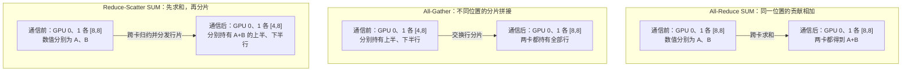

# 分布式并行基础：先看切什么，再看传什么

一张 GPU 放不下模型，或训练速度不够快时，需要让多张 GPU 合作。合作的关键不是把程序多启动几遍，而是明确三件事：**数据怎么分、参数放哪里、计算结果怎样合并**。

本组文档以稠密 Transformer 训练为主，按“基础 → DP → TP → PP → SPTD”展开。数值均为教学示例，不对应某个商业模型；涉及性能的比例均说明成立条件。

## 1. 从一次单卡训练开始

一次训练迭代包含：前向计算、计算损失、反向求梯度、优化器更新。以一个微批次、无偏置线性层为例，$b$ 为样本数，$S$ 为序列长度，$d$ 和 $f$ 分别为输入、输出宽度。约定数学权重按“输入维 × 输出维”存储。

| 步骤          | 运算与尺寸                            | 数值示例                 |
| ------------- | ------------------------------------- | ------------------------ |
| 输入          | $X:[b,S,d]$                         | $[2,4,8]$              |
| 展平 token 维 | $[b,S,d]\to[T,d]$，$T=bS$         | $[2,4,8]\to[8,8]$      |
| 前向          | $Y=XW:[T,d][d,f]\to[T,f]$           | $[8,8][8,16]\to[8,16]$ |
| 上游梯度      | $G_Y=\partial L/\partial Y:[T,f]$   | $[8,16]$               |
| 权重梯度      | $G_W=X^\top G_Y:[d,T][T,f]\to[d,f]$ | $[8,8][8,16]\to[8,16]$ |
| 输入梯度      | $G_X=G_YW^\top:[T,f][f,d]\to[T,d]$  | $[8,16][16,8]\to[8,8]$ |
| SGD 更新      | $W\leftarrow W-\eta G_W$，尺寸不变  | $[8,16]$               |

$L$ 为标量损失，$\eta$ 为学习率。展平只是把不同 token 排成行；注意力计算仍须恢复样本与序列边界。

由此可见，训练显存至少包含参数、梯度、优化器状态、保存的激活，以及临时工作区。**参数能放下，不等于训练能跑起来。**

## 2. 五篇共用的符号

| 符号        | 含义                                        |
| ----------- | ------------------------------------------- |
| $b$       | 一个模型副本每次处理的微批次样本数          |
| $m$       | 一次优化器更新累积的微批次数                |
| $D,P,t,C$ | DP、PP、TP、CP 的并行度                     |
| $S,d,f$   | 序列长度、隐藏维度、FFN 中间维度            |
| $n,d_h$   | 注意力头数、每头维度，标准 MHA 中$d=nd_h$ |
| $T=bS$    | 一个微批次的 token 数                       |
| $N,q$     | 参数元素数、所讨论张量每个元素的字节数      |

TP 篇沿用 $B=b$、$p=t$ 的记号；其中 $B$ 是微批次大小，不是全局 batch。$G_A=\partial L/\partial A$ 表示张量 $A$ 的梯度，形状与 $A$ 相同。形状表中，相邻方括号表示矩阵乘法，`@` 表示按最后两维进行的批量矩阵乘法。

在各副本、各微批次大小相等的条件下，一次优化器更新处理的样本数为：

$$
B_{\mathrm{global}}=Dmb.
$$

例如 $D=4,m=8,b=2$，一次更新处理 64 个样本。TP 和 PP 合作处理同一批样本，不能再乘入全局 batch；CP 切的是同一样本的序列，也不能再乘。若采样器补齐了重复样本，该式统计的是样本出现次数，不保证都是不同样本。

## 3. 不同并行方式切什么

| 方式        | 切分对象           | 单卡负责什么                      | 主要通信                                | 主要用途               |
| ----------- | ------------------ | --------------------------------- | --------------------------------------- | ---------------------- |
| 普通 DP     | 样本维             | 完整模型、不同样本                | 参数梯度归约                            | 提升吞吐               |
| TP          | 层内特征或注意力头 | 同一层的一部分权重与计算          | 激活及其梯度的集合通信                  | 分摊层内计算与存储     |
| PP          | 网络层             | 连续的一段模型                    | 相邻阶段发送激活及其梯度                | 分摊模型深度           |
| Megatron SP | 部分算子的序列维   | LayerNorm、Dropout 等的局部 token | 与 TP 配合的 All-Gather、Reduce-Scatter | 减少重复激活           |
| CP          | 长序列维           | 同一样本的一段上下文              | K/V 及相应梯度交换                      | 分摊长上下文计算与激活 |

SP 在不同论文中有不同含义。本组文档用“Megatron SP”指与 TP 配合的激活分片；将注意力中的上下文切分单独称为 CP，避免把两者混为一谈。参见 [Megatron 并行策略指南](https://docs.nvidia.com/megatron-core/developer-guide/latest/user-guide/parallelism-guide.html)。

ZeRO、FSDP 属于分片数据并行：它们让不同数据副本分摊模型状态。ZeRO-1/2 保留完整参数，分别分片优化器状态、优化器状态与梯度；ZeRO-3 和 FSDP 全分片模式才进一步分片参数。后两者通常在计算某个单元前汇集其参数，TP 则直接使用权重分片计算局部结果。

## 4. 四种通信原语：先判断数值含义

以下用两卡通信组举例，形状均为每卡视角；All-Gather 和 Reduce-Scatter 均沿第一个轴分片。

| 操作               | 输入 → 输出尺寸                        | 数值含义                                 |
| ------------------ | --------------------------------------- | ---------------------------------------- |
| All-Reduce SUM     | $[8,8]\to[8,8]$                       | 两卡同一位置的贡献求和，每卡得到相同结果 |
| All-Gather         | $[4,8]\to[8,8]$                       | 收集不同位置的数据，沿指定维拼接         |
| Reduce-Scatter SUM | $[8,8]\to[4,8]$                       | 先按位置求和，再把结果分片分发           |
| Send/Recv          | 发送端$[2,4,8]$ → 接收端 $[2,4,8]$ | 点对点搬运，不做求和                     |

还会遇到 Broadcast（把同一份数据发给全组）和 All-to-All（每卡向每个对端发送不同分块）。所有集合通信都只在指定的**通信组**内发生，并非默认全世界所有 GPU 都参与。

形状相同不保证数值含义相同。例如 TP 行并行中，各卡输出都是 $[T,d]$，但数值只是部分贡献，必须求和；DP 的局部梯度也是完整形状，却对应不同样本，通常需要求平均。

*图 0-1：三种集合通信的尺寸对照。All-Reduce 改变数值、不改变形状；另外两种还改变每卡持有的范围。图中 A、B 是张量名。后文图示均用方括号标注尺寸，集合通信框表示参与卡的协作，不代表额外的中心服务器。Mermaid 图需在支持 Mermaid 的 Markdown 阅读器中查看。*

## 5. 显存账：区分模型状态与激活

假设一种混合精度 Adam 实现使用低精度参数 2 字节、低精度梯度 2 字节、FP32 主参数 4 字节，以及两个 FP32 动量各 4 字节，则模型状态约为：

$$
M_{\mathrm{state}}\approx N(2+2+4+4+4)=16N\text{ 字节}.
$$

这只是指定精度配置下的估算；若梯度使用 FP32，或实现不保留主参数，结果会变化。它不包含激活、通信缓冲和内存碎片。

一个 $[b,S,d]$ 激活占 $bSdq$ 字节。例如 BF16 的 $[2,4096,4096]$ 张量约占 64 MiB。若序列长度翻倍，这个张量的容量翻倍；若显式保存注意力分数 $[b,n,S,S]$，其容量则变为四倍。FlashAttention 可避免完整保存分数矩阵，不能据逻辑形状直接推断实际峰值显存。

## 6. 速度账：分摊计算也会增加等待

训练一步的耗时可以粗略拆为：

$$
\tau_{\mathrm{step}}\approx\tau_{\mathrm{compute}}+\tau_{\mathrm{exposed\ comm}}+\tau_{\mathrm{idle}}.
$$

其中 $\tau$ 表示时间，避免与 TP 并行度 $t$ 混淆；exposed communication 指未被计算覆盖的通信，idle 指气泡和负载不均造成的其余等待，两者不重复计数。

增加卡数时，先观察以下指标：

- **吞吐**：每秒处理的有效 token 数，避免把 padding 当成有效工作。
- **峰值显存**：训练过程中真正的峰值，而非刚加载模型时的占用。
- **扩展效率**：相同工作量下，$k$ 卡加速比除以 $k$；改变 batch 的实验须另行说明。
- **训练质量**：吞吐增加不能代替验证集损失和收敛检查。

一般先把频繁通信的 TP 放在高速互联域内，再评估 PP 和 DP 的跨节点布局。具体布局应由硬件拓扑与测量决定，不能直接假定“卡数翻倍，速度翻倍”。

## 7. 阅读路线与资料

1. [DP 数据并行详解](./1-DP数据并行详解.md)：理解梯度平均、梯度累积和 ZeRO。
2. [TP 张量并行详解](./2-TP张量并行详解_矩阵尺寸逐步拆解.md)：逐步推导列并行、行并行及注意力尺寸。
3. [Pipeline 流水线并行详解](./3-Pipline流水线并行详解.md)：理解阶段边界、微批次和气泡。
4. [SPTD 并行详解](./4-SPTD并行详解.md)：把通信组与张量布局串起来。

本章根据本仓库 [分布式并行基础](../../../04Train/01ParallelBegin/README.md)、[SPTD](../../../04Train/01ParallelBegin/02SPTD.md) 与 [CP](../../../04Train/01ParallelBegin/03CP.md) 整理。工程细节可查 [PyTorch DDP](https://docs.pytorch.org/docs/stable/generated/torch.nn.parallel.DistributedDataParallel.html)、[DeepSpeed ZeRO](https://www.deepspeed.ai/tutorials/zero/)。
