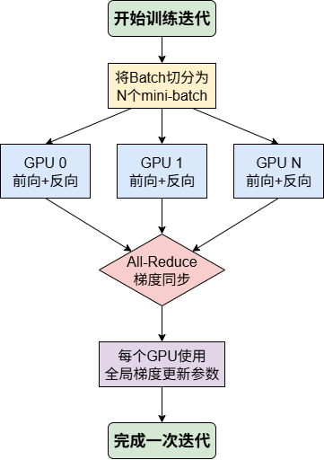
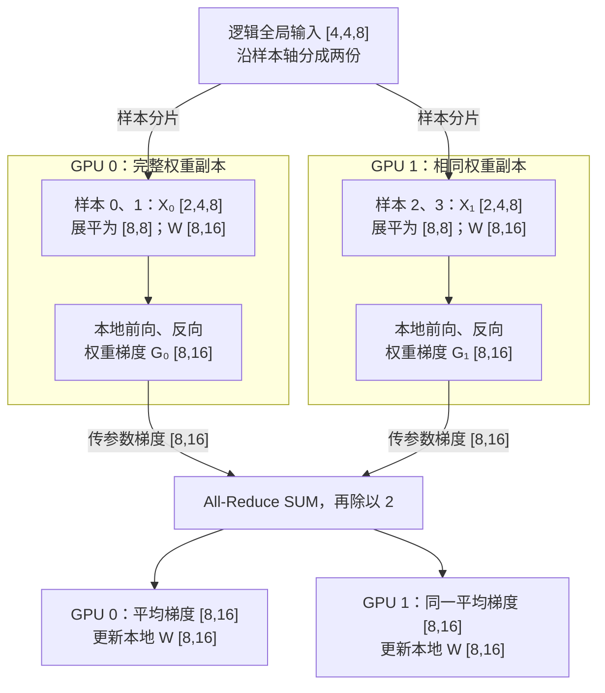

# DP 数据并行详解：各算一批数据，共同更新模型

数据并行（Data Parallelism，DP）的基本做法是：复制模型、划分样本、同步梯度。不同 GPU 计算同一组参数在不同数据上的梯度，再形成共同的更新方向。

本文先讨论同步、复制式 DP，再介绍 ZeRO。PyTorch 的 `DataParallel` 和 `DistributedDataParallel`（DDP）是具体实现，不能与 DP 这个算法类别混为一谈。多 GPU 训练通常采用一进程一 GPU 的 DDP。本文沿用[基础篇](./0-分布式并行基础.md)的记号：$D$ 为 DP 并行度，$b$ 为每卡微批次大小，$m$ 为累积步数。

## 1. 一次迭代发生什么



*图 1-1：本仓库 SPTD 章节的 DP 流程图。图中 GPU 标号为概念示意；若有 D 张卡，本文统一编号为 0 至 D−1。*

初始化后，各卡持有相同参数。随后，各卡读取不同样本，完成前向和反向；DDP 在反向过程中同步参数梯度；各卡再用相同梯度和一致的优化器状态执行更新。[PyTorch DDP 文档](https://docs.pytorch.org/docs/stable/generated/torch.nn.parallel.DistributedDataParallel.html) 明确说明：DDP 不自动切分输入，需要数据采样器或训练代码负责分片。

普通 DP 中，每卡保存完整参数、梯度和优化器状态。因此，它能分摊数据计算，却不能直接解决“模型状态本身放不下”的问题。

## 2. 两卡线性层：每一步的尺寸

设 $D=2$，每卡 $b=2$ 个样本，序列长度 $S=4$，输入维度 $d=8$，输出维度 $f=16$，暂不累积梯度。全局 batch 为 4。


| 步骤         | 全局或局部尺寸                          | 含义                               |
| -------------- | ----------------------------------------- | ------------------------------------ |
| 全局输入     | $[Db,S,d]=[4,4,8]$                      | 数学上描述全部样本，不要求集中存储 |
| 按样本切分   | $X_r:[b,S,d]=[2,4,8]$                   | 两卡样本不同，序列保持完整         |
| 本地展平     | $[2,4,8]\to[8,8]$                       | 本地 token 数$T=bS=8$              |
| 本地权重     | $W:[d,f]=[8,16]$                        | 两卡参数数值一致                   |
| 前向         | $X_rW:[8,8][8,16]\to[8,16]$             | 独立计算本卡结果                   |
| 输出梯度     | $G_{Y_r}:[8,16]$                        | 来自本卡标量损失                   |
| 权重梯度     | $X_r^\top G_{Y_r}:[8,8][8,16]\to[8,16]$ | 每卡得到完整权重形状的局部梯度     |
| 输入梯度     | $G_{Y_r}W^\top:[8,16][16,8]\to[8,8]$    | 用于本卡更早层的反向计算           |
| 同步权重梯度 | $[8,16]\to[8,16]$                       | 数值变为全局平均，形状不变         |
| 更新权重     | $[8,16]\to[8,16]$                       | 各卡执行同一更新                   |

DP 通常不汇集上述中间激活或输入梯度，因为各卡处理不同样本；要同步的是同一参数对应的梯度。统计全局 loss 属于日志通信，不能代替梯度同步。



*图 1-2：DP 切样本，保留相同的完整权重；跨卡同步的是权重梯度。这里假设两卡损失等权，DDP 默认已完成平均，代码无需再除以 2。顶部是逻辑划分，实际可由各进程的数据加载器直接读取自己的样本。*

## 3. 为什么梯度平均成立

设第 $r$ 张卡的本地平均损失为 $L_r$。若每卡样本数相同、各样本权重一致，则：

$$
L=\frac1D\sum_{r=0}^{D-1}L_r,
\qquad
\nabla_W L=\frac1D\sum_{r=0}^{D-1}\nabla_W L_r.

$$

因此可先各自反向，再平均梯度。通信库的 SUM 归约本身只求和；“求平均”由训练框架的缩放语义完成。默认 DDP 已进行相应平均，不应在其结果上再除一次 $D$。

例如两个 $[1,2]$ 梯度分别为 $[2,4]$ 和 $[6,8]$，同步后得到 $[4,6]$，尺寸仍是 $[1,2]$。

**等权平均有前提。**若两卡有效 token 数分别为 $u_0,u_1$，而各自损失已按本地 token 求均值，正确的全局梯度为：

$$
g=\frac{u_0g_0+u_1g_1}{u_0+u_1}.

$$

这里 $g_r=\nabla_W L_r$，与 $W$ 同形状；$u_r$ 是标量计数。简单计算 $(g_0+g_1)/2$ 会让有效 token 较少的卡权重过大。处理 padding、变长序列或不完整累积窗口时，应按全局有效 token 数统一归一化。

## 4. 梯度累积：一次更新可以分几次算

显存限制了每卡微批次大小 $b$，但一次更新可以累积 $m$ 个微批次：

$$
B_{\mathrm{global}}=Dmb.

$$

例如 $D=2,b=2,m=4$，全局 batch 为 16。若以全局 token 均值为目标，缩放时还需结合上一节的有效 token 计数。各微批次的激活在反向后可释放，参数梯度则持续累加；权重在这 4 次计算期间不更新。

以下是**训练循环片段**，假定 DDP 已初始化、每个窗口恰有 $m$ 批，所有 rank 的步数与每批有效元素数相同：

```python
from contextlib import nullcontext

optimizer.zero_grad(set_to_none=True)
for i, (x, target) in enumerate(window):  # len(window) == m
    context = ddp.no_sync() if i < m - 1 else nullcontext()
    with context:  # 前向和反向都必须放在 no_sync 范围内
        prediction = ddp(x)             # [b, S, d] -> [b, S, f]
        loss = criterion(prediction, target) / m  # criterion 返回均值标量
        loss.backward()
optimizer.step()
```

前 $m-1$ 次省去梯度同步，最后一次同步累积梯度。若不除以 $m$，累计的是微批次均值之和，会改变更新尺度。若窗口不足 $m$ 批或有效 token 数不同，应按实际总权重归一化，不能照抄 `/ m`。

## 5. 通信为何能与反向重叠

DDP 通常把参数梯度组织成桶（bucket）。一桶梯度就绪后可启动归约，同时继续计算更早层的梯度。一次迭代不是必然“全部反向结束后，只调用一次 All-Reduce”。

若一桶梯度大小为 $M$ 字节，理想 ring All-Reduce 的每卡发送量约为：

$$
2\frac{D-1}{D}M.

$$

接收量同阶；该式不包含协议开销，也不等于整个集群总流量。小桶能更早启动通信，却增加调用与延迟成本；大桶降低调用频率，却可能延后通信。实际效果应通过 profiler 检查未被覆盖的等待时间。

## 6. ZeRO：逐步消除模型状态的重复存储

[DeepSpeed ZeRO](https://www.deepspeed.ai/tutorials/zero/) 将分片分为三个阶段。下表沿用基础篇的示例精度：参数 2 字节、梯度 2 字节，主参数及两个动量共 12 字节；$N$ 为参数元素数。


| 方式    | 分片对象                   | 每卡常驻模型状态估算 |
| --------- | ---------------------------- | ---------------------- |
| 普通 DP | 无                         | $16N$ 字节           |
| ZeRO-1  | 优化器状态（含本例主参数） | $4N+12N/D$ 字节      |
| ZeRO-2  | 再分片梯度                 | $2N+14N/D$ 字节      |
| ZeRO-3  | 再分片参数                 | $16N/D$ 字节         |

这些式子描述理想常驻状态，不是峰值显存预测。ZeRO-3 计算时仍需汇集当前计算单元的参数，并使用激活和通信缓冲；FSDP 的全分片模式也采用类似的按需汇集思路。

以一个数学权重 $W:[8,16]$ 为例，共 128 个元素，在两卡中按展平后的元素分片：

1. 常驻分片：每卡 $[64]$，不保证对应矩阵的完整行或列。
2. 参数 All-Gather：每卡 $[64]\to[128]$，再恢复为 $[8,16]$。
3. 本地前向：本卡输入 $[8,8]$ 乘完整权重 $[8,16]$，得到 $[8,16]$。
4. 本地权重梯度：$[8,8]^\top[8,16]\to[8,16]$，展平为 $[128]$。
5. 梯度 Reduce-Scatter 并按目标损失缩放：$[128]\to[64]$，每卡只更新自己负责的状态分片。

步骤 2～5 描述 ZeRO-3 的简化计算流程；ZeRO-1/2 不需要按此方式汇集完整权重。参数何时释放、反向前是否再次汇集，取决于具体实现与配置。与 TP 相比，这里的单次矩阵计算使用汇集后的完整权重，而不是直接乘局部权重分片。

## 7. 实践中最容易遗漏的检查


| 问题                     | 原因与处理                                                    |
| -------------------------- | --------------------------------------------------------------- |
| 多卡读到相同数据         | DDP 不代替 sampler；检查样本索引分片                          |
| 每个 epoch 洗牌顺序相同  | 使用 DistributedSampler 时调用`sampler.set_epoch(epoch)`      |
| 最后一批梯度尺度异常     | 检查每卡样本数、有效 token 数和实际累积步数                   |
| 训练阻塞                 | 检查各 rank 是否以相同顺序参与集合通信，是否有某卡提前退出    |
| 参数更新逐渐不一致       | 检查初始化、优化器状态、更新次数和未同步的分支                |
| 多卡结果与单卡不完全一致 | 先排除归一化错误，再检查随机数、浮点归约顺序与 BatchNorm 语义 |

DistributedSampler 为等长分片可能补齐重复样本，也可以配置丢弃尾部；评估时尤其要处理重复计数。普通 DDP 不自动把 BatchNorm 的局部统计变为全局统计。

## 8. 本章要点与延伸

普通 DP 的关键是对**同一参数、不同数据**的梯度正确加权。它适合扩展吞吐；模型状态超出显存时，再考虑分片数据并行或模型并行。

- 本地实践：[从零构建 PyTorch DDP](../../../04Train/01ParallelBegin/Code01DDP.md)。本文图 1-1 来自 [SPTD 原章节](../../../04Train/01ParallelBegin/02SPTD.md)，原图版权归原作者，沿用仓库许可。
- 实现细节：[DDP 设计说明](https://docs.pytorch.org/docs/stable/notes/ddp.html)。
- 下一章：[TP 张量并行的逐步尺寸推导](./2-TP张量并行详解_矩阵尺寸逐步拆解.md)。
