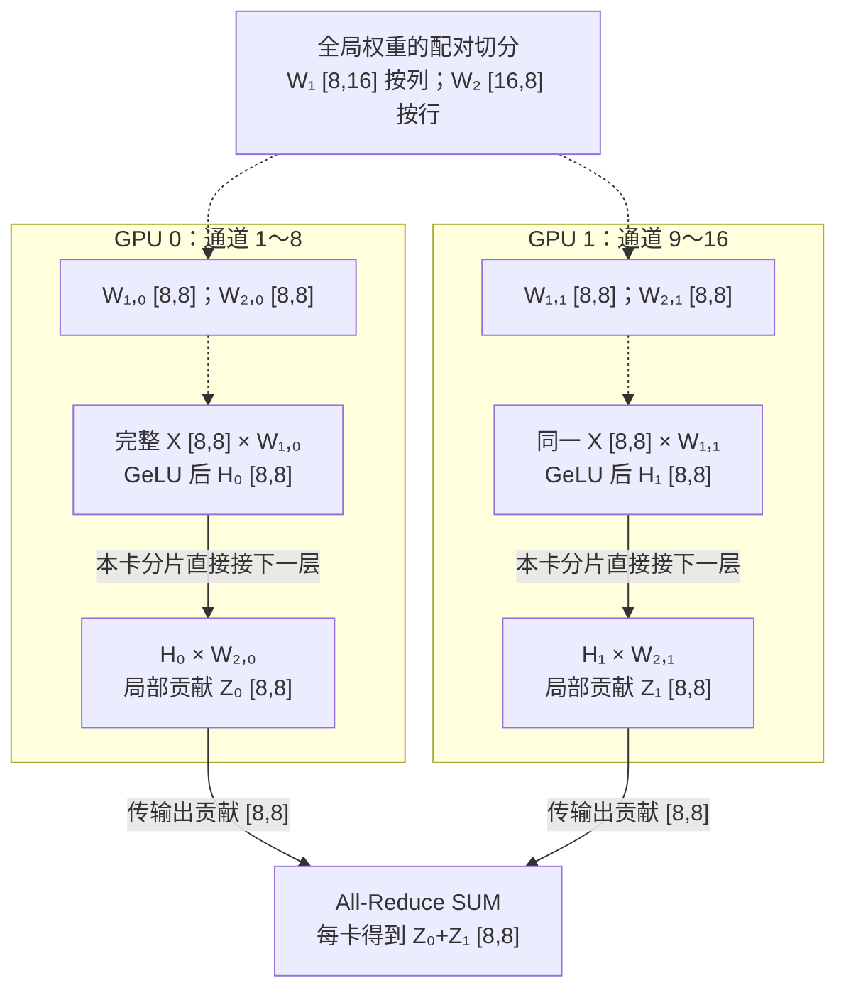
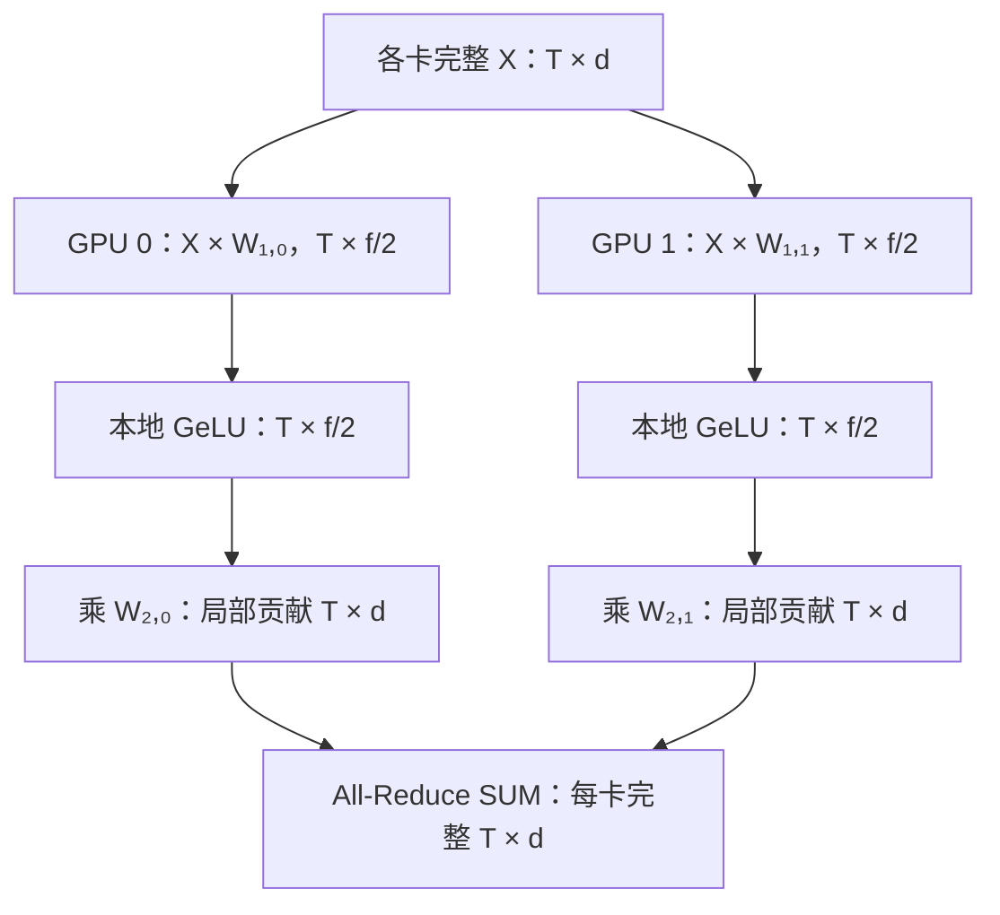
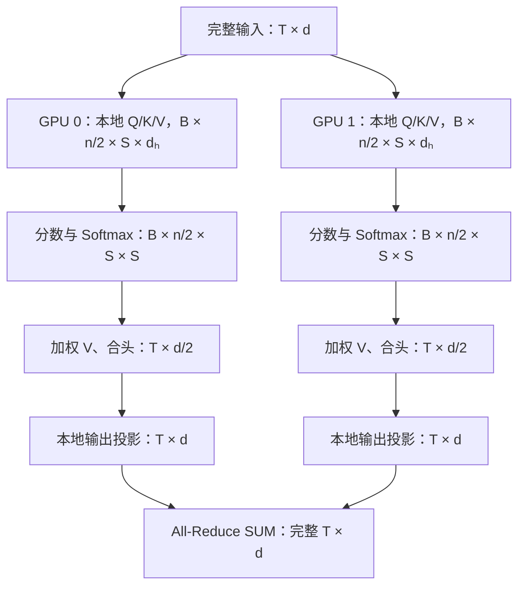

# 张量并行（TP）详解：从矩阵切分到 Transformer 的逐步尺寸推导

> 核心思路：多张 GPU 合作计算同一层、同一批数据。列并行产生“不同输出特征的完整结果”，行并行产生“全部输出特征的部分贡献”。Megatron 将两者配对，避免中间激活跨卡汇集。
>
> 本文从矩阵乘法出发推导 TP，并参考文末 Megatron 原始资料。数值示例用于教学，不代表特定模型配置。

## 1. 讨论范围与符号约定

### 1.1 基本假设

- 第 1～14 节讨论基础一维 Megatron TP，不叠加序列并行（SP）、上下文并行（CP）或流水线并行（PP）；第 15～17 节介绍扩展与组合。
- 先讨论无偏置、无 dropout 的两层 GeLU FFN 和标准多头注意力（MHA）。偏置、残差与归一化另行说明。
- TP 组内各 GPU 处理相同样本。模块输入已在各卡复制；这一前提不代表初始数据分发永远免费。
- 所需分片维度能够被 TP 大小整除。MHA 示例按完整注意力头分配，每个头的维度不再切分。
- 线性层统一写为 $Y=XW$，权重的数学形状为“输入维度 × 输出维度”。
- “全局张量”描述逻辑上完整的张量，不意味着它一定在某张 GPU 上被实际构造。

### 1.2 统一符号与主示例

| 符号        | 含义                        | 主示例         |
| ----------- | --------------------------- | -------------- |
| $B$       | TP 组处理的 batch size      | $2$          |
| $S$       | 每个样本的序列长度          | $4$          |
| $T=BS$    | 线性层展平后的 token 数     | $8$          |
| $d$       | 模型隐藏维度                | $8$          |
| $f$       | FFN 中间维度                | $16$         |
| $n$       | MHA 注意力头数              | $4$          |
| $d_h=d/n$ | 每个注意力头的维度          | $2$          |
| $p$       | TP 组内 GPU 数量            | $2$          |
| $r$       | TP rank，取$0,\ldots,p-1$ | $0$ 或 $1$ |
| $n_r=n/p$ | 每卡负责的注意力头数        | $2$          |

与[基础篇](./0-分布式并行基础.md)对应，本章 $B=b$ 表示微批次大小、$p=t$ 表示 TP 并行度；$B$ 不是全局 batch。

线性层可将输入从 $[B,S,d]=[2,4,8]$ 展平为 $[T,d]=[8,8]$，因为它逐 token 作用于最后一维。注意力计算必须恢复 batch 与序列边界，不能让不同样本的 token 互相注意。

### 1.3 三种数据状态

| 状态       | 每卡保存什么             | 示例                | 恢复完整结果的方式                  |
| ---------- | ------------------------ | ------------------- | ----------------------------------- |
| 完整复制   | 同一份完整张量           | 每卡输入$X:[T,d]$ | 无需恢复                            |
| 特征分片   | 不同特征位置上的完整数值 | $H_r:[T,f/p]$     | 若需要完整副本，按特征维 All-Gather |
| 待求和贡献 | 完整形状上的部分数值贡献 | $Z_r:[T,d]$       | All-Reduce SUM                      |

**形状完整不代表数值完整。**行并行输出的尺寸与最终输出相同，但每个元素还需要累加其他卡的贡献。

## 2. TP 与 DP、PP 的区别

| 方式    | 权重分配         | 数据与计算分配         | 直观理解             |
| ------- | ---------------- | ---------------------- | -------------------- |
| 普通 DP | 每卡完整模型     | 各卡处理不同样本       | 多人各做一份完整作业 |
| PP      | 不同卡负责不同层 | 数据依次经过不同阶段   | 多人依次完成不同工序 |
| TP      | 同一层的权重分片 | 各卡协作处理同一批样本 | 多人合算一道大题     |

这里的 DP 指普通复制式数据并行；FSDP、ZeRO 等分片数据并行还会切分模型状态。TP 不要求一定等到“单层放不下”才使用，也可用于分摊计算与权重存储。

## 3. 线性层基础：矩阵乘法如何决定切分方式

设：

$$
X\in\mathbb{R}^{T\times d_{\mathrm{in}}},\qquad
W\in\mathbb{R}^{d_{\mathrm{in}}\times d_{\mathrm{out}}}.
$$

则：

$$
Y=XW\in\mathbb{R}^{T\times d_{\mathrm{out}}}.
$$

单个输出元素为：

$$
Y_{t,j}=\sum_{k=1}^{d_{\mathrm{in}}}X_{t,k}W_{k,j}.
$$

- 切输出索引 $j$：不同 GPU 负责不同的答案，对应列并行。
- 切求和索引 $k$：不同 GPU 负责同一答案的不同加数，对应行并行。
- token 维度 $T$ 在以下两种 TP 中都保持不变。

## 4. 列并行：切输出特征，结果按列拼接

### 4.1 步骤一：按列切权重

$$
W=[W_0\mid W_1\mid\cdots\mid W_{p-1}],\qquad
W_r\in\mathbb{R}^{d_{\mathrm{in}}\times(d_{\mathrm{out}}/p)}.
$$

每张 GPU 保存不同的输出列，但保留这些列所需的全部输入行。

### 4.2 步骤二：每卡使用完整输入计算

$$
\underbrace{Y_r}_{T\times(d_{\mathrm{out}}/p)}
=
\underbrace{X}_{T\times d_{\mathrm{in}}}
\underbrace{W_r}_{d_{\mathrm{in}}\times(d_{\mathrm{out}}/p)}.
$$

局部乘法不需要其他卡的权重或输出。每个 $Y_r$ 对应一组不同的输出特征，其数值已完整。

### 4.3 步骤三：保留分片，或按需汇集

数学上：

$$
Y=[Y_0\mid\cdots\mid Y_{p-1}]\in\mathbb{R}^{T\times d_{\mathrm{out}}}.
$$

若下一层接受分片，直接保留 $Y_r$，无须通信。若每卡需要完整输出，则做 All-Gather：每卡由 $[T,d_{\mathrm{out}}/p]$ 变为 $[T,d_{\mathrm{out}}]$。

“Concat”表示拼接关系，不自动意味着免费跨卡传输。只有数据已在同一设备，或只是逻辑上描述拼接，才不涉及跨 GPU 汇集。

### 4.4 数值例子

令 $T=1,d_{\mathrm{in}}=2,d_{\mathrm{out}}=4,p=2$：

$$
X=\begin{bmatrix}1&2\end{bmatrix}_{1\times2},\qquad
W=\begin{bmatrix}1&2&3&4\\5&6&7&8\end{bmatrix}_{2\times4}.
$$

GPU 0：

$$
Y_0=
\underbrace{\begin{bmatrix}1&2\end{bmatrix}}_{1\times2}
\underbrace{\begin{bmatrix}1&2\\5&6\end{bmatrix}}_{2\times2}
=\underbrace{\begin{bmatrix}11&14\end{bmatrix}}_{1\times2}.
$$

GPU 1：

$$
Y_1=
\underbrace{\begin{bmatrix}1&2\end{bmatrix}}_{1\times2}
\underbrace{\begin{bmatrix}3&4\\7&8\end{bmatrix}}_{2\times2}
=\underbrace{\begin{bmatrix}17&20\end{bmatrix}}_{1\times2}.
$$

拼接后为 $[11,14,17,20]$，尺寸 $1\times4$。这里不能相加，因为两卡计算的是不同输出位置。

## 5. 行并行：切输入贡献，结果逐元素相加

### 5.1 步骤一：按行切权重，按特征切输入

$$
W=\begin{bmatrix}W_0\\\vdots\\W_{p-1}\end{bmatrix},\quad
W_r\in\mathbb{R}^{(d_{\mathrm{in}}/p)\times d_{\mathrm{out}}},\quad
X=[X_0\mid\cdots\mid X_{p-1}].
$$

其中 $X_r\in\mathbb{R}^{T\times(d_{\mathrm{in}}/p)}$。输入特征分片必须与权重行分片一一对应。

如果输入已由前一列并行层产生，不需要再通信切分；若各卡原本都有完整输入，可本地切片；若输入仅在单卡，则分发输入本身需要通信。

### 5.2 步骤二：计算局部贡献

$$
\underbrace{P_r}_{T\times d_{\mathrm{out}}}
=
\underbrace{X_r}_{T\times(d_{\mathrm{in}}/p)}
\underbrace{W_r}_{(d_{\mathrm{in}}/p)\times d_{\mathrm{out}}}.
$$

输出宽度仍是 $d_{\mathrm{out}}$，但只累加了 $d_{\mathrm{in}}/p$ 个输入特征的贡献。

### 5.3 步骤三：All-Reduce SUM

$$
Y=\sum_{r=0}^{p-1}P_r\in\mathbb{R}^{T\times d_{\mathrm{out}}}.
$$

All-Reduce 前后，每卡张量尺寸都是 $[T,d_{\mathrm{out}}]$；变化的是数值含义：从局部贡献变为完整结果。这是求和，不是取平均。

### 5.4 与列并行使用同一数值例子

将上一节的 $X$ 和 $W$ 改为按输入维切分：

$$
X_0=[1]_{1\times1},\quad X_1=[2]_{1\times1},
$$

$$
W_0=[1,2,3,4]_{1\times4},\quad W_1=[5,6,7,8]_{1\times4}.
$$

两卡局部计算都为 $(1\times1)(1\times4)\to1\times4$：

$$
P_0=[1,2,3,4],\qquad P_1=[10,12,14,16].
$$

求和得到：

$$
Y=P_0+P_1=[11,14,17,20]_{1\times4}.
$$

例如第一维的完整答案 $11$，来自 GPU 0 的 $1$ 和 GPU 1 的 $10$，不能通过拼接得到。

## 6. FFN 前向：逐步推导矩阵尺寸

### 6.1 未切分的 FFN

$$
U=XW_1,\qquad H=\operatorname{GeLU}(U),\qquad Z=HW_2.
$$

全局尺寸：

$$
(T\times d)(d\times f)\to T\times f
\xrightarrow{\operatorname{GeLU}}T\times f,
$$

$$
(T\times f)(f\times d)\to T\times d.
$$

主示例中：$X:[8,8]$、$W_1:[8,16]$、$H:[8,16]$、$W_2:[16,8]$、$Z:[8,8]$。

*图 2-1：主示例的权重归属与前向通信。虚线表示权重分片及其本地使用关系，不表示每轮传输权重；实线表示激活数据流。W₁ 的列与 W₂ 的行按相同中间通道配对，H₀、H₁ 不需跨卡汇集。输入 X 已复制的前提与第 1 节一致；此图不包含反向通信。*

### 6.2 步骤一：展平输入并保留各卡副本

$$
[B,S,d]\to[T,d],\qquad [2,4,8]\to[8,8].
$$

GPU 0 和 GPU 1 都持有完整 $X:[8,8]$。展平只改变组织方式，不减少元素，不混合 token。

### 6.3 步骤二：第一层采用列并行

将 $W_1:[d,f]$ 按输出特征切分，每卡保存 $W_{1,r}:[d,f/p]$。

$$
U_r=XW_{1,r}:
(T\times d)(d\times f/p)\to T\times f/p.
$$

主示例：

$$
(8\times8)(8\times8)\to8\times8.
$$

两卡的 $U_r$ 尺寸相同，代表的特征不同：GPU 0 负责中间通道 1～8，GPU 1 负责 9～16。

### 6.4 步骤三：本地 GeLU，尺寸不变

$$
H_r=\operatorname{GeLU}(U_r):[T,f/p]\to[T,f/p].
$$

主示例每卡为 $[8,8]\to[8,8]$。GeLU 逐元素计算，因此：

$$
\operatorname{GeLU}([U_0\mid U_1])
=[\operatorname{GeLU}(U_0)\mid\operatorname{GeLU}(U_1)].
$$

不用先汇集 $U_r$，也不用汇集 $H_r$。

### 6.5 步骤四：第二层采用行并行

将 $W_2:[f,d]$ 按输入特征切成 $W_{2,r}:[f/p,d]$。分片顺序与 $H_r$ 对应。

$$
Z_r=H_rW_{2,r}:
(T\times f/p)(f/p\times d)\to T\times d.
$$

主示例：

$$
(8\times8)(8\times8)\to8\times8.
$$

虽然本例尺寸与上一阶段恰好相同，张量含义已改变：$H_r$ 是部分通道的完整值，$Z_r$ 是全部输出通道的部分贡献。

### 6.6 步骤五：求和恢复完整输出

$$
Z=\sum_r Z_r,\qquad [T,d]\to[T,d].
$$

All-Reduce 前后每卡都是 $[8,8]$，之后两卡数值一致。再恢复 batch 和序列维：

$$
[T,d]\to[B,S,d],\qquad[8,8]\to[2,4,8].
$$

### 6.7 FFN 尺寸与通信汇总

| 步骤              | 全局逻辑尺寸        | 每卡尺寸    | 主示例每卡尺寸 | TP 通信         |
| ----------------- | ------------------- | ----------- | -------------- | --------------- |
| 输入$X$         | $[T,d]$           | $[T,d]$   | $[8,8]$      | 已复制          |
| 权重$W_1$       | $[d,f]$           | $[d,f/p]$ | $[8,8]$      | 本地持有        |
| 第一层输出$U_r$ | $[T,f]$           | $[T,f/p]$ | $[8,8]$      | 无              |
| 激活$H_r$       | $[T,f]$           | $[T,f/p]$ | $[8,8]$      | 无              |
| 权重$W_2$       | $[f,d]$           | $[f/p,d]$ | $[8,8]$      | 本地持有        |
| 局部贡献$Z_r$   | 求和目标为$[T,d]$ | $[T,d]$   | $[8,8]$      | 无              |
| 完整输出$Z$     | $[T,d]$           | $[T,d]$   | $[8,8]$      | 1 次 All-Reduce |

### 6.8 为什么不能简单交换行、列并行顺序？

若第一层行切，每卡计算 $A_r:[T,f]$，全局预激活为 $U=\sum_r A_r$。由于：

$$
\operatorname{GeLU}\left(\sum_r A_r\right)
\ne\sum_r\operatorname{GeLU}(A_r),
$$

就必须先对 $[T,f]$ 的局部贡献通信求和，再应用 GeLU。先列后行的价值在于跨过非线性时仍可保留正确的局部分片，从而省掉中间汇集。

## 7. Attention 前向：投影、拆头、注意力与合头

### 7.1 标准 MHA 的全局结构

$$
Q=XW_Q,\quad K=XW_K,\quad V=XW_V,
$$

其中 $W_Q,W_K,W_V\in\mathbb{R}^{d\times d}$。每个头计算：

$$
O_h=\operatorname{softmax}\left(\frac{Q_hK_h^\top}{\sqrt{d_h}}+M\right)V_h.
$$

拼接所有头后乘 $W_O\in\mathbb{R}^{d\times d}$。以下讨论无 KV cache 的自注意力前向，query 与 key 长度均为 $S$。

### 7.2 步骤一：按完整头分配 Q、K、V 投影列

每卡分配 $n/p$ 个头，每个头的宽度保持 $d_h$：

$$
\frac np d_h=\frac dp.
$$

因此每个投影权重的局部分片为：

$$
W_{Q,r},W_{K,r},W_{V,r}:[d,d/p].
$$

主示例：全局每个权重 $[8,8]$，局部 $[8,4]$。GPU 0 负责头 1、2，GPU 1 负责头 3、4。对应头的 Q、K、V 必须放在同一 GPU。

### 7.3 步骤二：本地 Q、K、V 投影

对 Q 而言：

$$
Q_r^{\mathrm{flat}}=XW_{Q,r}:
(T\times d)(d\times d/p)\to T\times d/p.
$$

K、V 同理。主示例中三次乘法各为：

$$
(8\times8)(8\times4)\to8\times4.
$$

每卡持有三个 $[8,4]$ 张量，没有跨卡通信。若将 QKV 融合为一次投影，本地可写为 $(T\times d)(d\times3d/p)\to T\times3d/p$，再沿最后一维拆成三个 $[T,d/p]$。融合权重的实际排列必须保证每卡拿到配套的 Q、K、V，不能对任意存储顺序盲目等分。

### 7.4 步骤三：恢复序列维，拆分头维，再换轴

对每个 Q、K、V 分片分别执行：

$$
[T,d/p]
\to[B,S,d/p]
\to[B,S,n/p,d_h]
\to[B,n/p,S,d_h].
$$

主示例：

$$
[8,4]\to[2,4,4]\to[2,4,2,2]\to[2,2,4,2].
$$

最后一步把“头”放到“序列”之前，便于批量矩阵乘法。这些变化只涉及本地 reshape、换轴及可能的本地内存重排，不需要跨 GPU 通信。

现在每张卡有两个头；每个头、每个样本的 Q、K、V 都是 $[S,d_h]=[4,2]$。

### 7.5 步骤四：转置 K 的最后两维

$$
K_r:[B,n/p,S,d_h]
\to K_r^\top:[B,n/p,d_h,S].
$$

主示例：$[2,2,4,2]\to[2,2,2,4]$。这里只交换最后两个轴，不转置 batch 或头维。

### 7.6 步骤五：计算注意力分数

$$
A_r=\frac{Q_rK_r^\top}{\sqrt{d_h}}.
$$

按最后两维相乘，前两维为批量索引：

$$
[B,n/p,S,d_h]\ @\ [B,n/p,d_h,S]
\to[B,n/p,S,S].
$$

主示例：

$$
[2,2,4,2]\ @\ [2,2,2,4]\to[2,2,4,4].
$$

其中每个 $4\times4$ 矩阵表示一个样本、一个头内的 query-key 配对分数。缩放不改变尺寸。切分的是头数，序列长度 $S$ 没有被切成 $S/p$。

### 7.7 步骤六：加 mask 并做 Softmax

$$
P_r=\operatorname{softmax}(A_r+M,\mathrm{dim}=-1).
$$

此处 $M$ 是加性 mask：可见位置为 0、不可见位置为 $-\infty$。因果 mask 可使用可广播的 $[1,1,S,S]$ 形状；实际 padding mask 的布局可不同，只要可广播到分数张量即可。

输入、输出尺寸均为：

$$
[B,n/p,S,S]\to[B,n/p,S,S],
$$

主示例 $[2,2,4,4]\to[2,2,4,4]$。Softmax 沿最后一维的所有 key 位置归一化，这些位置都在本卡，所以不需要跨头通信。

### 7.8 步骤七：用注意力概率加权 V

$$
O_r^{\mathrm{heads}}=P_rV_r.
$$

尺寸变化：

$$
[B,n/p,S,S]\ @\ [B,n/p,S,d_h]
\to[B,n/p,S,d_h].
$$

主示例：

$$
[2,2,4,4]\ @\ [2,2,4,2]\to[2,2,4,2].
$$

每个 query 将所有 key 对应的 value 加权求和，结果宽度回到 $d_h$。正确的第二次乘法是 $P_rV_r$，不是 $K_rV_r$。

### 7.9 步骤八：本地合头与展平

$$
[B,n/p,S,d_h]
\to[B,S,n/p,d_h]
\to[B,S,d/p]
\to[T,d/p].
$$

主示例：

$$
[2,2,4,2]\to[2,4,2,2]\to[2,4,4]\to[8,4].
$$

得到 $O_r:[T,d/p]$。这里合并的只是本卡拥有的头，不是跨 GPU 汇集全部头。

### 7.10 步骤九：输出投影采用行并行

将全局 $W_O:[d,d]$ 按行切为 $W_{O,r}:[d/p,d]$：

$$
Y_r=O_rW_{O,r}:
(T\times d/p)(d/p\times d)\to T\times d.
$$

主示例：

$$
(8\times4)(4\times8)\to8\times8.
$$

每个 $Y_r$ 已覆盖所有输出通道，但只包含本卡注意力头的贡献。无需先把 $O_r$ All-Gather 到 $[T,d]$。

### 7.11 步骤十：求和并恢复三维输出

$$
Y=\sum_rY_r:[T,d],\qquad
[T,d]\to[B,S,d].
$$

All-Reduce 前后每卡都是 $[8,8]$，随后 reshape 成 $[2,4,8]$。整个注意力子模块的前向至此只需要一次 All-Reduce。

### 7.12 Attention 尺寸总览

| 阶段               | 每卡一般尺寸      | 主示例        | 数值或布局含义      |
| ------------------ | ----------------- | ------------- | ------------------- |
| 输入               | $[B,S,d]$       | $[2,4,8]$   | 完整复制            |
| 展平输入           | $[T,d]$         | $[8,8]$     | 完整复制            |
| 各 Q/K/V 权重      | $[d,d/p]$       | $[8,4]$     | 输出列分片          |
| 各 Q/K/V 投影结果  | $[T,d/p]$       | $[8,4]$     | 本卡头对应的特征    |
| 拆头并换轴         | $[B,n/p,S,d_h]$ | $[2,2,4,2]$ | 本卡完整头          |
| K 转置             | $[B,n/p,d_h,S]$ | $[2,2,2,4]$ | 最后两轴交换        |
| 分数、Softmax 概率 | $[B,n/p,S,S]$   | $[2,2,4,4]$ | 每个头的 token 交互 |
| 加权 V             | $[B,n/p,S,d_h]$ | $[2,2,4,2]$ | 每个头的输出        |
| 本地合头并展平     | $[T,d/p]$       | $[8,4]$     | 特征分片            |
| 输出投影权重       | $[d/p,d]$       | $[4,8]$     | 输入行分片          |
| 输出投影局部贡献   | $[T,d]$         | $[8,8]$     | 数值待求和          |
| All-Reduce 后      | $[T,d]$         | $[8,8]$     | 完整复制            |
| 最终输出           | $[B,S,d]$       | $[2,4,8]$   | 完整复制            |

> 分数张量的 $[B,n/p,S,S]$ 是数学上的逻辑尺寸。FlashAttention 一类实现可以分块计算而不在显存中完整物化该张量，不能直接把逻辑元素数当作所有实现的实际峰值显存。

## 8. FFN 反向：为什么还需要一次通信？

### 8.1 记号与前提

以 $G_Z=\partial L/\partial Z$ 表示上游梯度，尺寸 $[T,d]$。下表使用经典 Megatron 的复制/分片自动求导语义：各 rank 上相同的完整上游梯度代表同一个逻辑梯度，不将其重复累计成 $p$ 倍。

### 8.2 逐步反向推导

| 步骤             | 计算公式                                          | 矩阵尺寸变化                                | 主示例                              | TP 通信         |
| ---------------- | ------------------------------------------------- | ------------------------------------------- | ----------------------------------- | --------------- |
| 传递输出梯度     | $G_{Z_r}=G_Z$                                   | $[T,d]\to[T,d]$                           | $[8,8]$                           | 无              |
| 第二层权重梯度   | $G_{W_{2,r}}=H_r^\top G_Z$                      | $(f/p\times T)(T\times d)\to f/p\times d$ | $(8\times8)(8\times8)\to8\times8$ | 无              |
| 中间激活梯度     | $G_{H_r}=G_ZW_{2,r}^\top$                       | $(T\times d)(d\times f/p)\to T\times f/p$ | $(8\times8)(8\times8)\to8\times8$ | 无              |
| GeLU 反向        | $G_{U_r}=G_{H_r}\odot\operatorname{GeLU}'(U_r)$ | $[T,f/p]\to[T,f/p]$                       | $[8,8]\to[8,8]$                   | 无              |
| 第一层权重梯度   | $G_{W_{1,r}}=X^\top G_{U_r}$                    | $(d\times T)(T\times f/p)\to d\times f/p$ | $(8\times8)(8\times8)\to8\times8$ | 无              |
| 输入梯度局部贡献 | $G_{X,r}=G_{U_r}W_{1,r}^\top$                   | $(T\times f/p)(f/p\times d)\to T\times d$ | $(8\times8)(8\times8)\to8\times8$ | 无              |
| 完整输入梯度     | $G_X=\sum_rG_{X,r}$                             | 各卡$[T,d]\to[T,d]$                       | $[8,8]\to[8,8]$                   | 1 次 All-Reduce |

权重梯度与各自权重分片同形状，保存在拥有该分片的 GPU 上。TP 组内各卡参数不同，因此不需要把不同分片的权重梯度像普通 DP 那样逐元素相加。

输入 $X$ 同时影响所有分支，完整输入梯度必须包含所有分支贡献，这正是反向 All-Reduce 的来源。

## 9. Attention 反向的尺寸与通信

为避免与模型维度 $d$ 混淆，仍以 $G_A$ 表示张量 $A$ 的梯度。以下忽略 dropout，Softmax 反向在本卡沿 key 维完成。

| 步骤               | 公式或操作                                    | 每卡结果尺寸      | 主示例        |
| ------------------ | --------------------------------------------- | ----------------- | ------------- |
| 上游输出梯度       | $G_Y$                                       | $[T,d]$         | $[8,8]$     |
| 输出权重梯度       | $G_{W_{O,r}}=O_r^\top G_Y$                  | $[d/p,d]$       | $[4,8]$     |
| 本地合头输出梯度   | $G_{O_r}=G_YW_{O,r}^\top$                   | $[T,d/p]$       | $[8,4]$     |
| 逆向 reshape、换轴 | 恢复各头梯度                                  | $[B,n/p,S,d_h]$ | $[2,2,4,2]$ |
| V 梯度             | $G_{V_r}=P_r^\top G_{O_r^{\mathrm{heads}}}$ | $[B,n/p,S,d_h]$ | $[2,2,4,2]$ |
| 概率梯度           | $G_{P_r}=G_{O_r^{\mathrm{heads}}}V_r^\top$  | $[B,n/p,S,S]$   | $[2,2,4,4]$ |
| 分数梯度           | Softmax 反向                                  | $[B,n/p,S,S]$   | $[2,2,4,4]$ |
| Q 梯度             | $G_{Q_r}=G_{A_r}K_r/\sqrt{d_h}$             | $[B,n/p,S,d_h]$ | $[2,2,4,2]$ |
| K 梯度             | $G_{K_r}=G_{A_r}^\top Q_r/\sqrt{d_h}$       | $[B,n/p,S,d_h]$ | $[2,2,4,2]$ |
| 恢复投影布局       | Q/K/V 梯度分别合头、展平                      | 各$[T,d/p]$     | 各$[8,4]$   |
| Q/K/V 权重梯度     | 如$X^\top G_{Q_r}^{\mathrm{flat}}$          | 各$[d,d/p]$     | 各$[8,4]$   |
| 输入梯度局部贡献   | Q、K、V 三条本地路径贡献相加                  | $[T,d]$         | $[8,8]$     |
| 完整输入梯度       | 对各 rank 贡献求和                            | $[T,d]$         | $[8,8]$     |

其中输入梯度局部贡献为：

$$
G_{X,r}=
G_{Q_r}^{\mathrm{flat}}W_{Q,r}^{\top}
+G_{K_r}^{\mathrm{flat}}W_{K,r}^{\top}
+G_{V_r}^{\mathrm{flat}}W_{V,r}^{\top}.
$$

每项都是 $(T\times d/p)(d/p\times d)\to T\times d$。三项可先在本卡相加，再对各 rank 做一次 All-Reduce。经典通信计数假设采用这样的融合或合并处理；若三个投影被实现为相互独立的通信算子，实际调用次数可能更多。

## 10. 通信次数、尺寸与适用边界

### 10.1 基础 Megatron TP 的逻辑通信次数

| 模块                   | 前向            | 反向            | 每次每卡参与求和的逻辑张量 |
| ---------------------- | --------------- | --------------- | -------------------------- |
| 两层 FFN               | 1 次 All-Reduce | 1 次 All-Reduce | $[T,d]$                  |
| MHA 与输出投影         | 1 次 All-Reduce | 1 次 All-Reduce | $[T,d]$                  |
| 一个 Transformer Block | 2 次 All-Reduce | 2 次 All-Reduce | 各次为$[T,d]$            |

这些次数不包含 DP 梯度同步、PP 传输、词表并行、初始数据分发或重计算带来的额外执行。叠加 SP 后可能使用 All-Gather、Reduce-Scatter 等不同通信组合，不能直接套用此表。

### 10.2 All-Gather 与 All-Reduce 的关键差别

| 操作              | 通信前每卡尺寸 | 通信后每卡尺寸 | 数据含义                 |
| ----------------- | -------------- | -------------- | ------------------------ |
| 特征维 All-Gather | $[T,d_{\mathrm{out}}/p]$    | $[T,d_{\mathrm{out}}]$      | 汇集不同特征位置的完整值 |
| All-Reduce SUM    | $[T,d_{\mathrm{out}}]$      | $[T,d_{\mathrm{out}}]$      | 累加同一位置的不同贡献   |

沿用基础篇的字节数记号，若每个元素占 $q$ 字节，一个 $[T,d]$ 张量的逻辑数据量为 $Tdq$ 字节。这不是具体通信算法的总链路流量；后者还取决于拓扑、算法和参与卡数。

## 11. Bias、残差与归一化如何接入

### 11.1 第一层偏置

列并行第一层偏置 $b_1:[f]$ 同样按输出维切成 $b_{1,r}:[f/p]$：

$$
U_r=XW_{1,r}+b_{1,r}.
$$

偏置沿 token 维广播，结果仍为 $[T,f/p]$，不引入额外 TP 通信。

### 11.2 第二层偏置

行并行第二层输出的偏置 $b_2:[d]$ 应在求和后加一次：

$$
Z=\sum_rH_rW_{2,r}+b_2.
$$

如果每卡先加同一个完整偏置，再直接 All-Reduce，就会得到 $\sum_rH_rW_{2,r}+p\,b_2$，造成重复累加。注意力输出投影的偏置同理。

### 11.3 残差与 LayerNorm

完整输出和残差均为 $[B,S,d]$，逐元素相加后仍为 $[B,S,d]$。基础 TP 中若每卡持有完整隐藏维度，LayerNorm 可在本地沿 $d$ 计算，尺寸不变。若隐藏维本身仍分片，则归一化是否需要通信必须另行分析。

复制张量上的 dropout 还需要保持各 rank 的一致性；本文的简单推导省略了随机数管理。

## 12. 参数量、计算量与显存收益

### 12.1 两层 FFN 的参数量

忽略偏置，全局参数量为：

$$
N_{\mathrm{FFN}}=df+fd=2df.
$$

每卡参数量为：

$$
N_{\mathrm{FFN,local}}=d\frac fp+\frac fp d=\frac{2df}{p}.
$$

主示例为全局 $2\times8\times16=256$ 个参数，每卡 $128$ 个。

### 12.2 标准 MHA 投影参数量

在 $nd_h=d$、Q/K/V 各投影到 $d$ 维的 MHA 中：

$$
N_{\mathrm{MHA}}=4d^2,\qquad N_{\mathrm{MHA,local}}=\frac{4d^2}{p}.
$$

主示例为全局 $256$ 个参数，每卡 $128$ 个。注意力分数矩阵是激活，不是额外的可训练权重。

### 12.3 FFN 主要矩阵乘法计算量

按一次乘加约计为 2 FLOPs：

$$
F_{\mathrm{FFN}}\approx2Tdf+2Tfd=4Tdf,
\qquad F_{\mathrm{FFN,local}}\approx\frac{4Tdf}{p}.
$$

这只是两个主矩阵乘法的计算量，未包含激活、通信等成本。总计算被分摊，并未从数学上消失。

### 12.4 为什么总显存不是严格除以 p？

- 权重分片及对应梯度、优化器状态可以随 TP 分摊。
- FFN 中间激活从全局 $[T,f]$ 变为每卡 $[T,f/p]$。
- MHA 的本地头数从 $n$ 变为 $n/p$。
- 基础 TP 的模块输入、最终输出仍是每卡完整的 $[T,d]$。
- 行并行局部贡献在求和前也保持 $[T,d]$。
- 通信缓冲、临时工作区及其他未分片状态仍占显存。

TP 越大，每卡矩阵可能越小，通信占比可能越高。因此，参数分摊比例、实际显存下降比例和实际加速比是三个不同指标。

## 13. 常见误解与修正

| 容易混淆的说法                   | 更准确的表述                                                                                |
| -------------------------------- | ------------------------------------------------------------------------------------------- |
| 列并行拼接无需通信               | 保留分片无需通信；跨卡获得完整副本需要汇集                                                  |
| 行并行只输出一部分列             | 每卡输出全部列的部分贡献，形状完整但数值待求和                                              |
| FFN 训练只通信一次               | 基础方案前向一次，反向一次                                                                  |
| Attention 的第二步乘法是 KV      | 是 Softmax 后的概率矩阵乘 V                                                                 |
| TP 将序列切成几段                | 本文 TP 切特征或头，序列长度保持不变                                                        |
| 头数增多一定使参数量增多         | 标准 MHA 在固定$d$ 时，投影参数量仍为 $4d^2$；若固定 $d_h$ 增加头数，$d$ 才随之增大 |
| 任何注意力架构都能照搬此尺寸表   | 基础推导限定 MHA；GQA/MQA 的 KV 头数不同，参见第 16 节                                |
| 张量形状相同，就能按同一方式合并 | 必须同时判断是复制值、特征分片，还是待求和贡献                                              |

## 14. 阅读与实现时的检查顺序

1. 先写出全局输入和权重形状，明确数学约定是 $XW$ 还是 $XW^\top$。
2. 指定切分维度，写出每卡权重形状。
3. 检查局部矩阵乘法的收缩维是否相等。
4. 标记输出属于完整复制、特征分片或待求和贡献。
5. 检查激活、Softmax、归一化所依赖的维度是否完全在本卡。
6. 判断下一层能否直接消费当前分片，再决定是否通信。
7. 最后核对通信前后的形状，以及是否重复累加偏置或复制梯度。

> 本文的数学权重为 $[d_{\mathrm{in}},d_{\mathrm{out}}]$。在以 $[d_{\mathrm{out}},d_{\mathrm{in}}]$ 存储权重的实现中，数学上的列切对应存储张量的输出轴切分；不要只看代码里的轴号就判断“行并行”或“列并行”。

## 15. 扩展一：SwiGLU 的三矩阵如何切分

前文采用两矩阵 GeLU FFN。带门控的 SwiGLU 可写为：

$$
H=\operatorname{SiLU}(XW_g)\odot(XW_u),\qquad Y=HW_d.
$$

$W_g,W_u:[d,f]$ 分别是门控、上投影权重，$W_d:[f,d]$ 是下投影权重；$\odot$ 表示逐元素乘法。这里的 $f$ 是实际门控中间维度，不要求等于 $4d$。门控结构参见 [GLU Variants Improve Transformer](https://arxiv.org/abs/2002.05202)。

延续主示例 $T=8,d=8,f=16,p=2$，两个上投影都按列切，下投影按行切：

| 步骤 | 一般尺寸变化 | 主示例每卡尺寸 |
| --- | --- | --- |
| 门控投影 $A_r=XW_{g,r}$ | $[T,d][d,f/p]\to[T,f/p]$ | $[8,8][8,8]\to[8,8]$ |
| 上投影 $U_r=XW_{u,r}$ | $[T,d][d,f/p]\to[T,f/p]$ | $[8,8][8,8]\to[8,8]$ |
| 激活 $V_r=\operatorname{SiLU}(A_r)$ | $[T,f/p]\to[T,f/p]$ | $[8,8]\to[8,8]$ |
| 门控 $H_r=V_r\odot U_r$ | 两个 $[T,f/p]$ → $[T,f/p]$ | 两个 $[8,8]$ → $[8,8]$ |
| 下投影 $Y_r=H_rW_{d,r}$ | $[T,f/p][f/p,d]\to[T,d]$ | $[8,8][8,8]\to[8,8]$ |
| All-Reduce SUM | $[T,d]\to[T,d]$ | $[8,8]\to[8,8]$ |

两个上投影必须使用相同的中间通道分片顺序，否则逐元素相乘会把不对应的通道配在一起。若融合投影，局部权重为 $[d,2f/p]=[8,16]$，输出为 $[T,2f/p]=[8,16]$，再按配套布局拆成两个 $[8,8]$。

反向仍可先在本卡合并两条输入梯度路径，再跨卡归约：

| 步骤 | 矩阵或逐元素运算尺寸 |
| --- | --- |
| $G_{H_r}=G_YW_{d,r}^\top$ | $[T,d][d,f/p]\to[T,f/p]$，本例 $[8,8]$ |
| $G_{W_{d,r}}=H_r^\top G_Y$ | $[f/p,T][T,d]\to[f/p,d]$，本例 $[8,8]$ |
| $G_{U_r}=G_{H_r}\odot\operatorname{SiLU}(A_r)$ | $[T,f/p]$，本例 $[8,8]$ |
| $G_{A_r}=G_{H_r}\odot U_r\odot\operatorname{SiLU}'(A_r)$ | $[T,f/p]$，本例 $[8,8]$ |
| 两个上投影的权重梯度 | $X^\top G_{A_r}$ 与 $X^\top G_{U_r}$：各 $[d,T][T,f/p]\to[d,f/p]$，本例 $[8,8]$ |
| 输入梯度局部贡献 | $G_{A_r}W_{g,r}^\top+G_{U_r}W_{u,r}^\top$：两项各 $[T,f/p][f/p,d]\to[T,d]$，本例 $[8,8]$ |
| 输入梯度 All-Reduce SUM | $[T,d]\to[T,d]$，本例 $[8,8]$ |

在合并两条反向通信的条件下，基础 TP 的 SwiGLU 仍可做到前向一次、反向一次 All-Reduce。无偏置参数量变为 $3df$，本例全局 384 个、每卡 192 个。

## 16. 扩展二：GQA 不能沿用 MHA 的 KV 尺寸

分组查询注意力（GQA）让多个 Q 头共享一组 K/V 头。设 Q 头数 $n_q=8$，KV 头数 $n_{kv}=2$，每头维度 $d_h=2$，则 $d=n_qd_h=16$，每个 KV 头对应 $g=n_q/n_{kv}=4$ 个 Q 头。

本节改用 $B=2,S=4,T=8,p=2$。假设 Q/K/V 按完整组分片，每卡有 4 个 Q 头、1 个 KV 头，且对应关系在本卡内完整。

| 步骤 | 权重或输入尺寸 | 每卡结果尺寸 |
| --- | --- | --- |
| Q 投影 | $X:[8,16]$，$W_{Q,r}:[16,8]$ | $[8,16][16,8]\to[8,8]$ |
| K、V 投影，分别计算 | 各 $W_{K/V,r}:[16,2]$ | 各 $[8,16][16,2]\to[8,2]$ |
| Q 恢复、拆头、换轴 | $[8,8]\to[2,4,8]\to[2,4,4,2]\xrightarrow{\text{换轴}}[2,4,4,2]$ | $[2,4,4,2]$，轴为 batch、Q 头、序列、头维 |
| K/V 恢复、拆头、换轴 | 各 $[8,2]\to[2,4,2]\to[2,4,1,2]$ | 各 $[2,1,4,2]$ |
| 按 Q 组逻辑复用 K/V | $[2,1,4,2]$ 对应 4 个 Q 头 | 逻辑上各 $[2,4,4,2]$，不要求物理复制 |
| K 的最后两轴转置 | 逻辑 $[2,4,4,2]$ | $[2,4,2,4]$ |
| Q 乘 K 转置 | $[2,4,4,2]@[2,4,2,4]$ | $[2,4,4,4]$ |
| 缩放、mask、Softmax | $[2,4,4,4]$ | $[2,4,4,4]$ |
| 概率乘 V | $[2,4,4,4]@[2,4,4,2]$ | $[2,4,4,2]$ |
| 本地换轴、合头、展平 | $[2,4,4,2]\to[2,4,4,2]\to[2,4,8]$ | $[8,8]$ |
| 行并行输出投影 | $[8,8][8,16]$ | $[8,16]$ 局部贡献 |
| All-Reduce、恢复序列 | $[8,16]\to[8,16]\to[2,4,16]$ | 完整输出 $[2,4,16]$ |

两处换轴前后尺寸恰好一样，是因为本例头数和序列长度都为 4；轴含义仍发生了交换，不能省略操作。

全局投影权重尺寸分别为 $W_Q:[16,16]$、$W_K,W_V:[16,4]$、$W_O:[16,16]$。无偏置参数量为 $256+64+64+256=640$，而相同 $d$ 的 MHA 为 $4d^2=1024$。减少的是 KV 投影规模；注意力分数仍按 Q 头计算。

当 $p>n_{kv}$，或不能整除 KV 头组时，不能继续写“每卡 $n_{kv}/p$ 个完整 KV 头”。实现可能复制 KV 头、采用其他分片，或限制配置。若跨卡复制可训练的 KV 权重，还必须正确合并其梯度。GQA 定义见 [Ainslie et al., GQA](https://arxiv.org/abs/2305.13245)。

## 17. 扩展三：接入 SP、PP 与 DP 时检查什么

完成层内分片后，可继续阅读[PP 篇](./3-Pipline流水线并行详解.md)，理解不同层如何接力。前文的通信次数适用于基础 TP。组合其他并行后，需显式标出布局与通信组：

| 组合 | 需要补充的约定 | 典型尺寸变化 |
| --- | --- | --- |
| TP+SP | 哪些位置按序列切分 | 输入 All-Gather：$[B,S/p,d]\to[B,S,d]$；输出 Reduce-Scatter：$[B,S,d]\to[B,S/p,d]$ |
| TP+PP | 阶段边界传完整激活还是分片 | 完整 $[B,S,d]$ 或约定的局部形状，发送接收必须一致 |
| TP+DP | 哪些卡持有同一权重分片 | 如 $W_{1,r}:[d,f/p]$ 的梯度仅在对应 DP 副本之间平均 |

TP 求和是在合并同一个答案的不同计算贡献；DP 平均是在合并不同样本对同一参数的梯度。两者的通信对象、参与组和缩放规则都不同。

完整的 TP+SP 尺寸链与 16 卡通信组示例见 [SPTD 并行详解](./4-SPTD并行详解.md)。算法实现可进一步查阅 [Megatron-LM 张量并行代码](https://github.com/NVIDIA/Megatron-LM/tree/main/megatron/core/tensor_parallel)；数学权重轴与代码实际存储轴应分别核对。

## 参考资料

1. [AIInfra：SPTD 并行与大模型，张量并行部分](https://infrasys-ai.github.io/aiinfra-docs/04Train01ParallelBegin/02SPTD.html)。本文保留其主题结构，并修正“拼接无需通信”等容易产生歧义的表述。
2. [NVIDIA ADLR：MegatronLM — Training Billion+ Parameter Language Models Using GPU Model Parallelism](https://research.nvidia.com/labs/adlr/MegatronLM/)。列并行与行并行配对、按头切分注意力、前反向通信次数的原始说明。
3. [Shoeybi et al., Megatron-LM: Training Multi-Billion Parameter Language Models Using Model Parallelism](https://arxiv.org/abs/1909.08053)。重点参见 Model Parallel Transformers 部分。

本文中的具体数值与尺寸表由上述矩阵乘法规则推导。Markdown 使用标准标题、表格、LaTeX 数学公式和 Mermaid 代码块；公式与流程图的可视化需要阅读器支持相应扩展。
