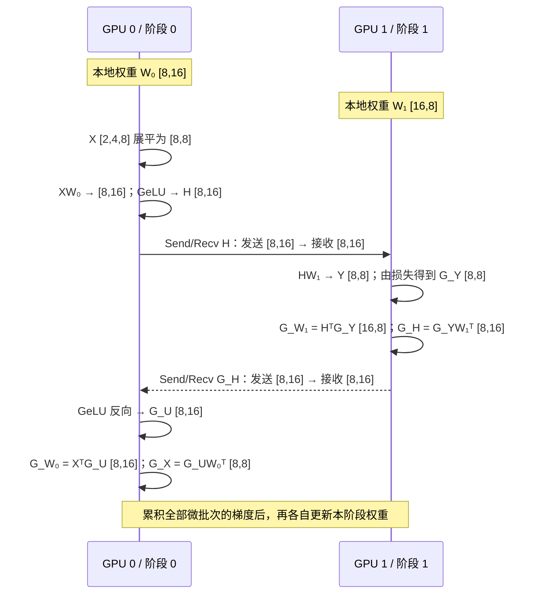

# Pipeline 流水线并行详解：让不同 GPU 接力计算

流水线并行（Pipeline Parallelism，PP）把模型按层分成若干阶段。每个阶段负责自己的参数与计算，把前向激活发给下一阶段，再接收下一阶段传回的梯度。

[上一章](./2-TP张量并行详解_矩阵尺寸逐步拆解.md)将一层拆给多张卡，本章把不同层分配到不同阶段。全文采用同步训练语义：一次更新内的所有微批次使用同一版本参数，全部反向完成后才更新。

## 1. 模型分段只是第一步

假设模型有 8 个 Transformer Block，分成 $P=4$ 个阶段，每阶段 2 层：

```text
输入 → GPU 0       → GPU 1       → GPU 2       → GPU 3       → 损失
       Block 1～2    Block 3～4    Block 5～6    Block 7～8
反向 ← 输入梯度    ← 激活梯度     ← 激活梯度     ← 损失梯度
```

前向经过阶段 0、1、2、3；反向经过阶段 3、2、1、0。各阶段参数不同，PP 组内不能像 DP 那样把各阶段权重梯度逐元素平均。


*图 3-1：本仓库 SPTD 章节的流水线步骤示意。仅切模型而不引入微批次，会让多数阶段长时间等待。*

## 2. 阶段边界上传什么：一个可手算的网络

先用两个线性层说明边界，再推广到 Transformer。设微批次 $b=2$、序列长度 $S=4$，因此 $T=8$；第一层输入维度为 8，中间维度为 16，最终输出维度为 8。

GPU 0 保存 $W_0:[8,16]$，GPU 1 保存 $W_1:[16,8]$，计算 $Y=\operatorname{GeLU}(XW_0)W_1$。

### 2.1 前向传播

| 位置     | 操作                         | 尺寸变化                                          |
| -------- | ---------------------------- | ------------------------------------------------- |
| GPU 0    | 展平输入                     | $[2,4,8]\to[8,8]$                               |
| GPU 0    | $U=XW_0$                   | $[8,8][8,16]\to[8,16]$                          |
| GPU 0    | $H=\operatorname{GeLU}(U)$ | $[8,16]\to[8,16]$                               |
| 阶段边界 | Send/Recv 激活$H$          | 发送$[8,16]$ → 接收 $[8,16]$                 |
| GPU 1    | $Y=HW_1$                   | $[8,16][16,8]\to[8,8]$                          |
| GPU 1    | 示例采用均方误差损失         | 输出与回归目标均为$[8,8]$，逐元素误差归约成标量 |

发送激活不是发送参数。每个阶段保留反向所需的数据，或在需要时重新计算它们。

### 2.2 反向传播

记 $G_A=\partial L/\partial A$。

| 位置     | 操作                                    | 尺寸变化                                |
| -------- | --------------------------------------- | --------------------------------------- |
| GPU 1    | 损失产生$G_Y$                         | $[8,8]$                               |
| GPU 1    | $G_{W_1}=H^\top G_Y$                  | $[16,8][8,8]\to[16,8]$                |
| GPU 1    | $G_H=G_YW_1^\top$                     | $[8,8][8,16]\to[8,16]$                |
| 阶段边界 | 反向 Send/Recv$G_H$                   | 发送$[8,16]$ → 接收 $[8,16]$       |
| GPU 0    | $G_U=G_H\odot\operatorname{GeLU}'(U)$ | 两个$[8,16]$ 逐元素相乘 → $[8,16]$ |
| GPU 0    | $G_{W_0}=X^\top G_U$                  | $[8,8][8,16]\to[8,16]$                |
| GPU 0    | $G_X=G_UW_0^\top$                     | $[8,16][16,8]\to[8,8]$                |
| 各阶段   | 累积并更新本阶段参数                    | 梯度与本阶段参数同形状                  |

跨阶段反向传递的是**边界激活的梯度**，不是下一阶段的权重梯度。实际实现需正确连接远端边界的自动求导；简单发送一个 detached 张量不会自动建立跨进程计算图。



*图 3-2：一个微批次的前向与反向接力。跨 GPU 的实线发送激活，虚线返回该激活的梯度；权重和权重梯度留在各自阶段。发送与接收的形状、数据类型必须匹配。*

### 2.3 Transformer 中的典型边界

若按完整 Block 分段且不叠加 TP/SP/CP，阶段输入与输出通常均为 $[b,S,d]$。例如 $[2,4,8]$ 经过若干 Block 后仍为 $[2,4,8]$，并以同尺寸向后发送；反向发送对应的 $[2,4,8]$ 梯度。

输入 embedding、输出词表投影及特殊层可能改变边界形状，因此框架需匹配每条边的 shape、dtype 和 micro-batch 标号。

## 3. 微批次让多个阶段同时工作

每个 DP 副本把一次更新的数据分成 $m$ 个微批次，每份有 $b$ 个样本。第一个微批次进入阶段 1 后，阶段 0 可以处理第二个微批次。

下面仅画 $P=3,m=4$ 的**前向**。假设每阶段耗时相同，每格一个时间槽，忽略通信：

| 阶段 / 时间槽 | 1  | 2  | 3  | 4  | 5  | 6  |
| ------------- | -- | -- | -- | -- | -- | -- |
| 阶段 0        | F0 | F1 | F2 | F3 | — | — |
| 阶段 1        | — | F0 | F1 | F2 | F3 | — |
| 阶段 2        | — | — | F0 | F1 | F2 | F3 |

F0 表示微批次 0 的前向。“—”为空闲。中间阶段同时忙碌，但启动与排空阶段仍存在空闲，这就是**气泡**。

## 4. GPipe 与 1F1B：不要混为一种调度

| 调度                              | 基本顺序                                   | 激活存储特点                           | 参数更新         |
| --------------------------------- | ------------------------------------------ | -------------------------------------- | ---------------- |
| GPipe 式 all-forward/all-backward | 先完成所有微批次前向，再完成反向           | 未反向的激活随$m$ 增长，可配合重计算 | 同一批次末尾更新 |
| 同步非交错 1F1B                   | 预热后，交替执行一次前向、一次反向，再排空 | 更早释放已反向微批次的激活             | 同一批次末尾更新 |
| 交错 1F1B                         | 一张 GPU 承担多个虚拟阶段，交错执行        | 调度更复杂，边界传输增多               | 可保持同步语义   |

GPipe 的原始方法不是 1F1B。[GPipe 论文](https://arxiv.org/abs/1811.06965) 介绍微批次与重计算；[Megatron 多维并行论文](https://arxiv.org/abs/2104.04473) 讨论非交错与交错流水线调度。原始 PipeDream 的异步权重版本管理也不能直接等同于本文的同步 1F1B。

“1F1B”是稳态阶段的调度原则，不意味着第一步即可反向。除直接由损失启动反向的末阶段外，其他阶段必须先收到后续阶段返回的梯度，才能执行该微批次的反向；各阶段的预热长度不同。

## 5. 气泡比例怎样估算

对均衡阶段、无通信开销的 GPipe 式调度，设每阶段一个微批次的前向、反向时间分别为 $\tau_f,\tau_b$：

$$
\tau_{\mathrm{step}}\approx(m+P-1)(\tau_f+\tau_b).
$$

理想情况下，每个阶段实际计算时间为 $m(\tau_f+\tau_b)$，于是气泡占总时间的比例为：

$$
f_{\mathrm{bubble}}\approx\frac{P-1}{m+P-1}.
$$

$P=4,m=8$ 时约为 $3/11=27.3\%$；$m=32$ 时约为 $3/35=8.6\%$。另一种常见写法 $(P-1)/m$ 表示空闲时间相对有效计算时间的比值，分母不同，不能与上述百分比互换。

均衡、同步、非交错 1F1B 的理想气泡也常用这一近似；它的主要收益之一是减少存活激活，并不天然消除气泡。交错调度、阶段不均衡和通信等待需要另外建模。

增大 $m$ 也有代价：固定全局 batch 时必须减小 $b$，过小的矩阵可能降低 GPU 利用率；若固定 $b$，则全局 batch 增大，可能需要调整训练超参数。

## 6. 划分阶段：均分层数不一定均衡

同样两层，实际耗时也可能不同：首尾阶段含 embedding 或词表输出层；某些层使用不同注意力或 MoE；跨节点传输也可能拖慢边界。

可先按层粗分，再记录每阶段的前向时间、反向时间与峰值显存，调整最慢或最满的阶段。若一个阶段的计算耗时是其他阶段的两倍，整条流水线会受它限制。

对于普通边界 $[b,S,d]$，若前向激活与反向梯度的每个元素都占 $q$ 字节，每个边界每次更新传输的逻辑载荷约为：

$$
V_{\mathrm{boundary}}\approx2mbSdq.
$$

例如 $m=8,b=2,S=4,d=8,q=2$ 时为 2048 字节。这里是教学尺寸，实际网络传输还包含协议、布局转换等开销；若两方向精度不同，应分别计算。

## 7. PP 与 DP、TP 如何组合

一个 PP 阶段可以由一个 TP 组协作完成，整条流水线又可以复制成多个 DP 副本。此时，DP 只同步“相同阶段、相同 TP 分片”的梯度。模型分片不增加独立样本，因此全局 batch 仍为 $Dmb$。具体的 16 卡分组与编号统一放在[下一章](./4-SPTD并行详解.md)。

叠加 SP 后，边界可能从完整激活变为序列分片。发送端与接收端必须使用一致布局，不能只凭相同元素总数就假定可直接连接。

## 8. 正确性检查与延伸

各微批次的损失应按整次更新的目标统一归一化；等大小、等权重时可按[DP 篇](./1-DP数据并行详解.md)的方法除以 $m$。每次更新前，确认所有微批次的梯度已累积；若叠加 DP，还应完成相应同步。不要在某个微批次刚反向结束时就更新它所在阶段的参数。共享 embedding 等跨阶段共享参数也需要专门同步其梯度和更新。

- 本地原理：[SPTD 流水线部分](../../../04Train/01ParallelBegin/02SPTD.md)。图 3-1 引自该章节，原图版权归原作者，沿用仓库许可。
- 本地练习：[PyTorch 模型并行](../../../04Train/01ParallelBegin/Code02MP.md)。简单模型分段有助于理解边界，但完整流水线还需要微批次调度。
- 组合推导：[SPTD 并行详解](./4-SPTD并行详解.md)。
