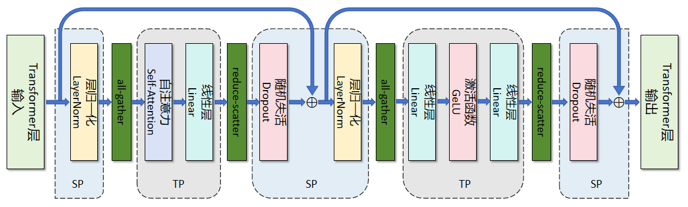
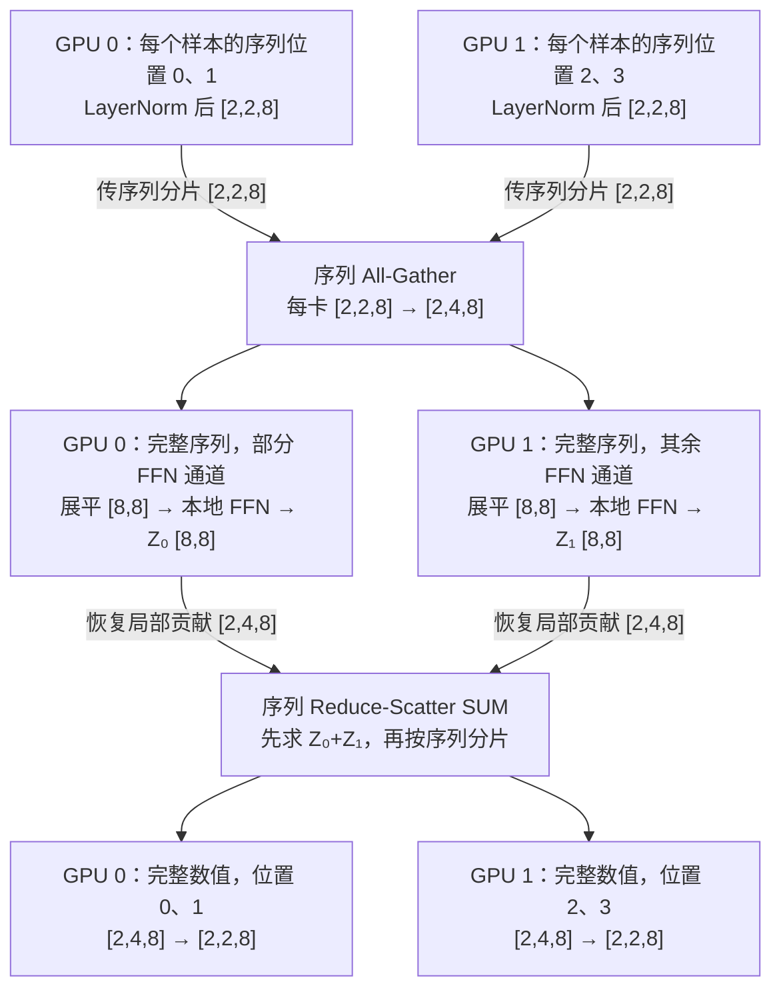
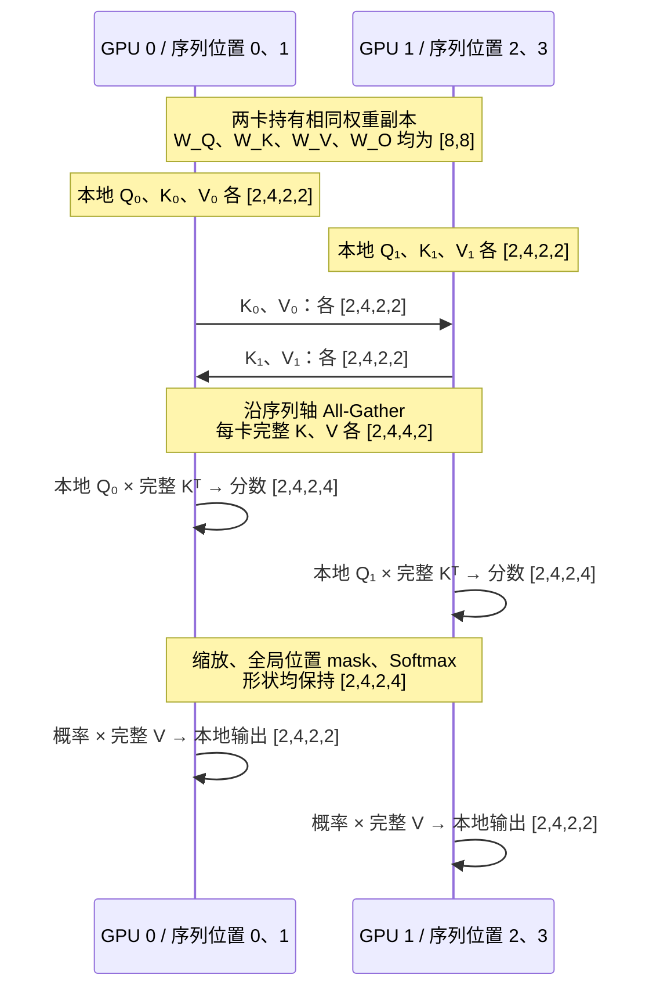

# SPTD 并行详解：把序列、流水线、张量与数据并行组合起来

SPTD 在本组文档中是 Sequence、Pipeline、Tensor、Data 四类并行的教学简称。它不是一个统一的标准算法，也不意味着 GPU 数一定等于四个并行度的乘积。

前三篇分别介绍了数据、层内和层间的分工。本章沿用基础篇的 $D,P,t,C$ 表示 DP、PP、TP、CP 并行度，重点讨论序列布局与通信组。理解混合并行时，持续回答两个问题：**这张卡拿到哪部分数据？它与哪些卡共同保存、计算或更新同一份参数？**

## 1. 先明确 SP 的含义

| 名称 | 主要切分对象 | 注意力是否仍覆盖完整序列 | 是否新增独立卡组维度 |
| --- | --- | --- | --- |
| Megatron SP | LayerNorm、Dropout 等的激活序列维 | 经典 TP+SP 中，各本地注意力头仍处理完整序列 | 通常复用 TP 组 |
| CP（上下文并行） | 同一样本的上下文及其激活 | 本地 Q 通过通信访问全局所需 K/V | 通常是独立维度 |
| Ulysses 等广义序列并行 | 序列与注意力头之间的分布布局 | 通过布局交换保持全局注意力语义 | 依具体方案确定 |

本文先讲经典 Megatron SP，再用简单 CP 示例说明长序列。不能把 Ring Attention、Ulysses 与 Megatron SP 的名称、通信次数或组大小直接互换。术语边界参见 [Megatron CP 说明](https://docs.nvidia.com/megatron-core/developer-guide/latest/user-guide/features/context_parallel.html)。

此外，训练时保存的 Q/K/V 激活与自回归推理中跨生成步复用的 KV cache 用途不同；不能用“KV cache 降低几倍”代替完整训练显存分析。

## 2. TP 已经切分计算，为什么还需要 SP

基础 TP 中，FFN 中间特征和注意力头已分片，但子模块边界通常仍在每张卡复制 $[b,S,d]$ 激活。LayerNorm 沿隐藏维 $d$ 计算，每个 token 独立；如果每张卡只拿部分 token，却保留这些 token 的完整隐藏维，就可以独立完成归一化。

例如 $b=2,S=4,d=8,t=2$：

- 基础 TP：两卡各持有完整 $[2,4,8]$，总共存储 128 个元素。
- SP 区域：沿序列维分成两份，每卡 $[2,2,8]$，总共存储 64 个元素。
- LayerNorm：每个 token 沿 8 个特征归一化，每卡输入输出均为 $[2,2,8]$。

减少的是这部分激活的重复存储，并不是整个模型的所有显存都减半。LayerNorm 的缩放、偏移参数仍是 $[d]=[8]$，在 TP/SP 组内复制；由于各卡看到的 token 不同，其参数梯度需要相应归约。

*图 4-1：引自本仓库 CP 章节。SP 区域保留序列分片，进入 TP 区域前 All-Gather，离开 TP 区域时 Reduce-Scatter。*

## 3. TP+SP 的 FFN：每一步形状

设 $b=2,S=4,d=8,f=16,t=2$，忽略偏置。假设 $S$、$f$ 可被 $t$ 整除。每卡持有每个样本的两个序列位置，共 $bS/t=4$ 个 token；不同卡的分片位置不同、尺寸相同。

| 步骤 | 每卡形状变化 | 说明 |
| --- | --- | --- |
| 输入与 LayerNorm | $[2,2,8]\to[2,2,8]$ | 沿隐藏维归一化，保留完整特征 |
| 序列 All-Gather | $[2,2,8]\to[2,4,8]$ | 收集两个序列分片 |
| 展平 | $[2,4,8]\to[8,8]$ | $T=bS=8$ |
| 第一层列并行 | $[8,8][8,8]\to[8,8]$ | 权重分片 $[d,f/t]$ |
| GeLU | $[8,8]\to[8,8]$ | 局部中间特征 |
| 第二层行并行 | $[8,8][8,8]\to[8,8]$ | 权重分片 $[f/t,d]$，输出待求和 |
| 恢复三维布局 | $[8,8]\to[2,4,8]$ | 仍是局部数值贡献 |
| 序列 Reduce-Scatter SUM | $[2,4,8]\to[2,2,8]$ | 先求和，再保留本卡序列位置 |
| Dropout、残差 | $[2,2,8]\to[2,2,8]$ | 残差必须与当前序列位置一致 |

表中写的是逻辑轴操作。底层 collective 若只支持连续缓冲分块，需先转为 sequence-first 等适合通信的布局，再恢复轴顺序，不能把 batch-first 内存随意平分成两半。

*图 4-2：同一 TP 组内，激活布局在“序列分片”与“特征分片”之间切换。本地 FFN 的权重分片与乘法尺寸见上表；通信前的 Z₀、Z₁ 是待求和贡献，通信后的序列分片已是完整数值。*

### 3.1 通信并没有消失

基础 TP 在 FFN 输出使用 All-Reduce；经典 TP+SP 可把这一逻辑归约拆成 Reduce-Scatter，并在后续 TP 子模块输入处执行 All-Gather。在理想 ring 通信模型下，两者的载荷总量可与对应 All-Reduce 相当，但调用顺序、延迟和重叠机会不同。

反向中，Reduce-Scatter 的对应梯度操作是 All-Gather：$[b,S/t,d]\to[b,S,d]$；前向 All-Gather 的对应梯度操作是 Reduce-Scatter SUM：$[b,S,d]\to[b,S/t,d]$。这些操作使不同分支对同一 token 的贡献正确汇总。具体实现也可融合或重排通信。

该设计与选择性重计算的原理见 [Reducing Activation Recomputation](https://arxiv.org/abs/2205.05198)。

### 3.2 为什么经典 SP 仍不等于 CP

进入注意力 TP 区域后，输入已汇集成 $[b,S,d]$。若标准 MHA 有 $n$ 个头，每卡 Q/K/V 为 $[b,n/t,S,d_h]$，逻辑分数为 $[b,n/t,S,S]$：**序列长度仍然是 S**。

这是经典 TP+SP 的布局选择，不是说 Q/K/V 的线性投影在数学上必须读取全部 token。线性投影逐 token 独立；需要跨 token 交互的是注意力。

## 4. CP：让本地 Q 访问远端 K/V

为突出序列切分，本节不叠加 TP。设 $b=2,S=4,d=8,n=4,d_h=2,C=2$。假设 $S$ 可被 $C$ 整除，每卡保留每个样本的 $S/C=2$ 个 token，共 $bS/C=4$ 个 token；此时本地展平长度为 $T/C$，而非 $T$。

先用完整汇集 K/V 的方案解释语义，实际实现可以改用环形分块交换以降低临时存储。

| 步骤 | 每卡尺寸变化 |
| --- | --- |
| 本地输入 | $[b,S/C,d]=[2,2,8]$ |
| 展平 | $[2,2,8]\to[4,8]$ |
| 本地 Q/K/V 投影，分别计算 | $[4,8][8,8]\to[4,8]$ |
| 分别恢复、拆头、换轴 | $[4,8]\to[2,2,8]\to[2,2,4,2]\to[2,4,2,2]$ |
| K/V 沿序列轴 All-Gather | 各 $[2,4,2,2]\to[2,4,4,2]$ |
| 完整 K 的最后两维转置 | $[2,4,4,2]\to[2,4,2,4]$ |
| 本地 Q 乘完整 K 转置 | $[2,4,2,2]@[2,4,2,4]\to[2,4,2,4]$ |
| 缩放、加 mask、沿 key 轴 Softmax | $[2,4,2,4]\to[2,4,2,4]$ |
| 概率乘完整 V | $[2,4,2,4]@[2,4,4,2]\to[2,4,2,2]$ |
| 换轴、合头、展平 | $[2,4,2,2]\to[2,2,4,2]\to[2,2,8]\to[4,8]$ |
| 输出投影、恢复局部序列 | $[4,8][8,8]\to[4,8]\to[2,2,8]$ |

其中 `@` 的前两维为 batch 与头索引，分数除以 $\sqrt{d_h}$。本例因果加性 mask 可为 $[1,1,S/C,S]=[1,1,2,4]$，可见位置为 0、不可见位置为 $-\infty$；按 token 的**全局位置**构造，不能在每个分片内从零重新编号。

*图 4-3：两卡 CP 的前向教学实现。只汇集 K/V，Q 保留本地；两个交换箭头共同表示 All-Gather 的数据需求，不规定底层收发调度。图止于合头前，后续输出投影见上表；反向 K/V 梯度的归约见第 4.2 节。*

### 4.1 分块交换不能直接相加局部 Softmax

环形方案让 K/V 分块经过各卡。本例每块 K/V 为 $[2,4,2,2]$，与本地 Q 形成分数块 $[2,4,2,2]$；每轮加权 V 的局部累加器形状也是 $[2,4,2,2]$。

不同 key 块共享同一个 Softmax 分母，不能对各块分别 Softmax 后把输出直接相加。正确实现需在线合并每行最大值与指数和（本例各为 $[2,4,2,1]$），并相应缩放输出累加器。因果 mask 下完全不可见的分块应跳过或以零贡献处理，不能直接对全 $-\infty$ 的行做普通 Softmax。

### 4.2 反向也必须回收跨卡贡献

同一 K/V token 会被不同卡的 Q 使用，反向时各卡产生的 K/V 梯度必须归约并送回其所属分片。对上述 All-Gather 教学实现，对应操作为 $[2,4,4,2]\to[2,4,2,2]$ 的 Reduce-Scatter SUM。

CP 组内通常复制同一权重，各卡只计算部分 token 对参数的贡献，因此参数梯度也要正确聚合。例如，各卡将本地 token 损失之和除以该模型副本的完整有效 token 数，再在 CP 组内对参数梯度求和，即得到该副本的 token 平均梯度。若随后对 DP 副本取平均，还要求各副本有效 token 数相等；不相等时按[DP 篇](./1-DP数据并行详解.md)加权。具体框架可采用等价缩放，但不能重复除以组大小。

## 5. 16 卡实例：把通信组写清楚

先不启用独立 CP，设 $D=2,P=4,t=2$，Megatron SP 复用 TP 组，总卡数为：

$$
N_{\mathrm{GPU}}=DPt=16.
$$

使用本文自定义的编号规则（不假定某个框架采用同一顺序）：

$$
\operatorname{rank}(a,j,r)=aPt+jt+r,
$$

其中 $a$ 是 DP 副本编号，$j$ 是 PP 阶段编号，$r$ 是 TP 分片编号。

| 副本 | 阶段 0 | 阶段 1 | 阶段 2 | 阶段 3 |
| --- | --- | --- | --- | --- |
| DP 0 | 0、1 | 2、3 | 4、5 | 6、7 |
| DP 1 | 8、9 | 10、11 | 12、13 | 14、15 |

- **TP/SP 组**：每格两张卡，如 `{0,1}`，协作计算相同样本、相同阶段。
- **PP 通道**：固定副本与 TP 分片，如 `0→2→4→6`，传递相应布局的激活及梯度。
- **DP 组**：固定阶段与 TP 分片，如 `{0,8}`、`{1,9}`，同步相同参数分片的梯度。

若 $b=2,m=8$，全局 batch 为 $Dmb=32$，不是 $16\times2\times8=256$。

若再加入独立 $C=2$ 的 CP 维度，保持其他并行度不变，总卡数变为 $DPtC=32$，全局 batch 仍为 32。SP 已复用 TP 组，不能再额外乘一个 SP 因子。

## 6. 一次混合并行更新怎样完成

1. 两个 DP 副本读取不同样本；每个副本组织 8 个微批次。
2. 每个微批次依次经过 4 个 PP 阶段，各阶段内两张 TP 卡合作计算。
3. TP 区域切特征，SP 区域切序列；阶段边界按约定布局传输激活。
4. 反向按流水线调度返回激活梯度，TP/SP 通信汇总同一 token 的计算贡献。
5. 各阶段累积所有微批次的参数梯度，再在对应 DP 组内完成同步并更新。

实际框架可以让第 4、5 步中的通信与计算重叠；这不改变“更新必须使用完整、正确归一化梯度”的要求。

## 7. 从瓶颈选择组合

| 观察到的瓶颈 | 优先检查或尝试 | 代价与边界 |
| --- | --- | --- |
| 模型能放下，但吞吐不足 | DP | 增加同步通信；固定本地工作量时全局 batch 增长 |
| 优化器状态占用过高 | ZeRO/FSDP | 参数或梯度的额外通信 |
| 层内权重或计算过大 | TP | 高频通信、小矩阵效率 |
| 模型总层数导致状态过大 | PP | 气泡、阶段负载均衡 |
| TP 区域外重复激活较多 | Megatron SP | 布局转换与通信调度 |
| 长序列注意力压力大 | CP，结合 FlashAttention | K/V 交换、mask 与负载均衡 |

没有脱离硬件的最优并行度。先固定模型与有效全局 batch，比较吞吐、峰值显存和收敛；每次改变一个配置，并记录通信组与张量布局，才能判断收益来自哪里。

## 8. 来源与延伸阅读

- 本地素材：[SPTD 原章节](../../../04Train/01ParallelBegin/02SPTD.md)、[CP 原章节](../../../04Train/01ParallelBegin/03CP.md)。图 4-1 引自后者，原图版权归原作者，沿用仓库许可。
- 原理论文：[Megatron-LM 多维并行](https://arxiv.org/abs/2104.04473)、[SP 与选择性激活重计算](https://arxiv.org/abs/2205.05198)。
- 工程对照：[Megatron 并行策略指南](https://docs.nvidia.com/megatron-core/developer-guide/latest/user-guide/parallelism-guide.html)、[GitHub 并行组实现](https://github.com/NVIDIA/Megatron-LM/blob/main/megatron/core/parallel_state.py)。框架版本变化可能影响配置名与布局，应按实际安装版本核对。

