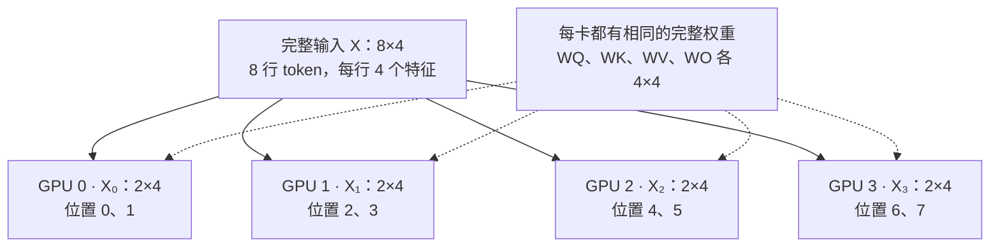
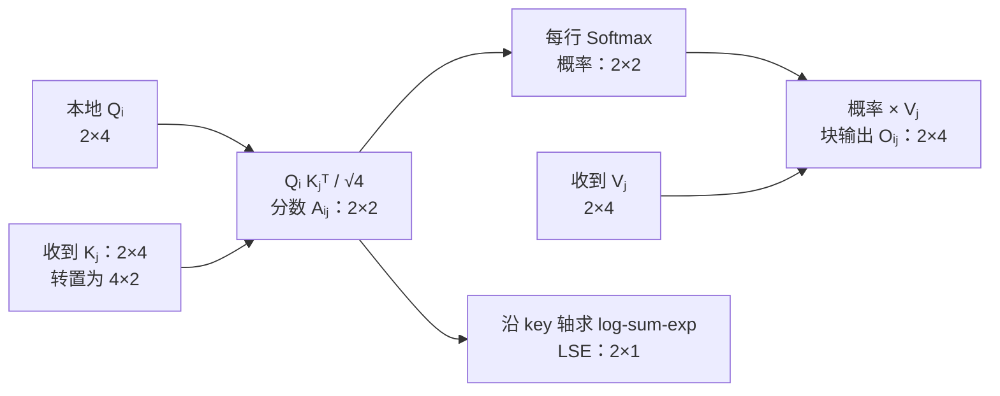
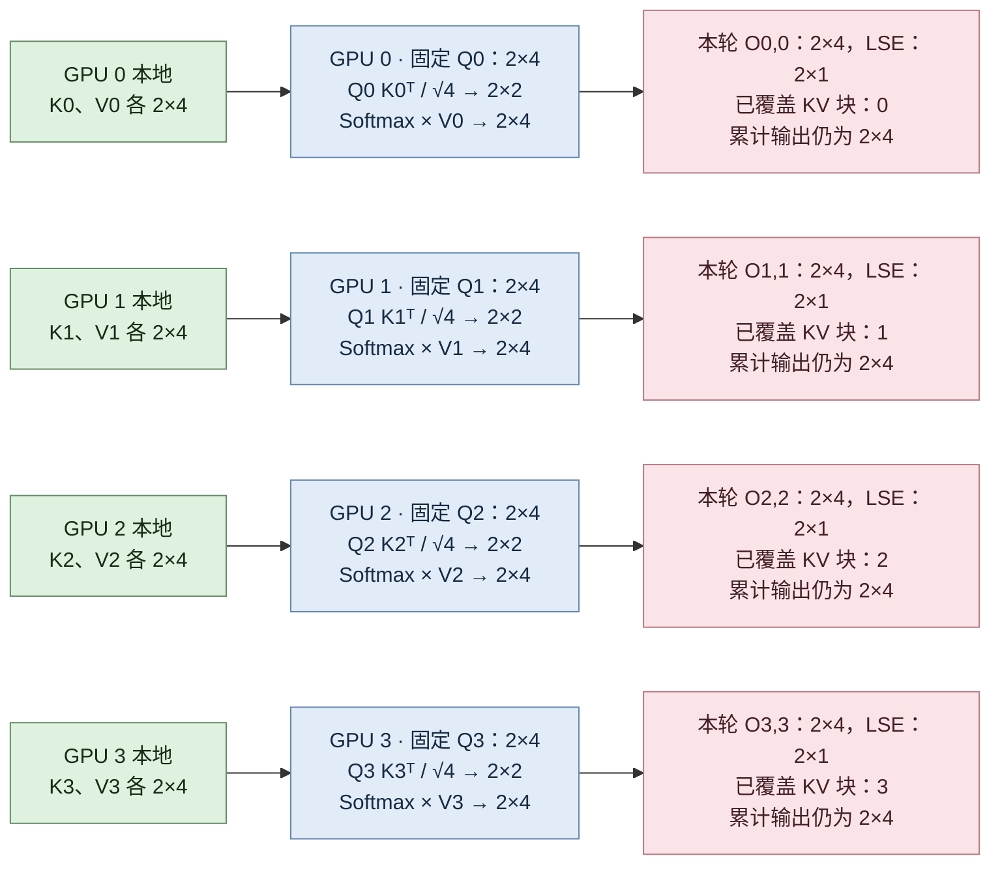
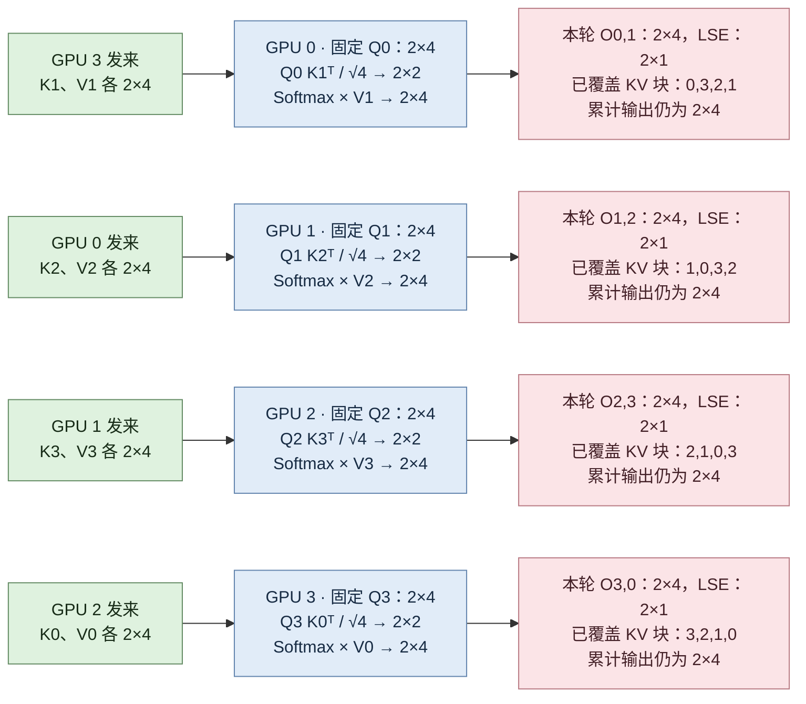
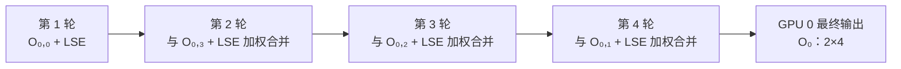
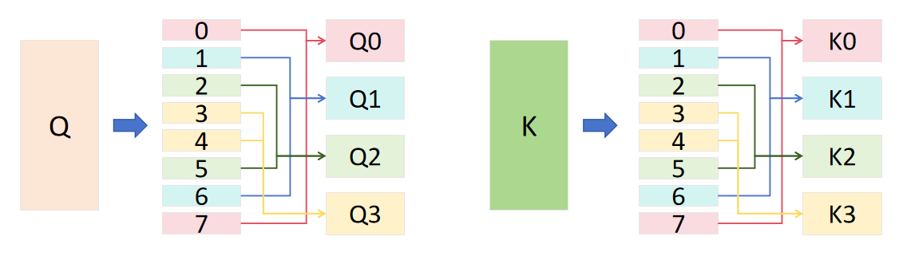
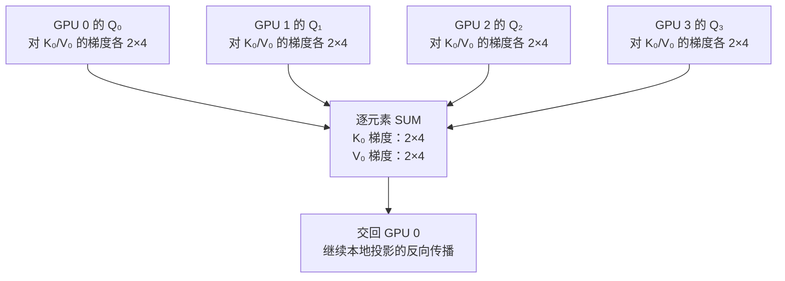

# CP 上下文并行：四张 GPU 如何合作计算一段长序列

上下文并行（Context Parallelism，CP）把**同一个样本的序列**分给多张 GPU。每张卡留下自己的 Q，让不同位置的 K/V 依次传过来，最终算出自己负责的 token 输出。[1][2]

本章以 `cp_size=4` 为主线：**切序列 → 本地投影 → 四轮注意力 → 合并输出**。先看不带因果遮罩的完整计算，再加入因果遮罩与负载均衡。与 [上一章](./4-SPTD并行详解.md)保持一致：CP 切序列，TP 切权重，DP 分配不同样本；经典 Megatron SP 则主要在 LayerNorm、Dropout 等区域切序列，并复用 TP 组。

## 1. 先把问题缩小：8 个 token，4 张卡

为看清矩阵，只画**一个样本、一个注意力头**：序列长度 $S=8$，隐藏维度和头维度均为 $d=d_h=4$，每卡处理 $S/4=2$ 个 token。忽略偏置、dropout 和位置编码的运算细节，权重采用 $Y=XW$ 的方向。

*图 5-1：按行切输入，不切特征，不切权重。虚线表示权重副本，不表示每轮传输权重。*

对任一张卡 $i$，本地独立计算：

$$
\underbrace{Q_i}_{2\times4}=\underbrace{X_i}_{2\times4}\underbrace{W_Q}_{4\times4},\qquad
\underbrace{K_i}_{2\times4}=\underbrace{X_i}_{2\times4}\underbrace{W_K}_{4\times4},\qquad
\underbrace{V_i}_{2\times4}=\underbrace{X_i}_{2\times4}\underbrace{W_V}_{4\times4}.
$$

投影逐 token 独立，无须跨卡通信。但计算注意力时，本地的两个 query 需要访问全部八个 key/value。**需要传输的是 K/V 激活，不是 Q，也不是投影权重。**

## 2. 先理解一张卡、一块 K/V 在算什么

用 $O_{i,j}$ 表示“GPU $i$ 的 Q 对第 $j$ 块 K/V 算出的块内输出”。第一个下标是 **Q 的归属**，第二个下标是 **K/V 的归属**，不是轮次。

$$
\underbrace{A_{i,j}}_{2\times2}
=\frac{\underbrace{Q_i}_{2\times4}\underbrace{K_j^\top}_{4\times2}}{\sqrt4},
\qquad
\underbrace{O_{i,j}}_{2\times4}
=\underbrace{\operatorname{softmax}(A_{i,j})}_{2\times2}\underbrace{V_j}_{2\times4}.
$$

*图 5-2：分数矩阵的行对应本地 query，列对应当前 key 块。一个块产生一个输出和一个 LSE；LSE 保存每行归一化分母的信息，用于跨块合并。*

如果直接 All-Gather 四块 K/V，每个 K/V 从本地 $[2,4]$ 汇集成 $[8,4]$，再计算 $[2,4][4,8]\to[2,8]$ 的分数、Softmax 后乘 $[8,4]\to[2,4]$ 的输出。环形方案把同一件事分成四次，每次只处理两列 key，不必同时暂存完整 K/V。[2]

## 3. 四轮环形计算：Q 不动，K/V 向下一张卡传

约定传递方向为 **GPU 0 → GPU 1 → GPU 2 → GPU 3 → GPU 0**。先计算本地块，再交换三次：共 **4 轮计算、3 次块交换**。每次传的是当前持有的 K/V，既可能是自己的，也可能是上一轮收到的。

以下每幅图都画出四张卡的**当前轮计算**。蓝色为固定 Q 的计算位置，绿色为 K/V 块，粉色为本轮输出及本地累计结果。每条跨卡箭头传 K、V 各一个 $[2,4]$；通信前后分片尺寸不变。

### 第 1 轮：先算自己的 K/V

本轮没有跨卡接收，四张卡先使用自己的 K/V。

*图 5-3：第 1 轮。用本轮结果初始化各卡的累计输出与累计 LSE。*

### 第 2 轮：接收上游的第一块 K/V

下图箭头表示上一轮结束后、当前轮开始前的接收；所有卡沿同一方向同时交换。

*图 5-4：第 2 轮。本轮块输出与之前累计结果按第 4 节的方法合并，不能直接相加。*

### 第 3 轮：继续转发，接收第二块 K/V

下图箭头表示上一轮结束后、当前轮开始前的接收；所有卡沿同一方向同时交换。

*图 5-5：第 3 轮。本轮块输出与之前累计结果按第 4 节的方法合并，不能直接相加。*

### 第 4 轮：接收最后一块 K/V，完成覆盖

下图箭头表示上一轮结束后、当前轮开始前的接收；所有卡沿同一方向同时交换。

*图 5-6：第 4 轮。本轮块输出与之前累计结果按第 4 节的方法合并，不能直接相加。*

以 GPU 0 为例，它依次使用 K/V 块 **0 → 3 → 2 → 1**，得到 $O_{0,0},O_{0,3},O_{0,2},O_{0,1}$；其他卡也各自覆盖四块，既没有遗漏，也没有重复。第四轮结束后不再为本次前向额外交换一次。

图中分数与概率用于解释数学关系；FlashAttention 内核可在更小的 tile 内融合计算，并不要求把这些中间矩阵完整写回显存。实际实现还可重叠通信与计算，图中按轮展开是为了看清数据归属。[2][3]

## 4. 四块输出怎样合成一个正确输出

### 4.1 原理：分子相加，分母也相加

Softmax 是“指数分数除以指数分数总和”。每块单独计算时，分母只包含本块；跨块合并时，必须改用四块共同的分母。

固定一张卡，省略 Q 的卡号。令 $Z_j$ 是第 $j$ 块每一行的指数分数和，$O_j$ 是该块的归一化输出：

$$
\underbrace{Z_j}_{2\times1}=\operatorname{sum}_{\mathrm{key}}\!\left(\underbrace{e^{A_j}}_{2\times2}\right),\qquad
\underbrace{O}_{2\times4}
=\frac{Z_0\odot O_0+Z_1\odot O_1+Z_2\odot O_2+Z_3\odot O_3}{Z_0+Z_1+Z_2+Z_3}.
$$

每个 $Z_j:[2,1]$ 沿特征轴广播，与 $O_j:[2,4]$ 相乘得到 $[2,4]$；分子相加仍为 $[2,4]$，分母为 $[2,1]$，逐行相除得到 $[2,4]$。这里的 $Z$ 用于解释原理，程序中通常保存它的对数以避免溢出。

例如只看一个 query、一个输出特征：四块的分母分别是 1、3、2、4，块输出分别是 2、10、6、8，则：

$$
O=\frac{1\times2+3\times10+2\times6+4\times8}{1+3+2+4}=7.6.
$$

这相当于权重行向量 $[1,4]$ 乘四个块输出组成的列向量 $[4,1]$，得到 $[1,1]$。四块输出直接求和是 26，简单平均是 6.5，都不等于正确结果。

### 4.2 实现：每来一块，只更新累计输出和 LSE

令 $L=\log Z$。把“旧累计结果”与“新块”合并：

$$
L_{\mathrm{合}}=\operatorname{logaddexp}(L_{\mathrm{旧}},L_{\mathrm{新}}),\qquad
O_{\mathrm{合}}=e^{L_{\mathrm{旧}}-L_{\mathrm{合}}}\odot O_{\mathrm{旧}}
+e^{L_{\mathrm{新}}-L_{\mathrm{合}}}\odot O_{\mathrm{新}}.
$$

这里所有 $L$ 和指数权重均为 $[2,1]$，所有 $O$ 均为 $[2,4]$。`logaddexp(a,b)` 稳定地计算 $\log(e^a+e^b)$。

*图 5-7：GPU 0 的累计过程。图中“+ LSE”表示同时携带归一化信息，不是把 LSE 数值加到输出。每一步只保留累计输出 $[2,4]$ 和累计 LSE $[2,1]$。*

因此无需存下四块输出再统一合并。计算顺序改变不影响实数意义下的结果，但浮点舍入可能产生微小差异。

## 5. 算完注意力以后，序列仍留在原卡

每卡拿到完整上下文贡献后的 $O_i:[2,4]$，执行本地输出投影，再进入后续逐 token 运算：

| 运算 | 本例的矩阵尺寸 |
| --- | --- |
| 输出投影 $Y_i=O_iW_O$ | $[2,4][4,4]\to[2,4]$ |
| 残差相加、逐 token LayerNorm | 各 $[2,4]\to[2,4]$ |
| FFN 上投影，中间维度取 8 | $[2,4][4,8]\to[2,8]$ |
| GeLU | $[2,8]\to[2,8]$ |
| FFN 下投影 | $[2,8][8,4]\to[2,4]$ |

归一化的先后顺序随模型而异，但以上运算都不需要额外的 CP 激活通信。下一层直接使用本卡的两个 token，不必每层拼回 $[8,4]$。若为了展示最终序列而拼接四卡输出，则沿 token 轴从四个 $[2,4]$ 恢复为 $[8,4]$；这是位置拼接，不是求和。

## 6. 加上因果遮罩：哪些块要算，哪些块可跳过

### 6.1 先不改变连续切分

自回归注意力只允许访问当前位置及以前的 key。沿用位置 `{0,1}`、`{2,3}`、`{4,5}`、`{6,7}` 的连续分片，四轮中的块关系如下：

| 固定 Q 所属卡 | 第 1 轮 | 第 2 轮 | 第 3 轮 | 第 4 轮 |
| --- | --- | --- | --- | --- |
| GPU 0 | KV0：下三角 | KV3：跳过 | KV2：跳过 | KV1：跳过 |
| GPU 1 | KV1：下三角 | KV0：全可见 | KV3：跳过 | KV2：跳过 |
| GPU 2 | KV2：下三角 | KV1：全可见 | KV0：全可见 | KV3：跳过 |
| GPU 3 | KV3：下三角 | KV2：全可见 | KV1：全可见 | KV0：全可见 |

每个分数块仍为 $[2,2]$。对于对角块，加入的因果 mask 为：

$$
\underbrace{M}_{2\times2}=\begin{bmatrix}0&-\infty\\0&0\end{bmatrix},\qquad
\underbrace{A}_{2\times2}\leftarrow\underbrace{A}_{2\times2}+\underbrace{M}_{2\times2}.
$$

全可见块不需要因果遮罩；全不可见块对输出贡献为零，可以跳过计算。**跳过本卡计算不等于停止转发**：该 K/V 块可能仍被后续卡使用。不可对全为 $-\infty$ 的行直接做普通 Softmax；应跳过该行贡献，并在尚无有效累计结果时单独初始化，避免 NaN。

### 6.2 首尾配对，让四张卡更均衡

连续切分时，四卡的有效 query-key 配对数分别为 $1+2=3$、$3+4=7$、$5+6=11$、$7+8=15$。后面的卡明显更忙。

将序列等分为 $2\times\text{cp_size}=8$ 小块，再按首尾配对：

*图 5-8：复用原 CP 章节配图。八小块分别配为 {0,7}、{1,6}、{2,5}、{3,4}。本例刚好每小块一个 token；实际长序列中每小块通常含多个 token。*

| GPU | 持有的全局 token 位置 | 有效 query-key 配对数 |
| --- | --- | --- |
| 0 | 0、7 | $1+8=9$ |
| 1 | 1、6 | $2+7=9$ |
| 2 | 2、5 | $3+6=9$ |
| 3 | 3、4 | $4+5=9$ |

每个小块 Q/K/V 是 $[1,4]$，每卡拼接两块后仍各为 $[2,4]$。环形传输的形状和卡间方向都不变，但 **KV0 此时代表位置 {0,7}，不再代表 {0,1}**；第 6.1 节的整块可见性表不能直接套用。

例如 GPU 0 的 Q 位置为 `{0,7}`，遇到 GPU 1 的 K 位置 `{1,6}`，分数仍为 $[2,2]$，对应 mask 是 $\begin{bmatrix}-\infty&-\infty\\0&0\end{bmatrix}$：第一行无贡献，第二行全可见。mask 与 RoPE 均须使用全局位置，不能使用重排后的本地行号。

该方案要求序列长度可被 $2\times\text{cp_size}$ 整除，否则需 padding 或其他分片方式。配对数均衡也不意味着实际耗时完全相同，内核分块与网络仍会影响结果。

## 7. 反向传播：谁拥有 K/V，梯度就汇回谁

前向时，一个 K/V 块被四张卡的 Q 使用；反向时，这四处产生的 K/V 梯度必须**相加后返回所属卡**。

*图 5-9：展示逻辑归属。实际 ring 可以逐块累加并归还梯度，不要求把四份贡献同时集中存放；因果不可见部分贡献为零。*

为了容易核对公式，暂用全量 K/V 写反向：本地概率 $P:[2,8]$，本地输出梯度 $G_O:[2,4]$，完整 $K,V:[8,4]$。$G$ 表示对应张量的梯度，转置交换矩阵的两个轴。

| 运算 | 公式与尺寸 |
| --- | --- |
| 本卡对完整 V 的梯度贡献 | $P^\top G_O:[8,2][2,4]\to[8,4]$ |
| 概率梯度 | $G_P=G_OV^\top:[2,4][4,8]\to[2,8]$ |
| 分数梯度 | $G_A=P\odot(G_P-\operatorname{sum}_{\mathrm{key}}(G_P\odot P))$；行归约 $[2,8]\to[2,1]$，广播后得到 $[2,8]$ |
| 本地 Q 梯度 | $G_Q=G_AK/\sqrt4:[2,8][8,4]\to[2,4]$ |
| 本卡对完整 K 的梯度贡献 | $G_A^\top Q/\sqrt4:[8,2][2,4]\to[8,4]$ |
| K/V 梯度归还所属卡 | 四卡贡献分别求和，再按序列 Reduce-Scatter：每个 $[8,4]\to[2,4]$ |

此后以 Q 投影为例，参数局部梯度为 $X_i^\top G_{Q_i}:[4,2][2,4]\to[4,4]$，输入梯度贡献为 $G_{Q_i}W_Q^\top:[2,4][4,4]\to[2,4]$。K、V 两条路径同理；三条输入梯度贡献相加仍为 $[2,4]$。

CP 复制了权重，各卡却只处理部分 token，因此**参数梯度也要归约**：各卡 $[4,4]$ 的梯度求和后仍为 $[4,4]$。这与 K/V 激活梯度的归还不是同一件事。若使用全序列平均损失，可先把本地损失之和除以全序列有效 token 数，再做 CP SUM；与 DP 组合时避免重复除以并行度，详见 [DP 篇](./1-DP数据并行详解.md)。

## 8. 推广到多头、TP 与真实长序列

### 8.1 多头只是给上面的矩阵增加批量轴

保持 `cp_size=4`。对微批次 $b$、序列长 $S$、头数 $n$、每头维度 $d_h$，隐藏维度 $d=nd_h$：

| 步骤 | 尺寸变化 |
| --- | --- |
| 本地输入展平、Q/K/V 投影 | $[b,S/4,d]\to[bS/4,d]$；分别乘 $[d,d]\to[bS/4,d]$ |
| 拆头、换轴 | $[bS/4,d]\to[b,S/4,n,d_h]\to[b,n,S/4,d_h]$ |
| 每轮 K 转置 | $[b,n,S/4,d_h]\to[b,n,d_h,S/4]$ |
| 每轮 QK、缩放与 Softmax | $[b,n,S/4,d_h]@[b,n,d_h,S/4]\to[b,n,S/4,S/4]$，缩放和 Softmax 不改形状 |
| 每轮概率乘 V | $[b,n,S/4,S/4]@[b,n,S/4,d_h]\to[b,n,S/4,d_h]$ |
| 累计 LSE、输出 | LSE 为 $[b,n,S/4,1]$，四轮合并输出仍为 $[b,n,S/4,d_h]$ |
| 合头、输出投影 | $[b,n,S/4,d_h]\to[b,S/4,n,d_h]\to[bS/4,d]$；乘 $[d,d]\to[bS/4,d]$，恢复 $[b,S/4,d]$ |

`@` 表示前两个轴上的批量矩阵乘法。将 $b=1,n=1,S=8,d_h=4$ 代入，就回到了前面的图。

### 8.2 与 TP 组合时，在相同权重分片之间传 K/V

若再用 `tp_size=2`，就需要 $4\times2=8$ 张卡：

| CP 分片 | TP 分片 0 | TP 分片 1 |
| --- | --- | --- |
| CP 0 | GPU 0 | GPU 1 |
| CP 1 | GPU 2 | GPU 3 |
| CP 2 | GPU 4 | GPU 5 |
| CP 3 | GPU 6 | GPU 7 |

CP 环为 `{0,2,4,6}` 与 `{1,3,5,7}`，TP 组为 `{0,1}`、`{2,3}`、`{4,5}`、`{6,7}`。标准按头 MHA 中，本地 Q/K/V 的头轴由 $n$ 变为 $n/2$，尺寸为 $[b,n/2,S/4,d_h]$，CP 仍只交换序列块。[1]

不额外启用 SP 时，列并行投影为 $[bS/4,d][d,d/2]\to[bS/4,d/2]$；注意力后，局部头输出合并为 $[bS/4,d/2]$，行并行输出投影为 $[bS/4,d/2][d/2,d]\to[bS/4,d]$，再在 TP 组求和，尺寸不变。细节与 GQA 的头分片约束见 [TP 篇](./2-TP张量并行详解_矩阵尺寸逐步拆解.md)。

## 9. CP 节省什么，又付出什么

本例每卡只持有自己的 Q 与输出，各为 $[2,4]$；K/V 以块流过，每块各为 $[2,4]$。实现可能使用双缓冲和额外工作区，因此不能把这些逻辑尺寸直接当成峰值显存。

若 K/V 均用 BF16，每个元素 2 字节，则本例一次交换发送：

$$
\underbrace{2}_{K\text{ 与 }V}\times
\underbrace{2\times4}_{\text{每块元素数}}\times
\underbrace{2\text{ 字节}}_{\text{每元素}}=32\text{ 字节}.
$$

三次交换，每卡前向发送 $3\times32=96$ 字节，接收也是 96 字节；不含反向、参数梯度同步与协议开销。真实长序列中载荷会随 token 数与 KV 头数增长。

CP 分摊序列激活与注意力计算，但本身不分摊权重和优化器状态，也不把稠密注意力的全局二次计算变成线性计算。是否提速取决于计算是否足以覆盖通信；不能仅凭四张卡就假定显存或耗时降到四分之一。

实现核对时，先检查四轮是否恰好覆盖所有 K/V 块，再检查 LSE 合并、全局位置 mask 与梯度归属。关闭 dropout 后，与单卡比较输出及梯度，并用非方形尺寸避免掩盖轴交换错误；数值通过后再测吞吐与显存。

## 参考资料

本章依据本仓库[长序列与上下文并行 CP](../../../04Train/01ParallelBegin/03CP.md)整理；图 5-8 复用该章节图片，其余为本章四卡示意图。图中省略实现相关的通信重叠与缓冲细节。

1. [NVIDIA：Context Parallel Package](https://docs.nvidia.com/megatron-core/developer-guide/latest/user-guide/features/context_parallel.html)。CP 的作用范围、K/V 通信及 TP/CP 组关系。可对照 [GitHub 文档版本](https://github.com/NVIDIA/Megatron-LM/blob/a54dd7378c25b8056cae46579bda92cb56d0de35/docs/user-guide/features/context_parallel.md)。
2. [Liu et al.：Ring Attention with Blockwise Transformers for Near-Infinite Context](https://arxiv.org/abs/2310.01889)。环形分块计算与通信重叠。
3. [Dao：FlashAttention-2: Faster Attention with Better Parallelism and Work Partitioning](https://arxiv.org/abs/2307.08691)。精确注意力的分块计算与内核并行优化。
