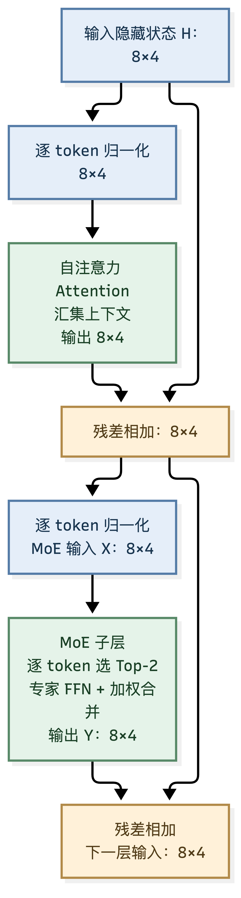
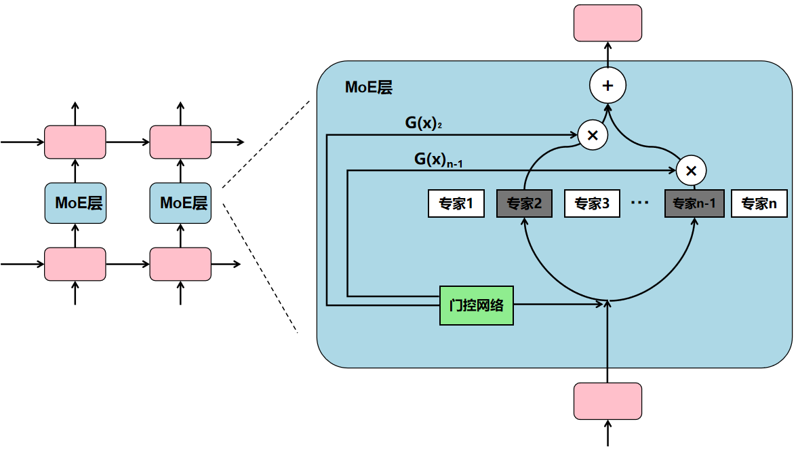
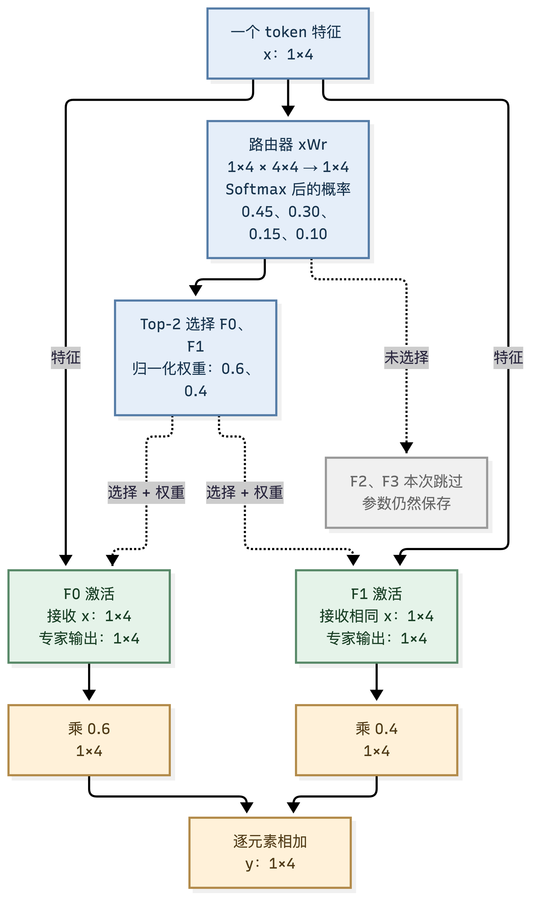
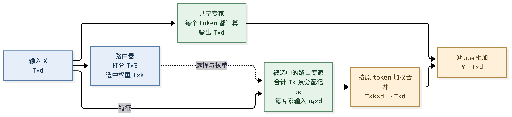
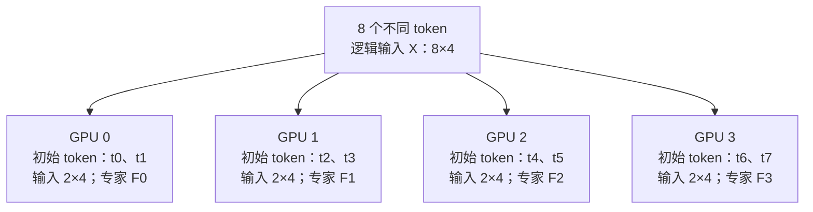
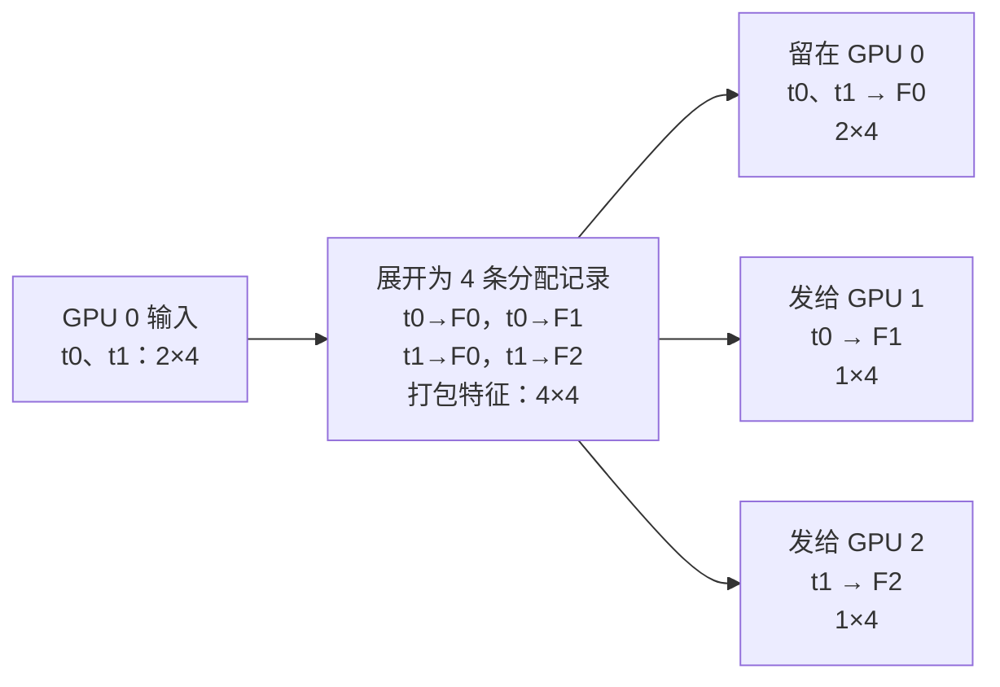
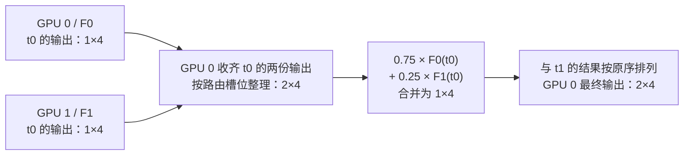

<!--Copyright © ZOMI 适用于[License](https://github.com/Infrasys-AI/AIInfra)版权许可-->

# EP 并行与专家模型：把 token 送到专家所在的 GPU

> 原稿作者：于嘉阔；本章在原稿的 MoE 与 EP 主线上补充数学推导、通信示例与工程边界。

[上一章](./5-CP上下文并行.md)让不同 GPU 合作处理同一段上下文。本章换一种分工：**不同 GPU 保存不同专家，token 根据路由结果去找专家，算完再回到原来的位置。**

MoE（Mixture-of-Experts，混合专家）是一种模型结构；EP（Expert Parallelism，专家并行）是一种部署与执行方式。MoE 可以放在单卡上运行，也可以通过 EP 分布到多卡。本章先解释 MoE 的模型原理，再沿着 **路由 → 分发 → 专家计算 → 返回 → 加权合并** 展开四卡 EP 示例。

## 1. MoE 模型理论：先理解模型，再理解并行

### 1.1 MoE 在 Transformer 的什么位置

常见稀疏 MoE 用多个专家 FFN 替换原来的一个 FFN。注意力负责让当前位置读取其他位置的信息；MoE 则根据**当前位置已经包含上下文的隐藏状态**，选择哪些 FFN 参数参与计算。不同模型可以只替换部分层，也可以替换所有 FFN 层。[7]

*图 6-1：以 Pre-Norm 块为例。两条残差连接分别跨过注意力和 MoE；所有主干张量均为 $[8,4]$，MoE 不改变序列长度和隐藏维度。图中归一化可以采用 LayerNorm 或 RMSNorm，具体以模型定义为准。*

设 $T$ 为 token 数、$d$ 为隐藏维度，输入隐藏状态为 $H:[T,d]$，一个块可写成：

$$
H'=H+\operatorname{Attention}(\operatorname{Norm}(H)),\qquad
H_{\mathrm{out}}=H'+\operatorname{MoE}(\operatorname{Norm}(H')).

$$

归一化、各子层输出及两次残差相加都保持 $[T,d]$。注意力内部的 Q/K/V 变换见 [TP 篇](./2-TP张量并行详解_矩阵尺寸逐步拆解.md)，这里重点讨论 MoE 接收的输入 $X=\operatorname{Norm}(H'):[T,d]$。

若原始输入布局是 $[b,S,d]$，只需把样本轴与序列轴展平为 $[T,d]$，其中 $T=bS$；MoE 输出再由 $[T,d]$ 恢复为 $[b,S,d]$。在后面的 EP 例子中，$T$ 统计本次路由域的不同 token，可能包含多张卡上的本地分片。

### 1.2 “专家”是不同参数的 FFN，不是独立的完整语言模型

专家通常有相同的网络结构、不同的权重。路由器也不是一个单独的大语言模型，最简单的实现只是一个可学习的线性投影。

*图 6-2：复用原 EP 章节配图。路由器为当前 token 选择少数专家，并按权重合并专家输出。原图专家编号为示意，本文公式统一从 0 开始。*

以一个 SwiGLU 专家为例，输入 token 为 $x:[1,d]$，中间维度为 $f$，专家先把它映射到更宽的特征空间，再映射回来：

$$
F_e(x)=\left[\operatorname{SiLU}(xW_{g,e})\odot(xW_{u,e})\right]W_{d,e}.
$$

这个公式描述的是**第 $e$ 个专家内部的一次 SwiGLU 前向计算**。各符号的含义如下：

| 符号 | 含义 | 尺寸 |
| --- | --- | --- |
| $e$ | 专家编号，$e\in\{0,1,\ldots,E-1\}$；不同专家拥有彼此独立的三组权重 | 标量索引 |
| $x$ | 当前 token 输入专家前的隐藏状态；采用行向量表示 | $[1,d]$ |
| $d$ | 模型隐藏维度，也是专家的输入、输出维度 | 标量 |
| $f$ | 专家 FFN 的中间维度，通常大于 $d$，具体大小由模型配置决定 | 标量 |
| $W_{g,e}$ | 第 $e$ 个专家的**门控上投影**（gate projection），生成经过 SiLU 的门控特征 | $[d,f]$ |
| $W_{u,e}$ | 第 $e$ 个专家的**值上投影**（up projection），生成被门控调制的内容特征 | $[d,f]$ |
| $W_{d,e}$ | 第 $e$ 个专家的**下投影**（down projection），将中间特征投影回隐藏维度 | $[f,d]$ |
| $\odot$ | 对应位置逐元素相乘，不是矩阵乘法 | 两个 $[1,f]$ 得到 $[1,f]$ |
| $F_e(x)$ | 第 $e$ 个专家对 token $x$ 的输出 | $[1,d]$ |

为了看清两条上投影的分工，可把公式拆成四步：

$$
\begin{aligned}
G_e &= xW_{g,e} &&:[1,d][d,f]\to[1,f],\\
U_e &= xW_{u,e} &&:[1,d][d,f]\to[1,f],\\
H_e &= \operatorname{SiLU}(G_e)\odot U_e &&:[1,f]\odot[1,f]\to[1,f],\\
F_e(x) &= H_eW_{d,e} &&:[1,f][f,d]\to[1,d].
\end{aligned}
$$

$G_e$ 决定中间特征的“门开多大”，$U_e$ 提供被门控的内容，$H_e$ 是两条分支融合后的中间表示。最后，$W_{d,e}$ 把中间表示投影回 $d$ 维，使专家输出可以与其他专家输出加权求和，也可以接回 Transformer 的残差主干。

下标 $e$ 很关键：$W_{g,0}$ 与 $W_{g,1}$ 属于两个不同专家，不共享参数。三个权重名中的 `g/u/d` 分别对应 gate、up、down；其中 $W_{g,e}$ 只是专家 FFN 内部的门控投影，后文的 $W_r:[d,E]$ 才负责在 $E$ 个专家之间进行路由选择。本文为简化公式省略了偏置项；若实现包含偏置，则在相应线性投影后加上 $b_{g,e},b_{u,e}:[1,f]$ 和 $b_{d,e}:[1,d]$，广播相加不会改变上述张量尺寸。

其中 $\operatorname{SiLU}(u)=u\sigma(u)$，$\sigma$ 为 sigmoid；SiLU 和逐元素乘法都不会改变张量形状。

“数学专家”“代码专家”只是方便理解的比喻。真实专家可能对某些特征、语法模式或数据分布形成偏好，但通常没有人工分配的职业标签。每个 MoE 层都有自己的路由器和专家集合；同一 token 在不同层可以走不同路径，相同词语处在不同上下文中也可能选择不同专家。

### 1.3 从稠密混合到稀疏 Top-k：哪些计算可以跳过

设有 $E$ 个专家，最直接的混合方式是计算所有专家，再加权：

$$
y_t=\sum_{e=0}^{E-1}P_{t,e}F_e(x_t).

$$

每个 $F_e(x_t):[1,d]$ 乘标量后仍为 $[1,d]$，$E$ 项求和也为 $[1,d]$。这种**稠密专家混合**即使某些权重很小，仍执行了所有专家的计算。

稀疏 MoE 只选 $k$ 个专家，令选中集合为 $\mathcal S_t$：

$$
y_t=\sum_{e\in\mathcal S_t}a_{t,e}F_e(x_t),\qquad |\mathcal S_t|=k.

$$

只有被选中专家需要计算当前 token，最终输出仍为 $[1,d]$。所以“稀疏”描述的是**token 到专家的连接**；专家内部的矩阵乘法仍然是稠密的。它也不等同于把专家权重矩阵剪枝为大量零值。

本章采用一种常见的 Top-k 规则：[7]

| 步骤   | 数学含义                                         | 单 token 尺寸                              |
| -------- | -------------------------------------------------- | -------------------------------------------- |
| 打分   | $z_t=x_tW_r$，$W_r:[d,E]$                        | $[1,d][d,E]\to[1,E]$                       |
| 概率   | $P_t=\operatorname{softmax}(z_t)$，沿专家轴      | $[1,E]\to[1,E]$                            |
| 选择   | 取概率最高的$k$ 个专家                           | 编号、概率各$[1,k]$                        |
| 归一化 | $a_{t,e}=P_{t,e}/\sum_{j\in\mathcal S_t}P_{t,j}$ | 行和$[1,1]$，广播相除后 $[1,k]$            |
| 合并   | $k$ 个专家输出按各自权重相加                     | 堆叠$[k,d]$，权重 $[1,k]$ 乘它得到 $[1,d]$ |

*图 6-3：单 token 独立示例，$E=4,k=2,d=4$。实线传递特征，虚线表示选择与权重信息。两个专家都读取原始 token 特征；路由概率用来加权专家输出。*

图中概率为 $[0.45,0.30,0.15,0.10]$，选中 F0、F1，归一化为 $[0.6,0.4]$。若两份输出分别是 $[2,0,4,2]$、$[0,4,0,2]$，则：

$$
y=0.6[2,0,4,2]+0.4[0,4,0,2]=[1.2,1.6,2.4,2].

$$

这是 $[1,2][2,4]\to[1,4]$ 的加权求和。图中的数值用于说明规则，后面的 EP 路由表会给出另一组完整分配。

对这一规则，先在所有专家上做 Softmax 再归一化选中概率，等价于直接对选中的 logits 做 Softmax：

$$
a_{t,e}=\frac{e^{z_{t,e}}}{\sum_{j\in\mathcal S_t}e^{z_{t,j}}}.

$$

这个等价关系依赖相同的选中集合和相同的温度；换成 sigmoid 路由、不重新归一化或其他缩放规则后，需要重新推导。**Top-1 也不是把这里的 $k$ 改为 1 就能覆盖所有模型**：重新归一化会让唯一权重变成 1；Switch Transformer 保留所选门控概率，为路由器提供主任务梯度路径。[1]

### 1.4 路由器和专家怎样一起学会分工

MoE 通常与主模型端到端训练，不要求先分别训练多个“专业模型”再组合。前向时路由器选择专家，主任务损失衡量最终预测；反向时，被选专家及其路由权重收到梯度。

设一个 token 的输出梯度是 $G_y:[1,d]$，则：

$$
G_{F_e}=a_{t,e}G_y:[1,d],\qquad
G_{a_{t,e}}=G_yF_e(x_t)^\top:[1,d][d,1]\to[1,1].

$$

第一式训练专家“输出什么”，第二式帮助路由器学习“给哪个专家多大权重”。本章不对离散的 Top-k 索引本身求导，而是在当前选中集合内对连续的权重反传。未被当前 token 选中的专家没有来自该 token 的专家分支梯度，但可能从同批次其他 token 获得梯度。

对于本章的“选中后归一化”规则，固定选中集合时，主任务通过混合权重产生的梯度只落在选中的 logits 上；辅助损失还可以作用于完整路由概率。不同路由器保留的梯度路径可能不同，完整 EP 反向见第 7 节。

训练中的一个难题是反馈失衡：较早获得优势的专家可能被分到更多 token，从而获得更多训练机会；少数专家可能长期训练不足。因此常见目标会同时考虑任务和路由稳定性：

$$
L=L_{\mathrm{task}}+L_{\mathrm{balance}}+L_{\mathrm{router\ stability}}.

$$

三个项均为标量；后两项是设计选项，并非所有模型都采用相同公式。负载均衡控制分配，容量限制控制最多接收多少记录，数值稳定项控制路由分数的尺度，三者解决的问题不同。第 8 节会推导容量和均衡损失。

例如 ST-MoE 的 router z-loss 惩罚 logits 的 log-sum-exp 过大：[9]

$$
L_z=\frac{\beta}{T}\sum_t\left(\log\sum_{e=0}^{E-1}e^{z_{t,e}}\right)^2.

$$

$Z:[T,E]$ 沿专家轴归约为 $[T,1]$，逐元素平方仍为 $[T,1]$，再对 token 求和得到标量。其中 $\beta$ 是损失系数，计算应采用稳定的 log-sum-exp。它帮助控制路由分数尺度，不能替代专家负载均衡。

### 1.5 共享专家与细粒度专家：两种常见扩展

**共享专家**让每个 token 都经过一条公共 FFN 分支，同时通过路由专家学习差异化表示。假设有一个共享专家，其最简单的加法形式为：[8]

$$
y_t=F_{\mathrm{shared}}(x_t)+\sum_{e\in\mathcal S_t}a_{t,e}F_e(x_t).

$$

共享分支和路由合并分支各为 $[1,d]$，相加得到 $[1,d]$。共享专家承担公共能力是结构设计的动机，不表示训练能保证形成严格的知识划分。

*图 6-4：对 $T$ 个 token，共享专家总是执行；路由分支产生 $Tk$ 条记录，专家 $e$ 接收 $n_e$ 条。无丢弃时 $\sum_e n_e=Tk$，两条分支最终都回到 $[T,d]$。*

若共享专家和路由专家具有相同中间宽度 $f$，它会额外增加 $3df$ 个总参数，也会给每 token 增加 $3df$ 个激活参数。若共享分支采用不同宽度，应按自己的矩阵尺寸计算。

**细粒度专家**则把单个专家变窄、增加专家数量，并允许选择更多个较小专家。以 SwiGLU 为例，将 $E$ 个宽度为 $f$ 的专家改为 $2E$ 个宽度为 $f/2$ 的专家：

- 总专家参数由 $3Edf$ 变为 $3(2E)d(f/2)=3Edf$。
- 若 Top-k 同时由 $k$ 改为 $2k$，每 token 的专家激活参数仍为 $3(2k)d(f/2)=3kdf$。

尺寸相应从上投影 $[n_e,d][d,f]\to[n_e,f]$、下投影 $[n_e,f][f,d]\to[n_e,d]$，改为上投影 $[n_e,d][d,f/2]\to[n_e,f/2]$、下投影 $[n_e,f/2][f/2,d]\to[n_e,d]$。这要求宽度可以相应划分。

虽然专家参数和理想乘加量可保持接近，路由矩阵却从 $[d,E]$ 增长为 $[d,2E]$，分配记录由 $Tk$ 增为 $2Tk$；内核粒度、通信与调度也会变化，实际速度不一定相同。细粒度设计增加的是专家组合的灵活性，不能直接等同于免费提升性能。[8]

### 1.6 总参数、激活参数、FLOPs 与显存要分开看

忽略偏置，以 SwiGLU 专家和线性路由器为例：

$$
N_{\mathrm{MoE层}}=3Edf+dE,\qquad
N_{\mathrm{每token激活}}\approx3kdf+dE.

$$

这里不含注意力、共享专家、归一化等其他模块。若把一次乘加计为两个 FLOPs，$T$ 个 token 的专家与路由投影前向计算量约为：

$$
\mathrm{FLOPs}_{\mathrm{前向}}\approx6Tkdf+2TdE.

$$

其中三次专家矩阵乘法合计 $6Tkdf$，路由投影为 $[T,d][d,E]\to[T,E]$，成本约 $2TdE$。该估计忽略 SiLU、Softmax、Top-k、重排、通信、padding 和反向传播；不能直接用它预测端到端吞吐。

| 比较条件                           | 参数和计算怎样变化                                           | 应怎样理解                               |
| ------------------------------------ | -------------------------------------------------------------- | ------------------------------------------ |
| 与一个同宽度的稠密 SwiGLU FFN 比较 | 专家参数约变为$E$ 倍，专家计算约变为 $k$ 倍                  | Top-2 MoE 的专家计算通常高于单个同宽 FFN |
| 与计算所有$E$ 个专家的稠密混合比较 | 专家主计算只执行约$k/E$                                      | 节省来自跳过未选中的专家                 |
| 固定$k,d,f$，增加 $E$              | 专家总参数增长；专家主计算近似不变，路由与系统开销仍可能增长 | 增大容量与每 token 成本可以部分解耦      |

未被当前 token 激活的专家仍需保存参数；训练时通常还需保存梯度、优化器状态等。另一方面，即使单个 token 只激活两位专家，一个批次也可能覆盖全部专家。**激活参数量是每 token 的计算口径，模型存储量则需要统计全部专家及其副本。**

### 1.7 从模型理论走向 EP：为什么需要把专家分开放

到这里，MoE 的语义可以在单卡上完整描述：按 token 选择专家，专家计算，按权重合并。只要装得下且计算高效，并不必须采用 EP。

当专家总参数使显存吃紧，或希望利用多卡分摊专家计算时，可以把不同专家放到不同 GPU。此时多出来的问题是：**专家已经固定在某张卡上，当前 token 怎样过去，输出和梯度又怎样回来？**

下面固定 $E=4,k=2,d=4,f=8$，让四张卡各保存一个专家，逐步把模型公式变成可核对的通信过程。第 3 节重点展示各卡的路由矩阵布局，第 5 节展示按专家打包后的批量计算，第 8 节再讨论负载不均时的处理。

## 2. 贯穿全章的例子：4 张 GPU、4 个专家、Top-2

暂不叠加 TP、PP、CP。EP 组内一共有 8 个互不重复的 token，每张卡最初持有 2 个。它们可以来自不同样本；本章只关注进入 MoE 层后的展平布局。

| 符号     | 含义                              | 本例                    |
| ---------- | ----------------------------------- | ------------------------- |
| $p_{ep}$ | EP 并行度                         | 4                       |
| $E$      | 专家数                            | 4，每卡保存一个完整专家 |
| $T$      | 本次 EP 分发覆盖的原始 token 总数 | 8                       |
| $k$      | 每个 token 选择的专家数           | 2                       |
| $d$      | token 隐藏维度                    | 4                       |
| $f$      | 单个专家的 SwiGLU 中间维度        | 8                       |

这里 $T$ 仅统计本次路由域中的不同 token；不要再乘 EP 并行度。全局输入写作 $X:[8,4]$ 只是便于推导，实际不要求先把它集中到一张卡。

*图 6-5：token 的初始归属与专家的参数归属是两套映射。各卡复制路由器 $W_r:[4,4]$；每个专家的参数只在自己的卡上。专家参数互不相同。*

本例每个专家有 $3\times4\times8=96$ 个参数，四个专家共 384 个，加上路由器的 16 个，该层共有 400 个不同参数。每 token 激活两个专家及路由器，共涉及 208 个参数；每卡保存一个专家和一份路由器，共 112 个参数。四卡存储之和大于 400，是因为路由器有副本。

## 3. 路由：先打分，再选专家

### 3.1 逐步看清矩阵尺寸

对每张卡的两个 token，路由过程如下：

| 步骤                 | 计算                                    | 本地尺寸                        |
| ---------------------- | ----------------------------------------- | --------------------------------- |
| 计算专家分数         | $Z=X_{\mathrm{local}}W_r$               | $[2,4][4,4]\to[2,4]$            |
| 得到专家概率         | $P=\operatorname{softmax}(Z)$，沿专家轴 | $[2,4]\to[2,4]$                 |
| 选择 Top-2           | 每行取两个专家编号和对应概率            | 编号、概率各$[2,2]$             |
| 对所选概率重新归一化 | 每行除以所选概率之和                    | 行和$[2,1]$，广播后权重 $[2,2]$ |

本章采用“Softmax 后选 Top-2，再对选中概率归一化”的教学约定：

$$
a_{t,e}=\frac{P_{t,e}}{\sum_{j\in\mathcal S_t}P_{t,j}},\qquad e\in\mathcal S_t.

$$

第 1.3 节已用单 token 解释该规则；这里将它按行应用于每卡的两个 token，下一节给出整组 8 个 token 的具体路由结果。

不同模型可能使用 sigmoid、不同的权重缩放或不重新归一化，不能把本章约定套到所有模型。特别是 Top-1：若把唯一选中的概率归一化为 1，主任务就失去了通过该权重训练路由器的路径；Switch Transformer 保留所选门控概率，需按其定义实现。[1]

### 3.2 给出一组可追踪的路由结果

下面直接给出教学用的 Top-2 结果，括号内是归一化权重。它们不是训练中保证出现的固定分配。

| token | 原始 GPU | 第一个专家 | 第二个专家 |
| ------- | ---------- | ------------ | ------------ |
| t0    | 0        | F0（0.75） | F1（0.25） |
| t1    | 0        | F0（0.60） | F2（0.40） |
| t2    | 1        | F1（0.80） | F2（0.20） |
| t3    | 1        | F1（0.70） | F3（0.30） |
| t4    | 2        | F2（0.55） | F3（0.45） |
| t5    | 2        | F2（0.65） | F0（0.35） |
| t6    | 3        | F3（0.60） | F0（0.40） |
| t7    | 3        | F3（0.90） | F1（0.10） |

8 个 token 产生 $Tk=16$ 条 **token–专家分配记录**。原始 token 数仍是 8，Top-2 只是让每个 token 执行两次专家计算。

## 4. Dispatch：按专家重排，再跨卡发送

### 4.1 发送的是 token 特征，不是专家权重

每张卡把 $[2,4]$ 的输入按 Top-2 展开为 4 条分配记录，对应特征缓冲区 $[4,4]$，然后按目标 GPU、目标专家排序。还需保存原 token 位置、专家编号和分段计数，才能把结果送回来。以下把路由权重留在原卡，返回后再加权。

以 GPU 0 为例：

*图 6-6：Dispatch 的逻辑数据流。相同 token 的两条记录有相同输入特征，但送往不同专家；本地记录不需要经过跨 GPU 网络。*

### 4.2 All-to-All 前后，行的归属改变了

四张卡共同交换分配记录。下表每个数字表示“源 GPU 向目标 GPU 提交多少条记录”，对角项为本地记录：

| 源 GPU → 目标 GPU | 0 / F0 | 1 / F1 | 2 / F2 | 3 / F3 | 行和 |
| -------------------- | -------- | -------- | -------- | -------- | ------ |
| GPU 0              | 2      | 1      | 1      | 0      | 4    |
| GPU 1              | 0      | 2      | 1      | 1      | 4    |
| GPU 2              | 1      | 0      | 2      | 1      | 4    |
| GPU 3              | 1      | 1      | 0      | 2      | 4    |
| 列和               | 4      | 4      | 4      | 4      | 16   |

接收后，按专家整理为：

| 专家所在卡 | 接收的 token   | 专家输入    |
| ------------ | ---------------- | ------------- |
| GPU 0 / F0 | t0、t1、t5、t6 | $X_0:[4,4]$ |
| GPU 1 / F1 | t0、t2、t3、t7 | $X_1:[4,4]$ |
| GPU 2 / F2 | t1、t2、t4、t5 | $X_2:[4,4]$ |
| GPU 3 / F3 | t3、t4、t6、t7 | $X_3:[4,4]$ |

这次交换前后每卡恰好都是 $[4,4]$，但**行对应的 token 已经变了**。实际训练中专家 $e$ 可能接收 $n_e$ 条记录，专家输入为 $[n_e,d]$；无丢弃时 $\sum_e n_e=Tk$，各卡收发长度不一定相同。

“All-to-All”描述互相交换不同数据的逻辑模式，不代表每对 GPU 都发送等量数据。工程上可使用可变长度交换、计数交换与打包缓冲，或专用 dispatcher；接口、padding 和去重策略依实现而定。[2][3]

## 5. 专家计算：每个专家执行自己的 SwiGLU

专家 $e$ 保存 $W_{g,e},W_{u,e}:[d,f]$ 和 $W_{d,e}:[f,d]$。下标 g 表示 SwiGLU 门控投影，与路由器 $W_r$ 区分。

$$
F_e(X_e)=\left[\operatorname{SiLU}(X_eW_{g,e})\odot(X_eW_{u,e})\right]W_{d,e}.

$$

| 步骤         | 一般尺寸                 | 本例                 |
| -------------- | -------------------------- | ---------------------- |
| 门控上投影   | $[n_e,d][d,f]\to[n_e,f]$ | $[4,4][4,8]\to[4,8]$ |
| SiLU         | $[n_e,f]\to[n_e,f]$      | $[4,8]\to[4,8]$      |
| 另一条上投影 | $[n_e,d][d,f]\to[n_e,f]$ | $[4,4][4,8]\to[4,8]$ |
| 逐元素相乘   | 两个$[n_e,f]\to[n_e,f]$  | 两个$[4,8]\to[4,8]$  |
| 下投影       | $[n_e,f][f,d]\to[n_e,d]$ | $[4,8][8,4]\to[4,4]$ |

每个专家输入多少条记录，就输出多少条记录。不同专家使用不同权重，因此同一个 token 的两份输出通常不同。普通 GeLU FFN 只有两个投影，其参数量和计算量应另算，不能沿用 SwiGLU 的 $3df$。

## 6. Combine：送回原卡，再按 token 合并

专家完成计算后，根据 Dispatch 保存的映射，把输出发回 token 的原始 GPU。这是前向的第二次逻辑 All-to-All；传回的是**专家输出特征**，不是专家权重，也不是路由概率矩阵。

*图 6-7：以 t0 为例，F0 的输出走本地路径，F1 的输出跨卡返回。加权求和发生在同一个 token 的专家维，不发生在不同 token 之间。*

对 GPU 0 的两个 token，返回缓冲区是 $[4,4]$；逆重排后为 $[2,2,4]$，三个轴分别是“原始 token、Top-2 槽位、隐藏特征”。权重从 $[2,2]$ 扩为 $[2,2,1]$，广播相乘得到 $[2,2,4]$，沿专家槽位求和得到 $[2,4]$。

例如 $F_0(t0)=[2,0,4,2]$、$F_1(t0)=[0,4,0,2]$，则：

$$
y_{t0}=0.75[2,0,4,2]+0.25[0,4,0,2]=[1.5,1,3,2].

$$

整个 EP 层对外仍是 $[T,d]\to[T,d]$，本例为 $[8,4]\to[8,4]$；中间增加的是分配记录，而不是最终序列长度。至此才可以继续该 Transformer 块的残差等后续运算。

## 7. 反向传播：沿原路返回，并把重复分支的梯度相加

### 7.1 输出梯度先发给参与计算的专家

设一个 token 的输出梯度为 $G_y:[1,d]$，则专家输出梯度和路由权重梯度分别为：

$$
G_{F_e}=a_{t,e}G_y:[1,d],\qquad
G_{a_{t,e}}=G_yF_e(x_t)^\top:[1,d][d,1]\to[1,1].

$$

本例两个 token 的梯度 $[2,4]$ 按两个分支展开、乘权重，成为 $[2,2,4]$，展平为 $[4,4]$ 后按已保存的映射发往专家。选中概率的归一化和 Softmax 继续按链式法则反传；离散 Top-k 的索引选择通常不直接求导，不能据此说路由器完全没有梯度。

### 7.2 专家本地反向，再把输入梯度送回

以 SwiGLU 为例，记 $U=X_eW_u$、$V=X_eW_g$、$H=\operatorname{SiLU}(V)\odot U$。$G_F$ 为专家输出梯度：

| 步骤           | 公式与尺寸                                                                                             |
| ---------------- | -------------------------------------------------------------------------------------------------------- |
| 下投影权重梯度 | $G_{W_d}=H^\top G_F:[f,n_e][n_e,d]\to[f,d]$，本例 $[8,4]$                                              |
| 中间梯度       | $G_H=G_FW_d^\top:[n_e,d][d,f]\to[n_e,f]$，本例 $[4,8]$                                                 |
| 两条上投影梯度 | $G_U=G_H\odot\operatorname{SiLU}(V)$，$G_V=G_H\odot U\odot\operatorname{SiLU}'(V)$，各 $[n_e,f]=[4,8]$ |
| 上投影权重梯度 | $X_e^\top G_U$、$X_e^\top G_V$：各 $[d,n_e][n_e,f]\to[d,f]$，本例 $[4,8]$                              |
| 专家输入梯度   | $G_UW_u^\top+G_VW_g^\top$：两次 $[n_e,f][f,d]\to[n_e,d]$ 后相加，本例 $[4,4]$                          |

这些输入梯度返回 token 原卡，逆重排为 $[2,2,4]$，沿专家槽位求和为 $[2,4]$。路由器自身也依赖输入，需再加上路由路径的输入梯度：若路由 logits 梯度为 $G_Z:[2,4]$，则 $G_ZW_r^\top:[2,4][4,4]\to[2,4]$。

在基础实现中，前向有 Dispatch、Combine 两次逻辑交换，反向也有两次对应交换；这不等于底层只有四个通信调用，计数交换、融合与通信重叠会改变实际调用形式。

### 7.3 参数梯度要找“同一参数的副本”同步

本例 F0、F1、F2、F3 是不同参数，**不能把它们的梯度做 All-Reduce**。若另一个 EP 组也保存 F0，两个 F0 副本才需要在专家数据并行组中同步。

复制的路由器则需同步梯度，本地梯度为 $X_{\mathrm{local}}^\top G_Z:[4,2][2,4]\to[4,4]$。主任务损失可按整个路由域的有效原始 token 数归一化，再对副本贡献求和；不要因为 Top-2 产生两条分支就再除以 2。与 DP 结合时，沿用 [DP 篇](./1-DP数据并行详解.md)的有效 token 加权规则。

## 8. 负载均衡与容量：平均值不是实际负载

### 8.1 一张慢卡可能拖住所有卡

本例刻意让每个专家收到 4 条记录；真实路由可能是 $[8,4,3,1]$。总数同样是 16，但 GPU 0 的专家计算更多，其他 GPU 可能等待它完成。不能用“平均每卡四条”预测最慢卡耗时。

一种容量限制是：

$$
C_{\mathrm{expert}}=\left\lceil\gamma\frac{Tk}{E}\right\rceil,

$$

其中 $\gamma$ 是容量因子，$C_{\mathrm{expert}}$ 是每个专家可接收的分配记录数。取 $\gamma=1.25$，本例容量为 5。若负载为 $[8,4,3,1]$，专家 0 仍超出 3 条；容量加大并不能保证不会溢出。这里的 $T$ 必须与容量统计的路由域一致。

| 策略                   | 处理方式                        | 代价                                                    |
| ------------------------ | --------------------------------- | --------------------------------------------------------- |
| 固定容量并丢弃溢出分支 | 只保留容量内记录                | 改变该 token 的专家贡献；需明确丢弃、剩余权重与残差语义 |
| padding 到容量         | 把不同专家的输入补到共同长度    | 便于固定形状执行，但可能浪费显存与计算                  |
| dropless 动态执行      | 保留所有分配记录，处理不同$n_e$ | 避免因容量主动丢弃，但仍有负载不均、内存与调度压力      |

单独一次 GEMM 并不要求不同专家的行数相等；困难在于如何把许多大小不同的专家计算高效批处理。Grouped GEMM、块稀疏计算等方法为此提供不同方案。MegaBlocks 通过块稀疏运算支持无丢弃 MoE；这不意味着所有 padding、调度或硬件浪费都消失了。[4]

### 8.2 辅助损失让路由“倾向均衡”，不是强制均分

以 Switch 的 Top-1 形式为例，设 $f_e$ 为分配到专家 $e$ 的 token 比例，$\bar P_e$ 为该专家在全部 token 上的平均路由概率：

$$
f_e=\frac1T\sum_t\mathbf1[\text{选择专家 }e],\qquad
\bar P_e=\frac1T\sum_tP_{t,e},\qquad
L_{\mathrm{aux}}=\alpha E\sum_e f_e\bar P_e.

$$

概率矩阵 $[T,E]$ 沿 token 轴求平均得到 $[E]$；负载比例也是 $[E]$，逐元素相乘并归约得到标量损失。离散计数通常不求导，梯度通过概率项影响路由器。[1]

Top-k 的推广必须注明统计口径：若按 $Tk$ 归一化分配记录，则 $f_e=n_e/(Tk)$ 且 $\sum_e f_e=1$；若按 $T$ 归一化，则总和为 $k$，损失系数要相应处理。不要直接复制不同框架的系数。

辅助损失权重太小可能无法缓解拥堵，太大则可能干扰任务学习。也有根据负载调整选择偏置的方案；“无辅助损失负载均衡”不应理解为模型完全没有任何额外的均衡约束，具体应查模型定义。[5]

## 9. EP 与 DP、TP、PP、CP 如何组合

EP 解决“哪个 GPU 保存哪个专家”；其他并行方式还可以继续拆分模型与计算。首先明确参数的身份，再确定通信组。

| 组合         | 分工                                           | 需要注意                                             |
| -------------- | ------------------------------------------------ | ------------------------------------------------------ |
| EP + 专家 DP | 一个 EP 组保存一套专家，多组复制同一套专家     | 仅同步相同专家、相同分片的梯度                       |
| EP + 专家 TP | EP 分配专家，TP 把一个专家的矩阵切到多卡       | 专家内部还有 TP 通信；专家 TP 可与注意力 TP 配置不同 |
| EP + PP      | 不同流水线阶段保存不同层，每个阶段内部安排专家 | Dispatch/Combine 发生在相应 MoE 层的通信域           |
| EP + CP      | CP 分上下文，EP 分专家                         | 必须跟踪原始 token 位置，不能重复计入样本或路由记录  |

一个简化的 8 卡例子：GPU `{0,1,2,3}` 保存第一套 F0–F3，GPU `{4,5,6,7}` 保存第二套。EP 组为前后两组；F0 的副本组是 `{0,4}`，F1 是 `{1,5}`，其余同理。各卡若复制相同非专家参数，则非专家参数的同步范围与专家参数不同。

在这种布局中，稠密部分可以把 8 张卡看作 8 个数据分片，专家部分则是“4 路 EP × 2 路专家 DP”。因此 **EP 并行度不能机械地再乘到已经包含这些 GPU 的 DP 数量上**。总卡数和全局 batch 必须由实际 rank 映射、不同样本数推导；框架中的并行折叠还允许不同模块使用不同映射。[2]

## 10. 通信与计算成本：先算字节，再看瓶颈

### 10.1 本例到底传了多少数据

四卡共有 16 条分配记录，其中 8 条本地、8 条跨卡。每条特征为 $[1,4]$，若使用 BF16，则为 $4\times2=8$ 字节。

- Dispatch：跨卡发送总量 $8\times8=64$ 字节。
- Combine：返回相同维度的结果，跨卡发送总量也是 64 字节。
- 前向合计：全组跨卡发送 128 字节；本例每卡发送 32 字节。

接收量与发送量对应，以上没有再把两端重复相加，也不含元数据、padding、协议开销和反向。本例极小，实际通信主要受延迟影响，这些字节数只用于说明计算口径。

一般地，设跨卡分配记录数为 $R$、每元素占 $q$ 字节，基础逐记录分发方案的前向总发送量约为：

$$
V_{\mathrm{forward}}\approx2Rdq.

$$

在专家均匀放置、选择近似均匀且无去重的理想估计下，$R\approx Tk(1-1/p_{ep})$。同一卡保存多个专家时，某些 dispatcher 可以把发往该卡的重复 token 合并传输，因此实际字节数应以实现计数为准。**潜在通信伙伴对数与传输字节数不是同一个量**，不能笼统把成本写成 $O(p_{ep}^2)$。[3]

### 10.2 优化时分别看三件事

| 瓶颈       | 观察什么                                    | 常见方向                                |
| ------------ | --------------------------------------------- | ----------------------------------------- |
| 路由与负载 | 专家最大/平均 token 数、溢出率、各卡等待    | 调整均衡策略、容量与专家放置            |
| 专家计算   | 实际$n_e$、GEMM 利用率、内核启动开销        | Grouped GEMM、融合、合适的专家粒度      |
| 跨卡通信   | Dispatch/Combine 时间、跨节点字节、重叠效果 | 拓扑感知放置、通信去重、专用 dispatcher |

DeepEP 提供针对 MoE 的 Dispatch/Combine 通信实现，但具体收益依赖硬件、消息规模和工作负载，不能直接当作通用加速倍数。[3] 训练、预填充与逐 token 解码的 token 规模不同，应分别测量。

## 11. 模型案例：架构创新与 EP 的边界

原稿提到的模型有助于理解 MoE，但需要区分不同版本与不同模块：

| 案例               | 可核对的事实                   | 与本章的关系                                                                      |
| -------------------- | -------------------------------- | ----------------------------------------------------------------------------------- |
| Switch Transformer | 使用 Top-1 路由研究稀疏扩展    | 说明不必总用 Top-2，权重与容量语义也随路由规则变化 [1]                            |
| DeepSeek-V2        | 总参数 236B，每 token 激活 21B | MLA 主要压缩注意力 KV cache；MoE 负责稀疏专家计算，二者作用不同 [6]               |
| DeepSeek-V3        | 总参数 671B，每 token 激活 37B | 采用负载驱动的专家选择偏置，并保留补充的序列级均衡损失；不能把这些配置归到 V2 [5] |

共享专家与细粒度专家的数学含义见第 1.5 节。采用 EP 时，共享专家的放置和梯度同步还需单独设计；它是否复制到多卡，取决于实际参数布局。

MLA、注意力分数稳定化与优化器设计属于其他模块的主题，不是 EP Dispatch/Combine 的必要步骤。理解 EP 时，应先把 token 路由、参数归属和梯度回传三件事讲清楚，再讨论完整模型的联合优化。

## 12. 实现前的核对清单

1. **路由语义**：确认打分函数、Top-k、选中权重是否归一化，及丢弃后的权重规则。
2. **记录守恒**：无丢弃时，分配总数应为 $Tk$；记录数与原始 token 数分别统计。
3. **往返映射**：逆重排后，每份输出应回到正确 token 和正确专家槽位。
4. **梯度归属**：专家分支输入梯度求和；仅在相同参数副本之间同步参数梯度。
5. **数值等价**：用相同路由和权重，对比单卡逐 token 执行与按专家打包执行的输出及梯度；覆盖空专家、不均匀负载和 Top-2 重复分支。
6. **性能口径**：固定模型、有效全局 batch 和路由规则，分别测量峰值显存、专家计算、通信时间与有效 token 吞吐。

## 参考资料

本章基于本仓库 [EP 原章节](../../../04Train/01ParallelBegin/04EP.md)修订，保留原稿署名与版权信息。图 6-2 为原章节图片的副本；图 6-1、图 6-3、图 6-4 为本章制作的 PNG 图解，均保存在 `AIInfra-cookbook/images`。其余示意图及数值例子为本章教学推导。

1. Fedus et al. [Switch Transformers: Scaling to Trillion Parameter Models with Simple and Efficient Sparsity](https://www.jmlr.org/papers/v23/21-0998.html), JMLR, 2022。路由、容量与负载均衡辅助损失。
2. NVIDIA. [Megatron Core: Mixture of Experts](https://docs.nvidia.com/megatron-core/developer-guide/latest/user-guide/features/moe.html)。并行组合、专家计算与 token dispatcher；实现可对照 [MoE 源码](https://github.com/NVIDIA/Megatron-LM/tree/main/megatron/core/transformer/moe)。配置项随版本变化。
3. DeepSeek-AI. [DeepEP](https://github.com/deepseek-ai/DeepEP)。专家并行的 Dispatch/Combine 通信库。
4. Gale et al. [MegaBlocks: Efficient Sparse Training with Mixture-of-Experts](https://arxiv.org/abs/2211.15841), 2022。块稀疏专家计算与 dropless 执行。
5. DeepSeek-AI. [DeepSeek-V3 Technical Report](https://arxiv.org/html/2412.19437v2), 2024。专家路由、负载均衡与模型规模。
6. DeepSeek-AI. [DeepSeek-V2: A Strong, Economical, and Efficient Mixture-of-Experts Language Model](https://arxiv.org/abs/2405.04434), 2024。V2 参数规模、MLA 与 DeepSeekMoE。
7. Jiang et al. [Mixtral of Experts](https://arxiv.org/html/2401.04088v1), 2024。Transformer 中的稀疏 FFN、Top-2 门控与专家加权。
8. Dai et al. [DeepSeekMoE: Towards Ultimate Expert Specialization in Mixture-of-Experts Language Models](https://arxiv.org/abs/2401.06066), 2024。细粒度专家划分与共享专家隔离。
9. Zoph et al. [ST-MoE: Designing Stable and Transferable Sparse Expert Models](https://arxiv.org/abs/2202.08906), 2022。稀疏专家训练稳定性与 router z-loss。
