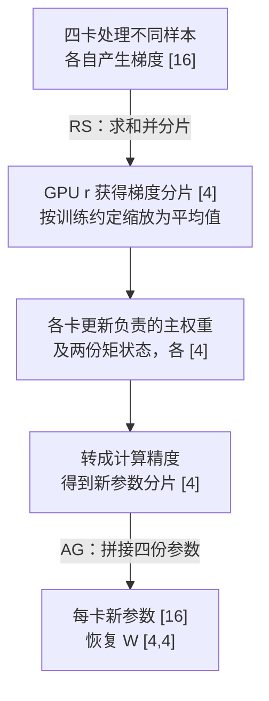
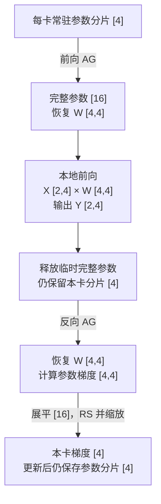
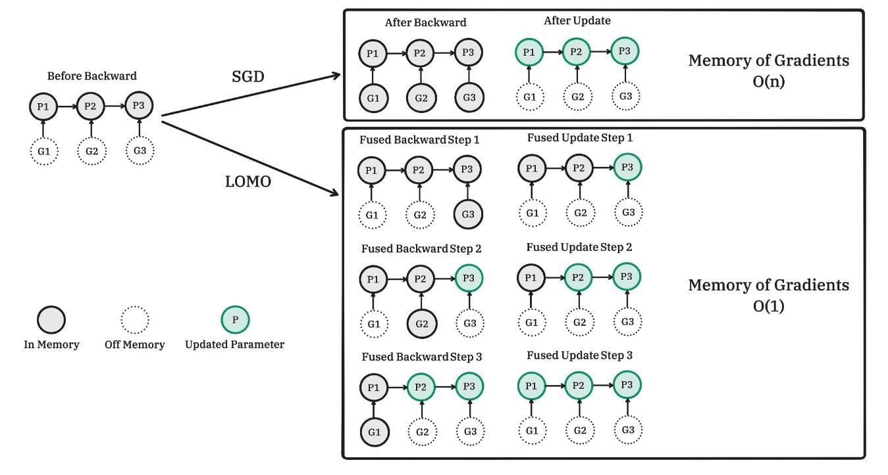

<!--Copyright © ZOMI 适用于[License](https://github.com/Infrasys-AI/AIInfra)版权许可-->

# 分布式优化器 ZeRO：面试问答与算法图解

> Author by: Ferman Yang

**记忆主线：ZeRO-1 分优化器状态，ZeRO-2 再分梯度，ZeRO-3 再分参数。** 面试回答按“省什么 → 怎么通信 → 有什么代价”展开。实现与配置细节见 [DeepSpeed ZeRO 详解](./02DeepSpeedZero.md)。

## 1. 训练显存都花在哪里？

**答：模型状态、激活、临时缓冲与碎片。ZeRO 三阶段主要优化模型状态。**

以混合精度 Adam 为例，设参数量为 $N$。Adam 是自适应矩估计（Adaptive Moment Estimation）优化器；FP16、FP32 为 16、32 位浮点格式，BF16 为 Brain Floating Point 16 位格式。

| 对象 | 保存什么 | 本文估算 |
| --- | --- | --- |
| 参数 $P$ | 前向、反向计算用权重 | FP16/BF16，$2N$ 字节 |
| 梯度 $G$ | 损失对参数的导数 | 假设为 16 位，$2N$ 字节 |
| 优化器相关状态 $O$ | FP32 主权重、一阶矩、二阶矩 | $12N$ 字节 |
| 激活 | 反向需要的层输入和中间结果 | 取决于微批次、序列长度和模型结构 |
| 其他 | 通信桶、算子工作区、显存碎片 | 取决于运行时 |

因此，**模型状态约占 $16N$ 字节，但训练峰值不止 $16N$**。10 亿参数即约 16 GB；这里 GB 为 $10^9$ 字节。

**追问：为什么不是固定的“每参数 16 字节”？** 主权重是混合精度实现中的副本，不是 Adam 的矩状态；梯度也可能用 FP32 累积。更通用的公式是 $(p+g+o)N$，其中 $p,g,o$ 分别是三类状态每参数的字节数。

## 2. ZeRO 为什么能省显存？三个阶段怎么背？

**答：普通数据并行（Data Parallelism，DP）重复保存模型状态，ZeRO 在 DP 组内分摊这些状态。** ZeRO 全称为 Zero Redundancy Optimizer，中文为零冗余优化器。[1]

设 DP 组有 $D$ 张图形处理器（Graphics Processing Unit，GPU），忽略填充、临时汇集和激活：

| 方式 | 参数 $P$ | 梯度 $G$ | 优化器相关状态 $O$ | 每卡模型状态 |
| --- | --- | --- | --- | --- |
| 普通 DP | 完整 | 完整 | 完整 | $16N$ |
| ZeRO-1 | 完整 | 按完整梯度预算 | 分片 | $4N+12N/D$ |
| ZeRO-2 | 完整 | 分片 | 分片 | $2N+14N/D$ |
| ZeRO-3 | 分片 | 分片 | 分片 | $16N/D$ |

*图 1：蓝色是参数，橙色是梯度，绿色是优化器状态。原图的 $\Psi$ 对应本文 $N$，$N_d$ 对应 $D$；三个分区行依次为 ZeRO-1、2、3。*

**四卡算例：** $N=10^9,D=4$ 时，普通 DP、ZeRO-1、2、3 分别为 **16、7、5.5、4 GB/卡**。算法是“复制项直接加，分片项除以卡数”。

**易错点：** ZeRO-1“省 4 倍”、ZeRO-2“省 8 倍”是上述精度假设下、卡数很大时的模型状态节省上限，并非四卡时就能达到。ZeRO-3 的 $1/D$ 也不适用于全部峰值显存。

## 3. 切成四份后，各卡到底存什么？

**答：按参数元素划分责任，每张卡只更新自己负责的那一段。**

设权重 $W:[4,4]$，展平为 $w:[16]$，四卡各负责一段 $[4]$：

| 卡 | 负责的参数区间（左闭右开） | 本卡独占维护的优化器相关状态 |
| --- | --- | --- |
| GPU 0 | $w[0:4]$ | 主权重、一阶矩、二阶矩，各 $[4]$ |
| GPU 1 | $w[4:8]$ | 同上，各 $[4]$ |
| GPU 2 | $w[8:12]$ | 同上，各 $[4]$ |
| GPU 3 | $w[12:16]$ | 同上，各 $[4]$ |

- **ZeRO-1：** 每卡参数仍为 $[16]$，只分摊优化器相关状态。
- **ZeRO-2：** 再只保留属于本卡的归约后梯度 $[4]$。
- **ZeRO-3：** 参数也只常驻 $[4]$，计算该层时临时恢复 $W:[4,4]$。

这里分片恰好对应一行，只为方便理解。真实分片边界不必与矩阵行或层边界重合。ZeRO-2/3 也仍会临时产生其他参数的局部梯度，然后归约、释放。

## 4. ZeRO-2 一步训练怎么走？

**答：本地计算梯度 → 归约到拥有者 → 各自更新 → 汇集新参数。**

先记住两种通信：全收集（All-Gather，AG）只拼接；归约散发（Reduce-Scatter，RS）先跨卡求和，再把不同分片交给不同卡。

*图 2：ZeRO-2 更新流程，箭头展示梯度与新参数的去向。梯度 $[16]$ 是逻辑总量，实际可逐桶产生、归约。优化器矩状态不参与 AG。*

若各卡样本数相同，拥有者 $j$ 更新时使用的梯度为：

$$
\bar g_j=\frac14\sum_{r=0}^{3}g_{r,j},\qquad g_{r,j},\bar g_j:[4].
$$

**追问：只更新四分之一参数，会不会少学数据？** 不会。该分片的梯度已经包含四张卡的样本贡献；分的是更新责任，不是丢掉其他卡的梯度。

ZeRO-1 也由拥有者更新并同步参数，但不采用 ZeRO-2 的梯度分片保留策略。具体实现未必直接调用一个 RS 接口，面试应区分**通信语义**与底层调用。

## 5. ZeRO-3 参数不完整，怎么做前向和反向？

**答：用到某层时先汇集参数，算完后按策略释放；反向需要时再汇集。**

*图 3：ZeRO-3 某层的基准生命周期。图示假设前向后释放完整参数；预取、缓存或持久化可能改变汇集次数。更新发生在整个模型达到更新边界之后。*

设输出梯度 $G_Y:[2,4]$，反向尺寸为：

$$
G_W=X^\top G_Y:[4,2][2,4]\to[4,4],\qquad
G_X=G_YW^\top:[2,4][4,4]\to[2,4].
$$

$G_W$ 需要跨 DP 组归约；$G_X$ 沿本卡计算图传给前一层。**ZeRO 不会自动把 DP 各卡的激活也平均切分。**

**追问：ZeRO-3 与张量并行（Tensor Parallelism，TP）有什么区别？** 普通 ZeRO-3 主要分摊状态存储，汇集参数后处理本地样本；TP 让多卡使用矩阵分片共同完成同一层计算。

## 6. 为什么说 ZeRO-3 通信是 DP 的 1.5 倍？

**答：在理想基准下，DP 是两段通信，ZeRO-3 是三段。这个倍数有前提。**

设参数与梯度通信精度相同，完整向量为 $L$ 字节，$\alpha=(D-1)/D$。按环形算法统计**每卡发送字节数**：AG 和 RS 各为 $\alpha L$；全归约（All-Reduce，AR）可分为 RS + AG，为 $2\alpha L$。

| 方式 | 一次更新的基准通信 | 每卡发送量 |
| --- | --- | --- |
| 普通 DP | 梯度 AR | $2\alpha L$ |
| ZeRO-2 | 梯度 RS + 新参数 AG | $2\alpha L$ |
| ZeRO-3 | 前向参数 AG + 反向参数 AG + 梯度 RS | $3\alpha L$ |

因此 $3/2=1.5$。例如四卡、10 亿参数、每元素 2 字节，三者分别发送 **3、3、4.5 GB/卡**。

**回答时补一句：** 这里假设一次前向、一次反向、一次更新，不额外考虑重计算取参或多微批次累积。通信精度、缓存、量化和调度都会改变结果。AR 中的系数 2 来自两个阶段，不是把发送和接收相加。[1]

## 7. ZeRO-R、卸载、ZeRO-Infinity 分别解决什么？

**答：分片决定“谁保存”，卸载决定“放哪里”，重计算决定“是否一直保存”。**

| 方法 | 解决的问题 | 代价或边界 |
| --- | --- | --- |
| ZeRO-DP | 参数、梯度和优化器状态重复存储 | 跨卡归约与参数汇集 |
| ZeRO-R | 激活、临时缓冲和碎片等剩余占用 | 依赖具体重计算、分片及内存管理策略 |
| 激活重计算 | 中间激活太多 | 少存激活，反向时多算一次 |
| 卸载（Offload） | GPU 容量不足 | 改存 CPU 内存或 NVMe，增加搬运 |
| ZeRO-Infinity | 结合 ZeRO-3 与异构存储扩展容量 | 需要缓冲、预取和带宽配合 |

CPU 为中央处理器（Central Processing Unit）；NVMe 为非易失性存储器高速接口（Non-Volatile Memory Express）。ZeRO-R 不是“第 4 阶段”，其分片激活检查点等功能也不会仅因模型变大就自动开启。

*图 4：本地参数分片从 CPU/NVMe 搬到 GPU，再跨卡汇集；梯度归约后交给拥有者更新。图中 $A$ 表示优化器状态，不是激活。*

**追问：卸载一定更快吗？** 不一定。搬运时间约为“搬运字节数 ÷ 有效带宽”；只有计算足够长且依赖允许时，才能隐藏部分搬运开销。容量增大不等于吞吐提升。[2]

分片激活检查点适用于模型并行组中原本重复的激活，不能直接照搬到样本各不相同的 DP 组。更大的微批次能摊薄每个样本的通信成本，但不会自动减少每次梯度归约的字节数。

## 8. LOMO 和 ZeRO 有什么区别？

**答：ZeRO 分摊状态，LOMO 缩短梯度存活时间，并采用低状态开销的更新方式。** LOMO 全称为 Low-Memory Optimization，中文为低内存优化。[3]

*图 5：普通随机梯度下降（Stochastic Gradient Descent，SGD）先保留各参数梯度再统一更新；LOMO 将梯度计算与更新融合，处理后及时释放。绿色表示已更新参数。*

图中的算法可读成：**产生当前参数梯度 → 在满足反向依赖后更新 → 释放梯度 → 继续处理下一参数**，从而不必同时保留所有参数的梯度。

**两个常见陷阱：**

- 图中的 $O(1)$ 指同时保留的梯度张量数量，不是梯度只占常数字节；峰值仍受当前参数张量大小影响。
- 不能把普通 Adam 简单改成“反向里直接 step”就称为 LOMO。全局梯度裁剪需要先获得范数，原始 LOMO 为此采用额外梯度范数计算过程；参数共享、梯度累积也需专门处理。

LOMO 仍需要激活和计算工作区，不能笼统地说“训练显存等于推理显存”。它与 ZeRO 优化的是不同环节，可以在兼容实现中结合。[3]

## 9. 面试收尾：怎么选，最容易错什么？

| 面试追问 | 简短回答 |
| --- | --- |
| 优化器状态太大？ | 先考虑 ZeRO-1；梯度也太大时考虑 ZeRO-2。 |
| 完整参数放不下？ | 考虑 ZeRO-3，同时检查初始化与最大模块的临时汇集峰值。 |
| 激活占主导？ | 缩小微批次、使用激活重计算；只升 ZeRO 阶段未必有效。 |
| ZeRO-3 一定最好？ | 最省常驻模型状态，但参数汇集可能拖慢训练，要看带宽和计算量。 |
| $16N/D$ 能直接预测峰值？ | 不能，还需激活、临时参数、通信缓冲和运行时空间。 |
| 梯度累积期间是否不通信？ | 不一定。更新只在累积边界发生，梯度通信可能每个微批次发生。 |

**30 秒回答模板：** ZeRO 消除数据并行中的模型状态冗余。Stage 1 分优化器状态，Stage 2 再分梯度，Stage 3 再分参数；各卡负责局部状态更新，通过梯度归约和参数汇集保持一致。Stage 3 计算前按需恢复参数，因此用通信换取更低的常驻显存。实际选择要同时看状态大小、激活、临时缓冲和网络带宽。

## 参考资料

1. [ZeRO 论文](https://arxiv.org/abs/1910.02054)、[DeepSpeed 官方教程](https://www.deepspeed.ai/tutorials/zero/)：三阶段分片与通信分析。
2. [ZeRO-Infinity 论文](https://arxiv.org/abs/2104.07857)：异构存储与卸载。
3. [LOMO 论文](https://arxiv.org/abs/2306.09782)、[官方代码](https://github.com/OpenLMLab/LOMO)：融合梯度计算与更新、梯度范数处理。

## 本节视频

<html>
<iframe src="https://player.bilibili.com/player.html?isOutside=true&aid=1804386342&bvid=BV1fb421t7KN&cid=1538761179&p=1&as_wide=1&high_quality=1&danmaku=0&t=30&autoplay=0" width="100%" height="500" scrolling="no" border="0" frameborder="no" framespacing="0" allowfullscreen="true"> </iframe>
</html>
