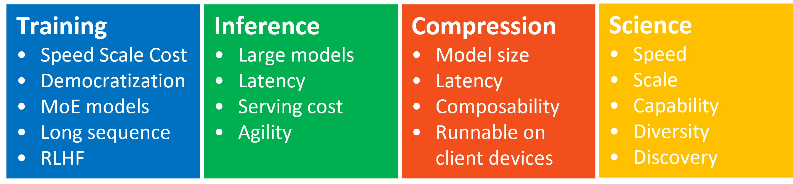
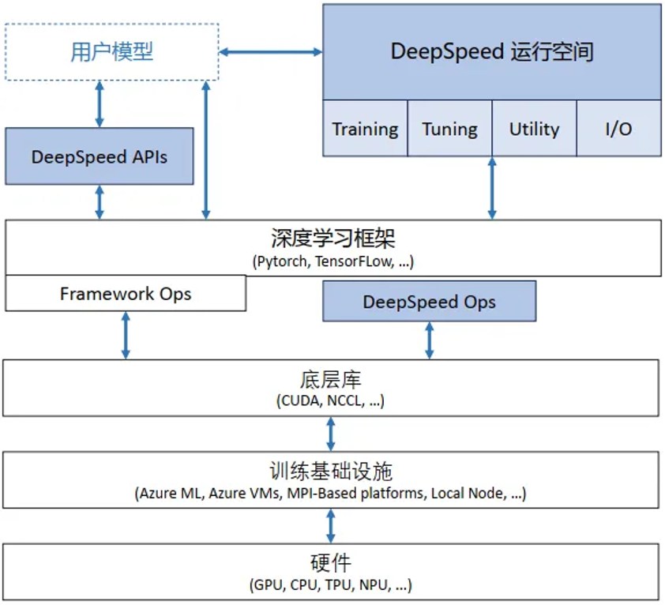
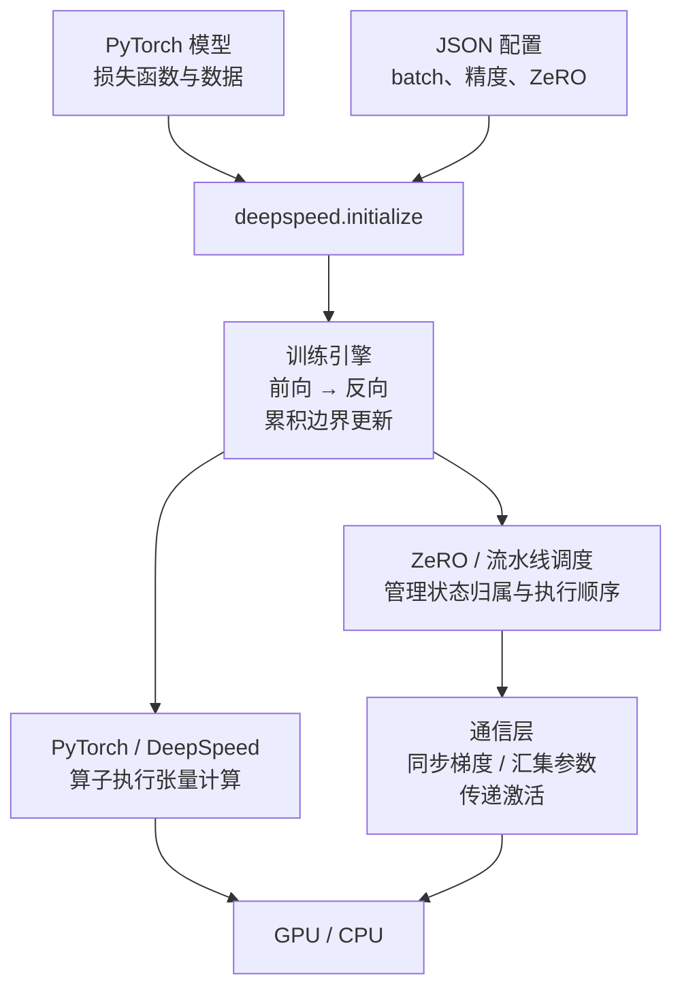
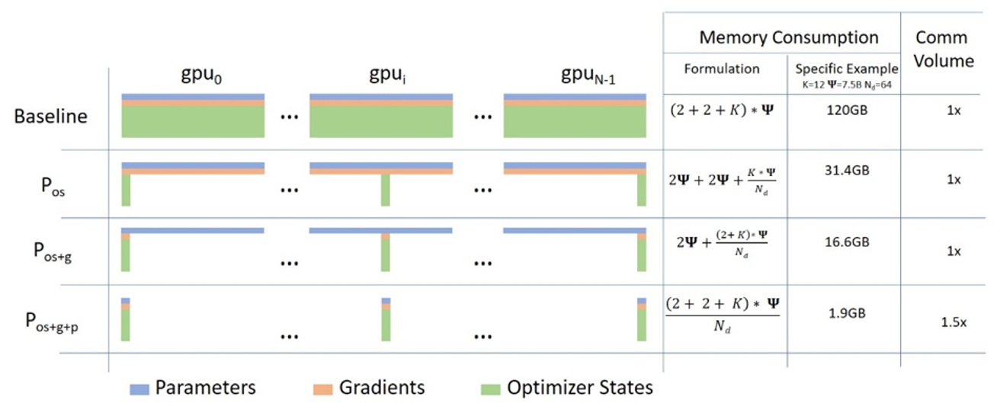
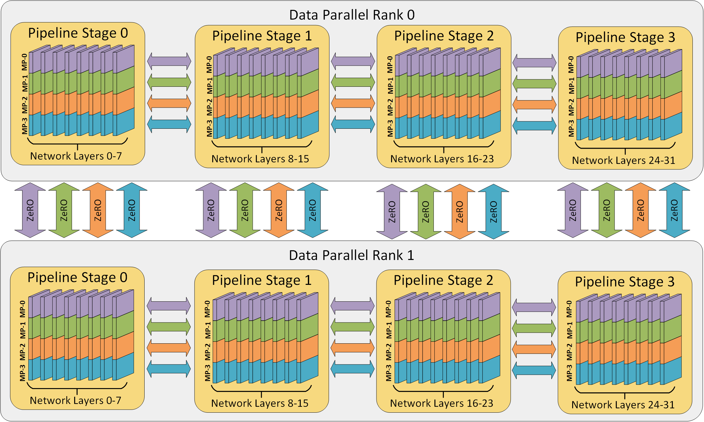
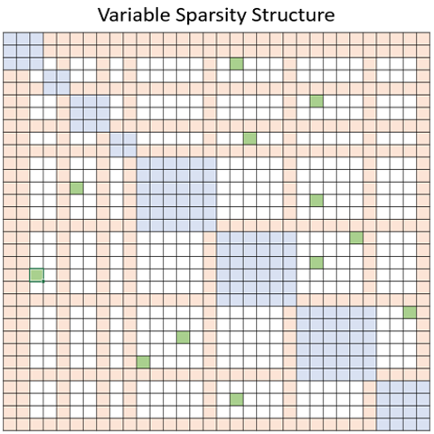
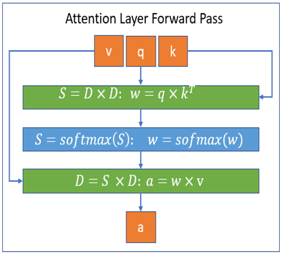
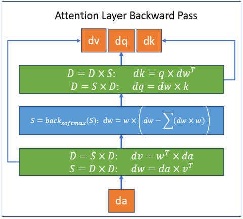

<!--Copyright © ZOMI 适用于[License](https://github.com/Infrasys-AI/AIInfra)版权许可-->

# 01. DeepSpeed 框架介绍

> Author by: Ferman Yang

DeepSpeed 是建立在 PyTorch 之上的深度学习优化库。模型变大后，训练往往同时遇到三类问题：**状态装不下、计算分配不均、通信等待过长**。DeepSpeed 用状态分片、并行调度和优化内核来处理这些问题。

本章以 [DeepSpeed v0.17.5](https://github.com/deepspeedai/DeepSpeed/tree/v0.17.5) 为源码阅读基线，重点介绍训练。在线文档会随版本更新，具体功能组合须核对所用版本。



原图展示四个方向：Training（训练）负责训练执行与内存优化；Inference（推理）优化模型执行；Compression（压缩）研究量化等方法；DeepSpeed4Science 面向科学计算。本章主要讨论 Training，推理仅说明入口与作用。

## 1. 从训练问题理解整体架构

### 1.1 分布式训练先分什么

一个训练步骤包括前向、反向和参数更新。多张图形处理器（Graphics Processing Unit，GPU）合作时，需要先决定数据、计算和模型状态分别由谁负责。

| 遇到的问题 | 常用方法 | 拆分或处理的对象 |
| --- | --- | --- |
| 单卡能装下模型，但吞吐不足 | 数据并行（Data Parallelism，DP） | 不同卡处理不同样本，同步梯度 |
| 每卡重复保存状态，显存不足 | 零冗余优化器（Zero Redundancy Optimizer，ZeRO） | 在 DP 组内分摊优化器状态、梯度或参数 |
| 模型层数多，整套层放不下 | 流水线并行（Pipeline Parallelism，PP） | 不同卡负责不同层，传递激活及其梯度 |
| 单层矩阵太大 | 张量并行（Tensor Parallelism，TP） | 多卡协作执行同一层的矩阵运算 |
| 反向所需的中间结果太多 | 激活重计算（Activation Checkpointing） | 少保存部分激活，反向时重新计算 |

这些方法可以组合，但组合是否可用取决于具体引擎。分布式训练也不是“增加 GPU 数量就按比例加速”：通信、负载不均和调度空闲都可能限制吞吐。

### 1.2 DeepSpeed 如何接在 PyTorch 上

DeepSpeed 整体软件架构如图:



读图时可从上往下理解：用户提供模型和配置，训练引擎安排执行，框架及优化算子完成计算，通信库和硬件负责实际运行。配置采用 JavaScript 对象表示法（JavaScript Object Notation，JSON）。**原图是抽象分层示意**；其中列出 TensorFlow、多种硬件，不代表本文的 PyTorch 接口能够直接运行于所有框架和设备。

图中的 CPU 指中央处理器（Central Processing Unit）；CUDA 是 NVIDIA 的统一计算设备架构（Compute Unified Device Architecture）及其编程平台。



*补充图 A：配置影响引擎的执行策略；引擎协调计算与通信。箭头表示调用或数据流向，不表示所有模块都必须启用。*

PyTorch 继续负责张量、模型定义和自动求导。DeepSpeed 引擎接管梯度累积、优化器更新及所选并行策略；其通信封装通常依赖 `torch.distributed`，在 NVIDIA GPU 上常使用 NVIDIA 集合通信库（NVIDIA Collective Communications Library，NCCL）。

原生 PyTorch 的分布式数据并行（DistributedDataParallel，DDP）主要同步模型副本的梯度；其完全分片数据并行（Fully Sharded Data Parallel，FSDP）也提供状态分片。DeepSpeed 是另一套训练组织方式，通常无需先把模型包成 DDP 再交给它。[1][2]

### 1.3 对照源码，找到每项职责

下面路径均相对于 v0.17.5 仓库根目录。可从 [`deepspeed/`](https://github.com/deepspeedai/DeepSpeed/tree/v0.17.5/deepspeed) 进入，按表定位：

| 代码位置 | 核心职责 | 适合追踪的问题 |
| --- | --- | --- |
| `deepspeed/__init__.py` | `initialize()` 入口，解析配置并选择引擎 | 用户模型如何变成训练引擎？ |
| `deepspeed/runtime/config.py` | 读取并校验训练配置 | batch 和精度选项怎样生效？ |
| `deepspeed/runtime/engine.py` | `DeepSpeedEngine`，组织 `backward()`、`step()` | 何时通信、何时真正更新参数？ |
| `deepspeed/runtime/zero/stage_1_and_2.py`、`stage3.py` | ZeRO 各阶段的优化器封装、梯度和状态管理 | 哪些状态只保留本卡分片？ |
| `deepspeed/runtime/zero/partition_parameters.py` | 参数分片、汇集及相关管理 | ZeRO-3 如何临时拿到完整参数？ |
| `deepspeed/runtime/pipe/` | `module.py` 定义阶段，`schedule.py` 排指令，`engine.py` 执行 | 谁安排某个微批次的前向、反向和收发？ |
| `deepspeed/comm/`、`deepspeed/launcher/` | 通信封装与进程启动 | 进程怎样启动，集合通信从哪里调用？ |
| `deepspeed/runtime/activation_checkpointing/`、`deepspeed/checkpoint/` | 分别处理激活重计算与训练检查点工具 | 临时激活与持久化训练状态怎样管理？ |
| `deepspeed/ops/`、`csrc/`、`op_builder/` | 算子接口、底层实现和扩展构建 | 优化算子怎样加载，依赖是否兼容？ |
| `accelerator/` | 封装设备能力与后端差异 | 运行环境支持哪些操作？ |

阅读顺序可先走 `initialize → DeepSpeedEngine.backward → DeepSpeedEngine.step`，再跟进所选 ZeRO 实现。对于 `PipelineModule`，初始化会选择 `PipelineEngine`，其批次入口是 `train_batch()`，不能照搬普通引擎的手写循环。[3]

底层算子可能使用 C++、CUDA 或 Triton。按需即时编译（Just-In-Time，JIT）和安装时预编译都是可用方式；并非启动后就会编译所有算子。使用 `ds_report` 检查当前环境的算子支持情况。[4]

## 2. ZeRO：减少模型状态的重复存储

### 2.1 先分清四种占用

| 对象 | 保存什么 | 主要由什么决定大小 |
| --- | --- | --- |
| 参数 | 模型当前权重 | 参数个数与存储精度 |
| 梯度 | 损失对参数的导数，形状与对应参数一致 | 参数个数与梯度精度 |
| 优化器状态 | 例如自适应矩估计（Adaptive Moment Estimation，Adam）的两份矩状态，以及某些混合精度实现中的 FP32 主权重 | 优化器及实现 |
| 激活值 | 前向产生、反向还会用到的中间张量 | 微批次、序列长度、层数及算子 |

这里 FP32 指 32 位浮点格式（32-bit Floating Point）。ZeRO 的三个阶段主要处理前三项，激活值需要结合微批次控制、重计算或其他并行方式处理。

### 2.2 三个阶段逐步分摊状态

设参数共有 $N$ 个元素，DP 组有 $D$ 张卡。忽略填充和临时缓冲，逻辑状态向量为 $[N]$，均匀切分后的每卡分片为 $[N/D]$。

| 方式 | 每卡参数 | 每卡梯度 | 每卡优化器状态 |
| --- | --- | --- | --- |
| 普通复制式 DP / ZeRO-0 | 完整 | 完整 | 完整 |
| ZeRO-1 | 完整 | 完整 | 分片 |
| ZeRO-2 | 完整 | 分片 | 分片 |
| ZeRO-3 | 分片，计算时按需汇集 | 分片 | 分片 |



图中的 $P_{os}$， $P_{os+g}$， $P_{os+g+p}$ 就是分别对应 Zero Stage 1， Stage 2 和 Stage 3.

图中采用经典混合精度 Adam 估算：参数、梯度各占 $2N$ 字节，FP32 主权重及两份矩状态共占 $12N$ 字节。因此每卡持久模型状态的理想占用为：

$$
M_0=16N,\quad
M_1=4N+\frac{12N}{D},\quad
M_2=2N+\frac{14N}{D},\quad
M_3=\frac{16N}{D}.
$$

例如 $N=10^9,D=4$，对应每卡约 16、7、5.5、4 GB（十进制）。这不是峰值显存预测：激活、通信缓冲、临时参数汇集和具体梯度精度都会改变实际占用；原图中的通信倍数也只对应其算法假设。[5]

### 2.3 分片之后怎样完成训练

- **ZeRO-1/2**：各卡计算本地样本的梯度；归约后由分片拥有者更新对应状态，再同步更新后的参数。ZeRO-2 会释放不属于本卡的梯度分片。
- **ZeRO-3**：某层计算前，通过全收集（All-Gather）把分片汇集为所需参数；反向后，通过归约散发（Reduce-Scatter）等操作把梯度贡献求和并交给分片拥有者。参数何时释放、复用或预取，由运行时策略决定。

以一层权重 $W:[4,8]$ 为例，展平后有 32 个元素，四卡各保存 $[8]$ 的参数分片。计算该层时，各卡汇集为 $[32]$ 并恢复 $[4,8]$，用本地输入 $X:[2,4]$ 计算 $XW:[2,8]$。这是“分摊存储、按需恢复计算参数”，与 TP 持续使用矩阵分片协同计算的方式不同。

混合精度 Adam 常由本卡 FP32 主权重完成更新，再生成计算用的低精度权重。详细推导见 [ZeRO 专题](./02DeepSpeedZero.md)，代码练习见 [ZeRO 实践](./Code01ZeRO.md)。

## 3. PP 与 TP：把计算也分给多张卡

### 3.1 三维并行各自负责什么

“三维并行”通常组合 DP、PP 和 TP：DP 分样本，PP 分层，TP 分单层矩阵；ZeRO 可在相应 DP 组内进一步分摊状态。



原图中，上下两行是不同 DP 副本；每行横向排列 PP 阶段，阶段内部的 MP 分片表示模型内的并行分工，在这里可按 TP 理解。跨阶段箭头传递前向激活及反向梯度；上下对应分片之间处理数据并行通信。

| 策略 | 两卡示例 | 主要跨卡内容 |
| --- | --- | --- |
| PP | 卡 0 保存前半层，卡 1 保存后半层；边界激活 $[b,S,d]$ 从卡 0 传到卡 1 | 前向激活、反向的激活梯度，形状均为 $[b,S,d]$ |
| TP | 权重 $W:[4,8]$ 按列拆为两个 $[4,4]$；相同输入 $X:[2,4]$ 各算出 $[2,4]$ | 若需要完整输出，沿特征轴汇集为 $[2,8]$；其他切法可能需要求和归约 |

$b$ 是微批次样本数，$S$ 是序列长度，$d$ 是隐藏维度。PP 的每个阶段保存自己各层的参数、梯度和优化器状态，并保留反向需要的局部激活；TP 则将相应权重及状态按算子布局分片，激活是否分片取决于具体层。

`PipelineModule` 需要模型具有明确的阶段划分；训练 TP 需要模型并行实现或支持该模型的自动切分机制。不能仅修改一个通用配置，就认为任意模型已正确启用 PP/TP。

**v0.17.5 的 `PipelineEngine` 明确禁止与 ZeRO-2/3 组合，可使用 ZeRO-0/1。** 这是一项具体引擎限制，不能从“三维并行”推断所有组合都可用。[6]

### 3.2 微批次怎样减少流水线空闲

一个大 batch 拆成多个 micro-batch（微批次）后，各阶段可以同时处理不同微批次。每次反向把梯度累积起来，到更新边界再更新参数。


图中 F、B 分别表示前向和反向，AR 表示全归约（All-Reduce），Step 表示参数更新。GPU 0、2 组成一条两阶段流水线，GPU 1、3 组成另一条；相同阶段的 DP 组分别是 {0,1}、{2,3}。

每条流水线处理 4 个微批次，两条合计 8 个。若每个微批次有 $b$ 个样本，全局 batch 为 $2\times4\times b=8b$，不再乘 PP 阶段数。阶段边界发送激活，反向沿相反方向发送其梯度。

该图把 DP 梯度归约画在累积末尾。不同实现可能重叠通信，但更新前仍需完成相应同步；混合精度溢出检查、全局梯度范数与裁剪也可能要求跨阶段协调。详细调度见 [流水线代码解析](./10PPCode.md)。

## 4. 稀疏注意力：控制参与计算的位置

稠密注意力中，单头 $Q,K:[S,d_h]$ 产生 $QK^\top:[S,S]$，每个 query 对所有 key 打分。块稀疏注意力只计算预先允许的块，以减少 query-key 配对数量。



以上图为例，蓝色，橙色和绿色块分别代表局部，全局以及随机注意力.

若每个 query 平均访问 $w$ 个 key，则保留约 $Sw$ 个分数，分数存储为 $O(Sw)$，主要乘加量为 $O(Swd_h)$。只有当 $w$ 不随 $S$ 同比例增长时，才有比稠密注意力更好的扩展趋势。选择稀疏连接会改变注意力范围，需要与模型训练方式匹配。

下图的 S 表示稀疏矩阵、D 表示稠密矩阵，不是本文公式中的序列长度 $S$。



单头前向的尺寸链为：

$$
Q:[S,d_h],\quad K^\top:[d_h,S]
\ \longrightarrow\ A:[S,S]\text{（只存允许位置）}
\ \longrightarrow\ P:[S,S]\text{（稀疏概率）};
\qquad PV:[S,S][S,d_h]\to O:[S,d_h].
$$

实际分数为 $QK^\top/\sqrt{d_h}$，再按允许的位置逐行做 Softmax。图为概念示意，省略了缩放及掩码细节。



设输出梯度为 $G_O:[S,d_h]$。反向先算 $G_V=P^\top G_O:[S,S][S,d_h]\to[S,d_h]$，再算 $G_P=G_OV^\top:[S,d_h][d_h,S]\to[S,S]$，经 Softmax 反向得到分数梯度 $G_A:[S,S]$。随后：

$$
G_Q=\frac{G_AK}{\sqrt{d_h}}:[S,S][S,d_h]\to[S,d_h],\qquad
G_K=\frac{G_A^\top Q}{\sqrt{d_h}}:[S,S][S,d_h]\to[S,d_h].
$$

仅允许的位置参与分数梯度计算。原反向图的 `dk` 标注容易产生转置歧义；采用本文“token 为行”的布局时，应以上式 $G_K=G_A^\top Q/\sqrt{d_h}$ 为准。

这组图展示旧版 Sparse Attention 模块的思想。v0.17.5 的 [兼容性检查](https://github.com/deepspeedai/DeepSpeed/blob/v0.17.5/op_builder/sparse_attn.py) 要求 PyTorch ≥1.5 且 <2.0，并检查 Triton 1.0.0；不能把它当作现代 PyTorch 环境中默认可用的模块。使用 Triton 也不意味着自动支持 CPU、OpenCL 或 Vulkan。本文不沿用旧硬件实验的加速倍数作为通用结论。

## 5. 进一步降低显存：重计算、卸载与混合精度

| 方法 | 具体改变 | 主要代价或边界 |
| --- | --- | --- |
| 激活重计算 | 保存片段边界输入，反向时重跑片段以恢复中间激活 | 增加计算；需实际对模块或函数启用 checkpoint |
| CPU 卸载 | 将指定参数或优化器状态放在主机内存，按需搬到 GPU；优化器卸载可在 CPU 上更新 | 消耗主机内存和传输带宽 |
| NVMe 卸载 | 使用非易失性存储器高速接口（Non-Volatile Memory Express，NVMe）设备作为更大容量的存储层 | 依赖存储吞吐、缓冲与预取，不能仅看容量 |
| 混合精度 | 部分参数和计算使用 FP16 或 BF16，必要的状态保持较高精度 | 需要硬件、算子支持及数值检查 |

FP16 是 16 位半精度浮点格式（16-bit Floating Point），BF16 是 Brain Floating Point 16 位格式。两者每元素都占 2 字节，但数值范围和有效精度不同。FP16 常需损失缩放；BF16 通常不需要损失缩放，但这并不保证任意计算都稳定。

以激活 $[b,S,d]=[2,1024,4096]$ 为例，该张量有 8,388,608 个元素，FP32 占 32 MiB，FP16/BF16 占 16 MiB（1 MiB 为 $2^{20}$ 字节）。重计算通常让它在前向后不再长期驻留，反向需要时重新生成相同尺寸的值；不是把隐藏维度减半。[7]

ZeRO-Offload 与 ZeRO-Infinity 把状态分片和异构存储结合起来。在 v0.17.5 的 [ZeRO 配置定义](https://github.com/deepspeedai/DeepSpeed/blob/v0.17.5/deepspeed/runtime/zero/config.py) 中，`offload_optimizer` 适用于 Stage 1/2/3，`offload_param` 仅适用于 Stage 3；具体设备与缓冲设置还需匹配所选路径。不要把“采用 ZeRO”理解为自动卸载，也不要把保存训练检查点与激活重计算混为一谈。

## 6. 一个小型训练配置与调用示例

以下针对**两张支持 BF16 的 NVIDIA GPU、纯 DP + ZeRO-2、普通 DeepSpeedEngine**。先准备相互兼容的 PyTorch、CUDA 与 DeepSpeed 环境，并运行 `ds_report`；源码阅读基线为 v0.17.5，不要求为此把工作环境降级。[4]

把下面内容保存为 `ds_config.json`：

```json
{
  "train_micro_batch_size_per_gpu": 2,
  "gradient_accumulation_steps": 4,
  "train_batch_size": 16,
  "bf16": {"enabled": true},
  "zero_optimization": {"stage": 2},
  "optimizer": {
    "type": "Adam",
    "params": {"lr": 0.001, "torch_adam": true, "adam_w_mode": false}
  },
  "gradient_clipping": 1.0
}
```

| 配置项 | 作用与适用场景 |
| --- | --- |
| `train_micro_batch_size_per_gpu` | 一次前后向每个数据副本处理的样本数；激活显存不足时优先减小 |
| `gradient_accumulation_steps` | 累积多少个微批次再更新；本例为 4 |
| `train_batch_size` | 每次更新的全局样本数，本例 $2\times4\times2=16$ |
| `zero_optimization.stage` | 本例 2：分片优化器状态和梯度；参数仍复制 |
| `bf16.enabled` | 启用 BF16 路径；使用 `fp16.enabled` 是另一种选择，二者不同时启用 |
| `optimizer` | 指定学习率；`torch_adam` 选用 PyTorch 实现，`adam_w_mode: false` 明确使用 Adam 而非 AdamW |
| `gradient_clipping` | 按所用训练路径计算的全局梯度范数进行裁剪；不是每张卡各自裁剪后直接拼接 |

通常有 $B_{\mathrm{global}}=b\times m\times D$，其中 $m$ 为累积步数、$D$ 为数据并行度；引入 PP/TP 后不能直接把总卡数代入 $D$。[8]

下面保存为 `train.py`，使用随机数据观察调用顺序：

```python
import os
import torch
import deepspeed

torch.cuda.set_device(int(os.environ["LOCAL_RANK"]))
torch.manual_seed(7)
model = torch.nn.Linear(16, 8)
engine, _, _, _ = deepspeed.initialize(
    model=model,
    model_parameters=model.parameters(),
    config="ds_config.json",
)
engine.train()
torch.manual_seed(1000 + torch.distributed.get_rank())

for _ in range(8):
    dtype = next(engine.parameters()).dtype
    x = torch.randn(2, 16, device=engine.device, dtype=dtype)
    target = torch.randn(2, 8, device=engine.device)
    prediction = engine(x)
    loss = (prediction.float() - target).square().mean()
    engine.backward(loss)
    engine.step()

if torch.distributed.get_rank() == 0:
    print("global_steps =", engine.global_steps)
```

运行 `deepspeed --num_gpus 2 train.py`。线性层使用 PyTorch 的权重布局 $[8,16]$，前向为 $[2,16][16,8]\to[2,8]$，加偏置后形状不变；损失按元素求均值得到标量。

在该默认累积模式下，每个微批次都调用 `engine.step()`，引擎每 4 次才更新一次；8 个微批次后应输出 `global_steps = 2`。不要额外手动调用外部 `optimizer.step()`，也不要重复把损失除以 4。真实数据集需按 DP rank 正确分片；这里用不同随机种子生成各卡数据。[1][3]

## 7. 推理优化：入口与训练不同

训练入口是 `deepspeed.initialize()`，传统 DeepSpeed-Inference 入口是 `deepspeed.init_inference()`。推理无需保存训练用的梯度与优化器状态，但自回归生成仍可能需要键值缓存（Key-Value Cache，KV cache）。[9]

Transformer 推理内核可融合部分算子、减少中间读写和启动开销；TP 可以分摊权重与计算。内核注入、支持的模型结构、精度和并行方式都有版本约束，不能把训练配置原样当作推理配置，也不能保证所有自定义模型都适配同一组融合内核。

## 8. 版本状态与学习顺序

截至 **2026-10-27** 核验，官方仓库未归档，仍有提交记录，并于 **2026-10-20 发布 v0.19.8**；因此“DeepSpeed 官方已经停止维护”不成立。具体模块可能有不同的更新频率，旧稀疏注意力的依赖限制也不能推导为整个项目停止维护。[10]

入门时先用小模型跑通普通引擎，确认全局 batch、损失与更新次数；遇到显存瓶颈后，区分模型状态和激活占用，再选择 ZeRO、重计算或卸载。需要进一步切分计算时，再进入 PP/TP 专题，并核对组合限制。

## 参考资料

1. [DeepSpeed Getting Started](https://www.deepspeed.ai/getting-started/)：初始化与训练接口。
2. [PyTorch DistributedDataParallel](https://docs.pytorch.org/docs/stable/generated/torch.nn.parallel.DistributedDataParallel.html)：原生数据并行的职责。
3. [v0.17.5 初始化入口](https://github.com/deepspeedai/DeepSpeed/blob/v0.17.5/deepspeed/__init__.py)、[训练引擎](https://github.com/deepspeedai/DeepSpeed/blob/v0.17.5/deepspeed/runtime/engine.py)：本文调用链与累积边界的源码依据。
4. [DeepSpeed Installation Details](https://www.deepspeed.ai/tutorials/advanced-install/)：算子构建与环境检查。
5. [ZeRO 论文](https://arxiv.org/abs/1910.02054)、[ZeRO 官方教程](https://www.deepspeed.ai/tutorials/zero/)：状态分片；[ZeRO-Infinity 论文](https://arxiv.org/abs/2104.07857)：异构存储卸载。
6. [v0.17.5 PipelineEngine](https://github.com/deepspeedai/DeepSpeed/blob/v0.17.5/deepspeed/runtime/pipe/engine.py)：流水线执行与 ZeRO 组合限制。
7. [DeepSpeed Activation Checkpointing](https://deepspeed.readthedocs.io/en/latest/activation-checkpointing.html)：激活重计算及相关内存选项。
8. [DeepSpeed Configuration JSON](https://www.deepspeed.ai/docs/config-json/)：batch、精度与优化器配置；在线页面可能包含基线版本之后新增的选项。
9. [DeepSpeed Inference Setup](https://deepspeed.readthedocs.io/en/latest/inference-init.html)：推理入口及配置。
10. [官方仓库](https://github.com/deepspeedai/DeepSpeed)、[v0.19.8 发布记录](https://github.com/deepspeedai/DeepSpeed/releases/tag/v0.19.8)：维护状态核验依据。
