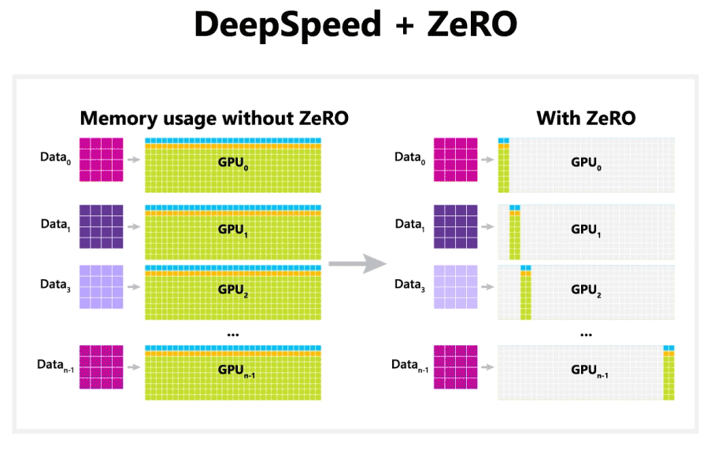
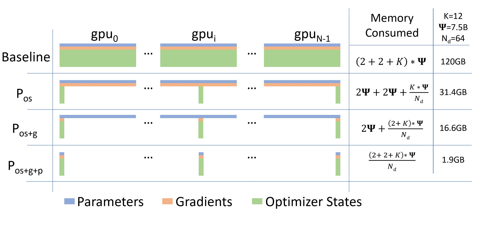
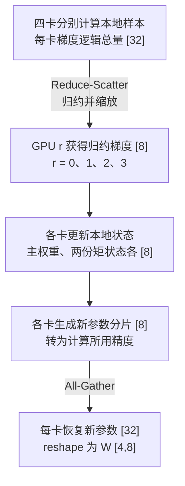
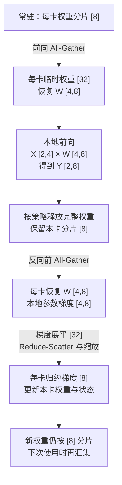
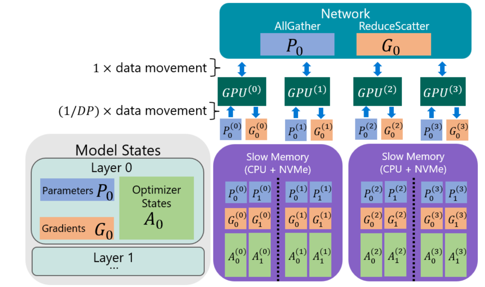
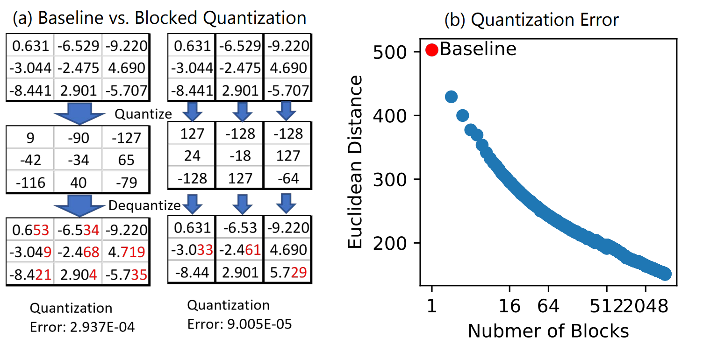
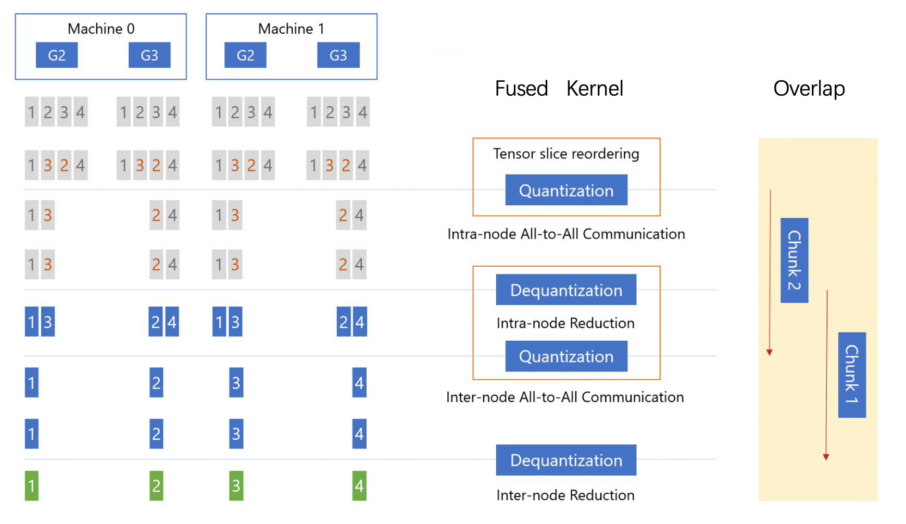

<!--Copyright © ZOMI 适用于[License](https://github.com/Infrasys-AI/AIInfra)版权许可-->

# 02. DeepSpeed ZeRO 系列介绍

Author by: Feiming Yang

[上一章](./01DeepSpeedIntro.md)介绍了 DeepSpeed 的整体架构。本章回答三个问题：**每张卡保存哪些状态，缺少的状态怎样通过通信获得，以及显存能省多少。**

零冗余优化器（Zero Redundancy Optimizer，ZeRO）在数据并行（Data Parallelism，DP）组内分摊模型状态。各卡仍处理不同样本，分片后的参数更新共同构成一次完整模型更新。本文源码说明沿用 **DeepSpeed v0.17.5**；其他版本的调度细节与功能组合可能不同。

## 1. 显存为什么不够

### 1.1 先区分模型状态与激活

训练不仅要存权重，还要保存梯度、优化器状态和反向所需的中间结果。普通复制式 DP 中，每张图形处理器（Graphics Processing Unit，GPU）保存完整模型状态，增加卡数不会自动降低这部分单卡占用。



*图 1：左侧各卡保存重复的模型状态，右侧用分片分摊状态。输入样本仍按数据并行分配，右侧不表示全部显存占用都能按卡数等分。*

本章以混合精度 Adam 为算例。Adam 是自适应矩估计（Adaptive Moment Estimation）优化器；FP16、FP32 分别为 16、32 位浮点格式，BF16 为 Brain Floating Point 16 位格式。

| 对象 | 作用 | 本章估算采用的存储 |
| --- | --- | --- |
| 计算用参数 $P$ | 前向、反向使用的权重 | FP16/BF16，2 字节/元素 |
| 参数梯度 $G$ | 损失对各参数的导数 | 假设为 2 字节/元素 |
| FP32 主权重 | 保留较高精度的参数更新结果 | 4 字节/元素 |
| Adam 一阶矩、二阶矩 | 分别跟踪梯度及其平方的移动平均 | 各 4 字节/元素 |
| 激活 | 反向需要的层输入、中间结果 | 取决于微批次、序列长度、层结构和重计算策略 |

为方便计数，把主权重和两份矩状态合记为优化器相关状态 $O$，即每个参数对应 **12 字节**。主权重不是 Adam 算法本身的矩状态，而是这里采用的混合精度实现所维护的权重副本。

**2 字节梯度是估算假设，不是 BF16 训练的固定规则。** 梯度累积、通信和优化器更新可以使用不同精度，应分别核对。

### 1.2 统一符号与计算口径

| 符号 | 含义 |
| --- | --- |
| $N$ | 参数元素总数，展平后形状为 $[N]$ |
| $D$ | ZeRO 所在 DP 组的进程数；本文每进程使用一张卡 |
| $r$ | 组内进程编号，$r=0,\ldots,D-1$ |
| $p,g,o$ | 每个参数对应的参数、梯度、优化器相关状态字节数 |
| $b$ | 每卡每个微批次的样本数 |

假设分片均匀、$N$ 能被 $D$ 整除，不计填充。没有 ZeRO 时，每卡模型状态为：

$$
M_{\mathrm{DP}}=(p+g+o)N.
$$

取 $p=2,g=2,o=12$，得到 $16N$ 字节。1750 亿参数对应 $2.8\times10^{12}$ 字节，即 **2800 GB**，尚未计入激活和缓冲。本文 GB 使用十进制 $10^9$ 字节；GiB 使用 $2^{30}$ 字节。

## 2. ZeRO-1/2/3 到底切分什么

### 2.1 从完整副本到分片

ZeRO 的三个阶段逐步叠加，而不是三个互不相关的算法。

| 方式 | 每卡计算用参数 $P$ | 每卡梯度 $G$ | 每卡优化器相关状态 $O$ |
| --- | --- | --- | --- |
| 普通 DP / ZeRO-0 | 完整 $[N]$ | 完整 $[N]$ | 三份完整 $[N]$ |
| ZeRO-1 | 完整 $[N]$ | 按完整梯度预算 | 三份分片 $[N/D]$ |
| ZeRO-2 | 完整 $[N]$ | 归约后保留 $[N/D]$ | 三份分片 $[N/D]$ |
| ZeRO-3 | 常驻分片 $[N/D]$ | 归约后保留 $[N/D]$ | 三份分片 $[N/D]$ |

表中描述存储布局与预算。反向传播会临时产生当前层或当前桶的梯度；ZeRO-2/3 并不是“从来不产生其他参数的梯度”。ZeRO-3 计算前也会临时汇集所需参数。[1][2]



*图 2：蓝、橙、绿分别表示参数、梯度、优化器相关状态。原图的 $\Psi$ 对应本文 $N$，$N_d$ 对应 $D$，$K=12$ 对应 $o$；$P_{os}$、$P_{os+g}$、$P_{os+g+p}$ 分别对应 ZeRO-1、2、3。*

### 2.2 四卡例子：谁负责哪一段

设一层权重 $W:[4,8]$，不含偏置。展平为 $w:[32]$ 后，按连续元素分成四段：

| 分片拥有者 | 元素区间（左闭右开） | 本卡负责更新的状态 |
| --- | --- | --- |
| GPU 0 | $w[0:8]$ | 第 0 段的主权重、一阶矩、二阶矩，各 $[8]$ |
| GPU 1 | $w[8:16]$ | 第 1 段的三份状态，各 $[8]$ |
| GPU 2 | $w[16:24]$ | 第 2 段的三份状态，各 $[8]$ |
| GPU 3 | $w[24:32]$ | 第 3 段的三份状态，各 $[8]$ |

这里每段恰好对应一行，只是为了便于理解。真实实现可把一个参数组展平后分片，分界不必与层或矩阵行对齐。

- **ZeRO-1**：每卡仍保存完整 $w:[32]$，但只维护本卡负责的三份 $[8]$ 优化器相关状态。
- **ZeRO-2**：进一步只保留本卡负责的归约后梯度 $[8]$。
- **ZeRO-3**：计算用权重也只常驻本卡 $[8]$，用到该层时再汇集为 $[32]$，恢复为 $W:[4,8]$。

每卡使用不同输入 $X_r:[2,4]$。普通 ZeRO-3 汇集完整权重后，执行 $X_rW:[2,4][4,8]\to[2,8]$。这与张量并行（Tensor Parallelism，TP）让多卡协作计算同一层矩阵分片不同。

## 3. 通信怎样把分片连接起来

### 3.1 三种集合通信各做什么

集合通信要求同一进程组的成员协作。下表仍用四卡、32 个元素说明；梯度归约先按求和描述，训练时按约定缩放为平均梯度。

| 通信 | 通信前 | 通信后 | 是否做数值运算 |
| --- | --- | --- | --- |
| 全收集（All-Gather） | 每卡持有不同分片 $[8]$ | 每卡获得完整 $[32]$ | 拼接，不求和 |
| 归约散发（Reduce-Scatter） | 每卡贡献逻辑向量 $[32]$ | 跨卡求和后，每卡获得不同分片 $[8]$ | 先归约，再分配 |
| 全归约（All-Reduce） | 每卡贡献逻辑向量 $[32]$ | 每卡获得相同的归约结果 $[32]$ | 归约并复制结果 |

例如各卡对第 $j$ 段产生梯度 $g_{r,j}:[8]$。在各卡样本数相同、采用平均损失的例子中，拥有者 $j$ 需要：

$$
\bar g_j=\frac{1}{4}\sum_{r=0}^{3}g_{r,j},\qquad \bar g_j:[8].
$$

它必须包含**所有卡的样本贡献**，不能仅用拥有者自身的局部梯度更新。

### 3.2 ZeRO-1 与 ZeRO-2：先归约梯度，再同步新参数

以 ZeRO-2 为例，一次更新可以概括为下图。“每卡 $[32]$”是待归约梯度的逻辑总量，运行时可逐桶产生和归约，不必一次性常驻完整向量。



*补充图 A：ZeRO-2 的一次更新。箭头依次表示梯度归约、拥有者更新和参数同步；优化器矩状态留在拥有者上，不需要全收集。*

ZeRO-1 也只由拥有者更新相应参数段，再同步新参数。它与 ZeRO-2 的关键区别是**是否分片保留梯度**，而不是“是否会通信”。具体实现可以把梯度归约到对应拥有者，不必机械地执行“完整 All-Reduce 后再 All-Gather”。

若累积多个微批次，参数在累积边界才更新，但梯度归约可能在各微批次的反向中发生。不要把“每次更新一次”误读为“期间只通信一次”。

### 3.3 ZeRO-3：用到一层，汇集一层

ZeRO-3 的参数常驻布局也是分片。下图跟踪某一层，其他层以相同原则调度。



*补充图 B：ZeRO-3 的参数生命周期。展示“前向后释放、反向前重新汇集”的基准流程；预取、缓存及参数持久化可能改变实际汇集次数。*

图中的“更新”发生在整个模型完成本次梯度累积、达到更新边界之后，并非某层梯度一产生就立即修改该层权重。

设本层输出梯度为 $G_Y:[2,8]$，本地反向的主要矩阵尺寸为：

$$
G_W=X^\top G_Y:[4,2][2,8]\to[4,8],\qquad
G_X=G_YW^\top:[2,8][8,4]\to[2,4].
$$

$G_W$ 是需要在 DP 组内归约的参数梯度；$G_X$ 沿本卡计算图传回前一层。ZeRO 不会自动把这些激活梯度按 DP 组分片。

## 4. 显存能省多少

### 4.1 通用公式与具体算例

把“复制项”直接相加，把“分片项”除以 $D$：

| 方式 | 每卡模型状态字节数 | 取 $p=2,g=2,o=12$ |
| --- | --- | --- |
| 普通 DP | $(p+g+o)N$ | $16N$ |
| ZeRO-1 | $(p+g)N+oN/D$ | $4N+12N/D$ |
| ZeRO-2 | $pN+(g+o)N/D$ | $2N+14N/D$ |
| ZeRO-3 | $(p+g+o)N/D$ | $16N/D$ |

设 $N=10^9$，即 10 亿参数，$D=4$：

| 方式 | 参数 | 梯度 | 优化器相关状态 | 每卡合计 |
| --- | --- | --- | --- | --- |
| 普通 DP | 2 GB | 2 GB | 12 GB | **16 GB** |
| ZeRO-1 | 2 GB | 2 GB | 3 GB | **7 GB** |
| ZeRO-2 | 2 GB | 0.5 GB | 3 GB | **5.5 GB** |
| ZeRO-3 | 0.5 GB | 0.5 GB | 3 GB | **4 GB** |

原图 2 用的是 $N=7.5\times10^9,D=64$，结果为 120、31.40625、16.640625、1.875 GB，与图中的四舍五入数值一致。

“ZeRO-1 节省 4 倍、ZeRO-2 节省 8 倍”是上述精度假设下、$D$ 很大时的模型状态节省上限；四卡例子并不达到这两个倍数。ZeRO-3 的常驻模型状态理想上缩小为 $1/D$，也不等于总峰值显存缩小为 $1/D$。

### 4.2 为什么公式算得下，运行仍可能溢出

实际峰值还取决于**同一时刻有哪些张量存活**：

$$
M_{\mathrm{peak}}
\approx M_{\mathrm{resident\ states}}
+M_{\mathrm{live\ activations}}
+M_{\mathrm{temporary\ gather/buffers}}
+M_{\mathrm{runtime/fragmentation}}.
$$

各项应按同时存活、去除重叠后的占用计算，不能把不同时间的峰值简单相加。

| 额外占用 | 为什么存在 | 优先检查 |
| --- | --- | --- |
| 激活 | 每卡仍计算自己的样本 | 微批次、序列长度、激活重计算 |
| 临时完整参数 | ZeRO-3 需要执行当前模块 | 最大模块、预取量、保留参数策略 |
| 通信桶 | 打包梯度、参数并支持重叠 | 桶大小、通信精度、并发缓冲数量 |
| 初始化与保存 | 可能临时构造完整模型或权重 | 分片初始化、分片检查点与权重导出方式 |

例如一个 5000 万元素的缓冲区，使用 2 字节精度时约占 100 MB；多桶重叠时不能只预留这一份空间。若梯度按 4 字节保存，应把公式中的 $g$ 改为 4，而不是继续套用 $16N$。

## 5. 通信量怎么算：先明确统计口径

### 5.1 按每卡发送字节数计算

下面使用环形集合通信的理想模型，**统计每卡发送量**，不把接收量再加一次。设完整向量为 $L$ 字节，$\alpha=(D-1)/D$：

$$
C_{\mathrm{AG}}=\alpha L,\qquad
C_{\mathrm{RS}}=\alpha L,\qquad
C_{\mathrm{AR}}=2\alpha L.
$$

All-Reduce 可分解为 Reduce-Scatter 和 All-Gather 两个阶段，因此系数是 2；**不是因为同时计算发送和接收**。同一理想模型下接收量相同，若统计收发合计需再乘 2，若统计全组发送量则乘 $D$。

### 5.2 普通 DP、ZeRO-2、ZeRO-3 的对比

假设一次前向、一次反向、一次参数更新；参数不跨前后向保留，忽略填充、延迟、额外标量通信。通信参数与梯度分别为 $p_c,g_c$ 字节/元素：

| 方式 | 基准通信过程 | 每卡发送字节数 |
| --- | --- | --- |
| 普通 DP | 梯度 All-Reduce | $2\alpha g_cN$ |
| ZeRO-2 | 梯度 Reduce-Scatter + 新参数 All-Gather | $\alpha(g_c+p_c)N$ |
| ZeRO-3 | 前向、反向参数各 All-Gather 一次 + 梯度 Reduce-Scatter | $\alpha(2p_c+g_c)N$ |

若 $p_c=g_c=2$，三者分别为 $4\alpha N$、$4\alpha N$、$6\alpha N$ 字节。四卡、10 亿参数时，分别是 **3、3、4.5 GB/卡**。这就是常见“ZeRO-2 与 DP 通信量相当，ZeRO-3 为 1.5 倍”的来源。[1]

ZeRO-1 在把梯度归约到拥有者、再同步参数的安排下，也可达到相近的理论通信量；若具体路径先做完整梯度 All-Reduce 再同步参数，则不能套用这一结论。**阶段定义描述状态归属，不保证某条固定的底层通信调用链。**

多微批次累积、激活重计算、参数缓存、量化和不同通信精度都会改变上述计数。通信时间还取决于消息数量、网络拓扑与计算重叠；字节数相同不代表耗时相同。

## 6. 在 DeepSpeed 源码与配置中对应到哪里

### 6.1 先找真实入口，再看通信实现

下表路径相对于 v0.17.5 仓库根目录。普通模型通过 `deepspeed.initialize()` 返回 `DeepSpeedEngine`，训练调用 `engine.backward(loss)` 和 `engine.step()`；`train_batch()` 是流水线引擎的接口，不能混用。

| 路径或类 | 阅读重点 |
| --- | --- |
| `deepspeed/runtime/zero/stage_1_and_2.py` 中的 `DeepSpeedZeroOptimizer` | 展平参数组，为拥有者建立 FP32 主权重分片；用 `partition_gradients` 区分阶段 |
| 同文件的梯度归约及 `step()` 路径 | 归约桶、丢弃非本卡梯度、局部更新、同步新参数 |
| `deepspeed/runtime/zero/stage3.py` 中的 `DeepSpeedZeroOptimizer_Stage3` | 分片梯度与优化器更新 |
| `deepspeed/runtime/zero/partition_parameters.py` | `zero.Init`、参数分片及 `ds_tensor` 等元数据 |
| `deepspeed/runtime/zero/parameter_offload.py`、`partitioned_param_coordinator.py` | 模块钩子、参数获取、预取、释放 |
| `deepspeed/runtime/zero/config.py` | 配置字段、默认值与适用阶段 |

例如 Stage 1/2 的源码存在 `average_tensor`、`allreduce_and_scatter` 等路径，参数同步使用通信封装；不要把 Reduce-Scatter 的数学语义写成“必然调用一次 `torch.distributed.reduce_scatter_tensor`”。[3]

### 6.2 ZeRO-3 初始化也需要控制峰值

小模型可以先正常构建，再由引擎分片。大模型若连初始化都放不下，应在构建阶段使用 `deepspeed.zero.Init(...)`，尽早转换和分片参数。[4]

它不是“参数完全不分配内存”，也不是“一个参数只存在某一张卡，其他卡都是空的”。各进程保留参数对象及分片元数据；完整参数在初始化、计算或显式访问时可能临时物化，本地分片由相应存储管理。

模型含共享权重、跨模块访问参数或自定义更新时，需要核对外部参数管理接口。参数汇集后能否及时释放，也取决于模块使用方式和缓存策略。

### 6.3 从小配置开始

以下为合并进训练配置的 **ZeRO 配置片段**，不是独立训练程序。JSON（JavaScript Object Notation，JavaScript 对象表示法）字段说明以 v0.17.5 为基线：

```json
{
  "zero_optimization": {
    "stage": 2,
    "contiguous_gradients": true,
    "reduce_scatter": true,
    "overlap_comm": true,
    "reduce_bucket_size": 50000000,
    "allgather_bucket_size": 50000000
  }
}
```

| 配置项 | 用途及边界 |
| --- | --- |
| `stage` | 选择状态分片范围；不是越大越快 |
| `contiguous_gradients` | 将梯度组织到连续缓冲，减少碎片 |
| `reduce_scatter` | 选择面向拥有者的梯度归约路径；底层实现依版本而异 |
| `overlap_comm` | 尝试重叠计算与通信，可能增加同时存活的缓冲 |
| `reduce_bucket_size`、`allgather_bucket_size` | 上例归约、参数汇集桶的元素数，**单位不是字节** |
| `stage3_prefetch_bucket_size`、`stage3_param_persistence_threshold` | Stage 3 的预取与小参数保留策略，需要在显存和通信间取舍 |
| `offload_optimizer` | v0.17.5 支持 Stage 1/2/3；卸载优化器相关状态，更新计算在 CPU 上 |
| `offload_param` | v0.17.5 仅用于 Stage 3，指定参数分片的卸载位置 |

CPU 是中央处理器（Central Processing Unit）。先跑通不卸载的小配置，再依据实际峰值和通信耗时调整。完整训练调用见[框架介绍](./01DeepSpeedIntro.md)，实践见 [ZeRO 代码练习](./Code01ZeRO.md)。[8]

## 7. ZeRO-R：处理模型状态之外的占用

ZeRO 论文把模型状态优化称为 ZeRO-DP，把激活、临时缓冲和碎片等剩余占用的优化称为 ZeRO-R。**ZeRO-R 不是另一个 `stage` 值，也不会仅因模型变大就自动启用所有功能。**

| 方法 | 保存什么、恢复什么 | 主要代价 |
| --- | --- | --- |
| 激活重计算（Activation Checkpointing） | 保存片段边界输入，反向重跑片段 | 额外计算 |
| 分片激活检查点 | 对模型并行组中原本重复的边界激活分片，需要时汇集 | 额外 All-Gather |
| 激活卸载 | 把选定激活暂存 CPU 内存，需要时搬回 | 主机与 GPU 之间的传输 |
| 有界缓冲与连续存储 | 控制临时桶大小，减少碎片 | 需平衡缓冲容量与通信效率 |

例如某边界激活为 $[2,1024,4096]$，共有 8,388,608 个元素。以 2 字节存储，共 16 MiB；若在四卡模型并行组中原本重复保存，可展平后每卡存 $[2097152]$，即 4 MiB。恢复时 All-Gather 得到 $[8388608]$，再还原原形状。1 MiB 为 $2^{20}$ 字节。

该例不能直接用于 DP 组：DP 各卡的样本不同，激活通常不是可互相替代的副本。分片检查点需要显式配置并实际使用对应检查点接口；保存的边界张量也不等于全部激活。[5]

增加微批次可能摊薄每个样本的通信成本，但不会让固定模型每次梯度归约的字节数自动变小。“通信只增加不到 10%”等结论依赖特定模型和调度，不作为通用估算。

## 8. ZeRO-Infinity 与 ZeRO++：容量和带宽的进一步取舍

### 8.1 ZeRO-Infinity：把状态放到更大的存储层

分片解决“由谁保存”，卸载解决“保存在哪里”。ZeRO-Infinity 结合 ZeRO-3 与 GPU、CPU 内存和 NVMe 存储；NVMe 是非易失性存储器高速接口（Non-Volatile Memory Express）。



*图 3：本地分片在慢速存储与 GPU 间搬运；GPU 之间汇集所需参数、归约梯度。图中的 $A$ 表示优化器状态，不表示激活。*

以本章四卡权重为例，每进程负责的 $[8]$ 参数分片先从其存储位置进入 GPU，再参与 All-Gather，临时得到 $[32]$。梯度归约得到本卡 $[8]$ 后交给拥有者的更新路径。NVMe 通常还涉及主机内存缓冲；卸载不会消除 GPU 上的临时完整参数和计算工作区。

可用简单模型理解带宽约束。设计算量为 $F$ 次浮点运算、所研究链路搬运 $V$ 字节，有效计算吞吐为 $R$、有效带宽为 $B$：

$$
T_{\mathrm{compute}}=F/R,\qquad T_{\mathrm{transfer}}=V/B.
$$

定义算术强度 $I=F/V$，单位为“浮点运算/字节”。在**不能重叠**的简化模型下，计算时间占比为：

$$
\eta=\frac{F/R}{F/R+V/B}=\frac{IB}{IB+R}.
$$

若两者能理想重叠，时间下界接近 $\max(F/R,V/B)$；真实训练还包含依赖、调度及更新开销。必须明确 $V$ 统计的是哪条链路，不能把 GPU 显存读写、跨卡通信和 NVMe 读写混成同一带宽。特定硬件实验中的带宽与效率数值不适合作为通用阈值。[6]

### 8.2 ZeRO++：减少跨卡通信负担

ZeRO++ 在 ZeRO-3 基础上提出三种通信优化，适合进一步研究通信成为瓶颈的场景：[7]

| 方法 | 英文名称 | 改变什么 |
| --- | --- | --- |
| qwZ | Quantized Weight Communication | 参数按块量化后传输，接收端反量化 |
| hpZ | Hierarchical Weight Partitioning | 保留额外的分层参数分片，用显存换取更少跨节点参数通信 |
| qgZ | Quantized Gradient Communication | 重排梯度、分层全互换（All-to-All）、反量化后归约 |

下图展示了 Zero++中使用的基于 block 的量化和传统量化方式的区别以及随着 block 的数目增大,量化误差的变化趋势.



*图 4：同一个 $[3,3]$ 张量采用整体量化或分块量化；元素数量不变，表示精度和缩放因子不同。*

例如 FP16 参数分片 $[8]$ 的数据载荷为 16 字节，转为 8 位整数（INT8）后为 8 字节，另外还需缩放元数据。接收后恢复为计算精度；量化并不改变矩阵逻辑形状，也不保证所有任务都没有精度损失。

hpZ 不是“每张 GPU 都保留完整模型”。若次级分组有 $H$ 张卡，一个模型副本可由该组共同分片保存，每卡额外负担量级为 $N/H$ 个参数元素，具体以配置和缓存策略为准。

qgZ 的具体过程可以参考下图.



其中,灰色块代表反向过程中产生的参数梯度,绿色块代表最终每个 gpu 设备上规约后的梯度.橙色线圈出的部分代表 qgZ 过程中的高性能融合算子,在执行过程中不同的 grad 分块之间可以交叠执行.

*图 5：按“重排 → 节点内交换与归约 → 节点间交换与归约”读取；图内机器和设备标签沿用原图，不作为本文四卡示例的全局编号。*

若四卡梯度逻辑向量均为 $[32]$，可分为四块 $[8]$。重排只改变顺序，量化只改变表示；最终每个拥有者仍应得到对应的归约梯度 $[8]$。节点内、节点间的中间布局取决于设备分组，不能把 All-to-All 本身当作求和操作。

`zero_quantized_weights`、`zero_hpz_partition_size`、`zero_quantized_gradients` 分别控制相关功能。论文中的通信压缩倍数和吞吐提升有实验条件，不能推导为任意网络、模型和配置都同比加速。[7]

## 9. 怎样选择与验证

| 实际瓶颈 | 可以优先尝试 | 需要一起观察 |
| --- | --- | --- |
| 优化器状态大，完整参数仍放得下 | ZeRO-1 | 参数同步耗时 |
| 梯度占用也很大 | ZeRO-2 | 归约桶和累积阶段的峰值 |
| 完整参数常驻放不下 | ZeRO-3 | 临时参数汇集、最大模块、初始化 |
| 激活占用为主 | 减小微批次、激活重计算 | 重计算时间和有效全局 batch |
| 分片后容量仍不足 | CPU/NVMe 卸载 | 主机内存、传输带宽和实际吞吐 |
| 跨节点通信成为瓶颈 | 调整桶、重叠策略，评估 ZeRO++ | 网络利用率及训练数值表现 |

ZeRO 与 TP、流水线并行可以在合适实现中组合，不存在“多维并行已经普遍取代 ZeRO”的简单关系。组合前应核对引擎限制；例如前章所述 v0.17.5 `PipelineEngine` 不支持 ZeRO-2/3。

验证时记录实际的 DP 度、状态精度、峰值显存、每步时间和通信时间，再与本章理论预算对照。先检查状态归属与尺寸是否正确，再判断优化是否划算。

## 参考资料

1. [ZeRO 原始论文](https://arxiv.org/abs/1910.02054)：模型状态、ZeRO-R 与理想通信量分析。
2. [DeepSpeed ZeRO 官方教程](https://www.deepspeed.ai/tutorials/zero/)：三个阶段与训练配置。
3. [v0.17.5 Stage 1/2 源码](https://github.com/deepspeedai/DeepSpeed/blob/v0.17.5/deepspeed/runtime/zero/stage_1_and_2.py)、[Stage 3 源码](https://github.com/deepspeedai/DeepSpeed/blob/v0.17.5/deepspeed/runtime/zero/stage3.py)：状态管理与通信路径。
4. [v0.17.5 参数分片源码](https://github.com/deepspeedai/DeepSpeed/blob/v0.17.5/deepspeed/runtime/zero/partition_parameters.py)、[ZeRO API 文档](https://deepspeed.readthedocs.io/en/latest/zero3.html)：初始化、外部参数和卸载；在线文档随版本更新。
5. [激活检查点文档](https://deepspeed.readthedocs.io/en/latest/activation-checkpointing.html)：重计算、分片和 CPU 检查点选项。
6. [ZeRO-Infinity 论文](https://arxiv.org/abs/2104.07857)、[ZeRO-Offload 官方教程](https://www.deepspeed.ai/tutorials/zero-offload/)：异构存储与卸载。
7. [ZeRO++ 论文](https://arxiv.org/abs/2306.10209)、[ZeRO++ 官方教程](https://www.deepspeed.ai/tutorials/zeropp/)：量化和分层通信。
8. [v0.17.5 ZeRO 配置定义](https://github.com/deepspeedai/DeepSpeed/blob/v0.17.5/deepspeed/runtime/zero/config.py)：配置单位、适用阶段及默认值。
